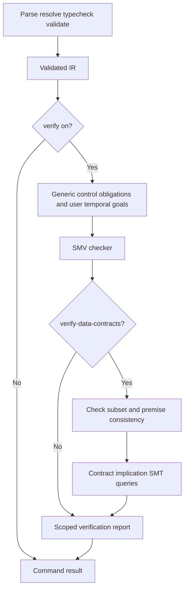

# AHFL Formal Backend Boundary

规范以 [Assurance Spec](../spec/assurance.zh.md) 为准。本设计说明默认控制验证与按需数据验证的边界；[RFC 0028](../rfcs/0028-default-pipeline-formal-verification.zh.md) 记录管线决策，[RFC 0017](../rfcs/0017-bmc-contract-semantics.zh.md) 记录合同蕴含语义。

## 所属模块与处理链路

- `src/compiler/backends/smv/`：从验证后的 IR 发射有限控制模型和有来源的 specification。
- `src/verification/formal/`：SMV checker 进程集成、数据表达式 SMT 编码与合同蕴含求解。
- `src/tooling/cli/`：请求选择、fail-closed 判定和分范围报告。

`check`、`build`、`run` 默认开启控制阶段；其他命令默认关闭。`emit smv` / `emit smt` 生成可检查 artifact，不独自执行证明。`--verify-data-contracts` 选择现有合同而不引入新 DSL 属性或第二套合同实现，且要求控制阶段开启。

## 通用控制验证

每个 Agent 都有状态变量和初始/转移/final 吸收义务，包括 standalone Agent。flow handler summary 限定合法终结控制流；状态分支可以抽象为 nondeterministic 选择。模型不包含完整 `let`、赋值、返回值或 provider 数据关系。

workflow node 包含 Agent state 与 lifecycle phase。基础 phase 为 idle、running、completed；recovery 可以扩展 failed、recovering、recovered、compensating、compensated、terminal_failed。生成义务保证模型中的 final membership、依赖顺序和 lifecycle 一致性。默认义务不会自动声称 Agent 终止或 provider 返回；用户声明完成性时需明示模型假设。

`called(k)` 派生自 flow handler 的 capability call summary，而非任意 environment input。call/effect event 的 committed、failed 子事件互斥；effect profile 产生有限 audit、receipt、approval、idempotency、compensation 义务。它们验证模型中的关系，不证明真实支付或服务内部行为。

用户的纯控制 `invariant`、`forbid`、workflow `safety`/`liveness` 声明本身即验证请求。其 temporal formula 进入 SMV `LTLSPEC`。若嵌入数据 expression 不能编码，observation 仍为抽象环境变量；报告必须将目标标为 conditional/unsupported 并列出假设，不得计作无条件证明。

SMV model 为 `MODULE main`，包含 `VAR`、`IVAR`、`DEFINE`、`ASSIGN` 与 `LTLSPEC`。`AHFL_MAP` 注释关联 specification/symbol 和 IR owner；counterexample 映射回 workflow node、Agent state、call/effect event 以及可用 source range。状态空间估计只是启动前提示。

## 按需数据验证

普通数据 `requires` 表示环境前提；数据 `ensures`、`invariant`、`forbid` 默认报告 not_requested，不触发 SMT 或未请求的子集告警。使用 `--verify-data-contracts` 后，package 中这些数据目标交给同一现有 SMT 编码器。

当前证明范围为 **contract_implication**。令 P 为类型约束与 `requires`，G 为目标，求解 P ∧ ¬G。UNSAT 表示 P ⇒ G；SAT 表示有公式反例。输出字段与输入字段只是符号，没有 flow 执行关系，因此不能把合同蕴含叫做实现正确性证明。反例赋值也不表示该值必定能由 flow 产生。

在逐目标检查前必须证明 P 可满足；P 矛盾应失败。各 invariant 与其他数据目标同等处理，未获证 invariant 不能进入 P，否则将产生循环证明。所选目标及其必要前提有不支持构造时，拒绝验证并报告源位置；missing solver、unknown、timeout、counterexample 同样失败。

当前编码子集包括 Bool/Int 标量、可编码字段 path、算术比较及布尔组合。`Int(lo,hi)` 附加边界约束；数学整数模型不自动证明运行时 machine integer 溢出安全。host predicate、provider 调用、字符串内容、无界或不可编码的集合量化等不能凭声明获得证明。decreases/ranking 与完整 transition relation 也不能被合同蕴含替代。

有界量化属于已实现子集：[RFC 0024](../rfcs/0024-bounded-collection-quantification.zh.md) / [RFC 0025](../rfcs/0025-bounded-collection-types.zh.md) 允许带静态容量（capacity）的 `List<T>(N)` / `Set<T>(N)` / `Map<K,V>(N)`，编码器按 N 个符号槽有限展开 `forall` 为合取（全部成立）、`exists` 为析取（至少一项成立）；N=0 分别为 true/false。非零容量展开时，元素（Map 的键和值）需为 Bool/Int/BoundedInt，量化体和集合操作数也必须可编码；无静态容量、无法映射 SMT 标量类型或量化体不支持时拒绝。已有真实 Z3 测试证明 `List<Int>(3)` 上 `forall x: x > 0` 蕴含 `forall x: x >= 1`，并反驳无前提的后者。该符号槽模型不包含 flow 操作集合或实际动态长度的执行关系。

退款金额规则示例 [refund-rules](../../examples/refund-rules/README.md) 使用有界整数最小货币单位，展示 amount ≤ total 蕴含 total − amount ≥ 0；[退款审核](../../examples/refund/audit.ahfl) 的 host predicate 仍属于无实现定义的业务声明。

## 进程集成和报告

NuSMV、Z3 随默认安装提供。SMV checker 解析顺序：`--model-checker` → `AHFL_SMV_CHECKER` → backend-specific 环境变量 → executable 同目录 → PATH。Z3 使用 `AHFL_Z3_PATH` → bundled Z3 → PATH。[RFC 0018](../rfcs/0018-nusmv-library-mode.zh.md) 将 library-mode 决策为 no-go；当前使用进程隔离。

缺 checker、timeout、进程错误、返回 specification 数与模型义务数不匹配、反例均失败。`--formal-model-out` 保存实际 checker 输入。BDD 检查为默认路径；`--bmc-depth` 的有界结论必须保留 bound，不能写成无界证明。

报告分别展示：

1. generated control obligations；
2. user temporal goals 及 conditional/unsupported；
3. environment premises；
4. user data goals 的 not_requested/proved/refuted/unsupported/unknown；
5. runtime contract checks = not_implemented。

“控制模型验证通过”只限定控制范围。即使请求的数据目标全通过，也仅有合同蕴含证据。

## 未实现的保证与移除条件

Core IR 当前擦除可执行合同，runtime 不执行 host predicate 合同；flow `assert` / `requires` statement 尚无运行时支持。报告不得声称已经进行了这些检查。真实边界数据检查仍需在业务实现中执行。

完整实现证明需要从 executable IR 构造 sound transition relation，连接 input/context/output、flow 赋值与 capability 结果，且对外部调用有明确可信模型。只有该关系及其对应回归证据具备后，才可修订 contract_implication 范围；本次不添加兼容开关、平行验证引擎或模拟运行时合同机制。

## 结果字段

控制报告使用 `verification_scope: control_model`、`control_status`，并分别列出 `generated_control_proven` / `generated_control_bounded` 与 `user_temporal_proven` / `user_temporal_bounded` / `user_temporal_conditional` / `user_temporal_unsupported`。无目标时报告 no_targets/not_run，不能声称证明通过。

数据报告使用 `data_contract_status`（not_requested、proved、bounded、refuted、inconsistent_assumptions、unknown、unsupported、solver_unavailable、no_targets）、`data_contract_scope: contract_implication`、`data_contract_assumptions` 和 `data_contract_goals`；逐条目标保留来源。`runtime_contract_checks: not_implemented` 表示当前没有自动 runtime 合同检查。
