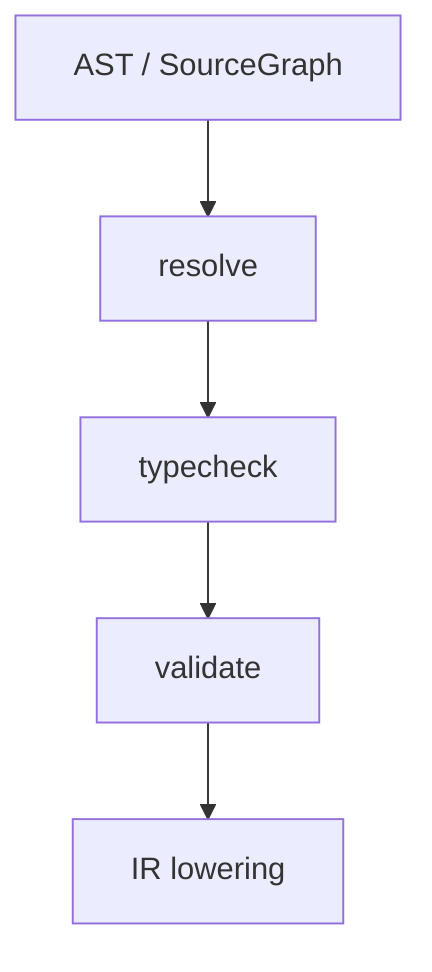
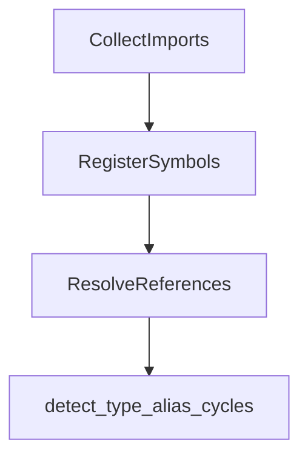
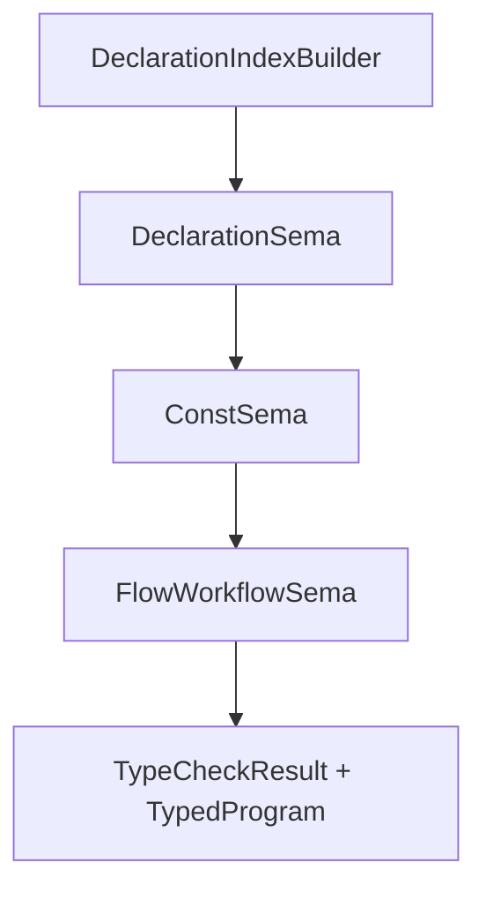
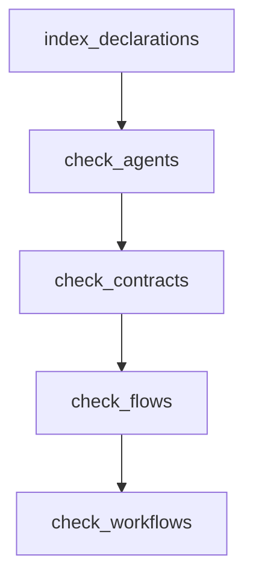

# AHFL Semantics Architecture

本文说明 AHFL Core `semantics` 层的实现组织，面向需要阅读 `resolver` / `typecheck` / `validate` 代码，或继续扩展静态语义能力的工程实现者。

关联文档：

- [compiler-architecture.zh.md](./compiler-architecture.zh.md)
- [compiler-evolution.zh.md](./compiler-evolution.zh.md)
- [source-graph.zh.md](./source-graph.zh.md)
- [compiler-phase-boundaries.zh.md](./compiler-phase-boundaries.zh.md)
- [core-language.zh.md](../spec/core-language.zh.md)

## 目标

本文主要回答五个问题：

1. `semantics` 层为什么拆成 `resolve`、`typecheck`、`validate` 三个相邻 pass。
2. 这三个 pass 各自依赖哪些输入、产出哪些稳定对象。
3. project-aware 模式下，语义阶段如何携带 `module_name` / `source_id` 上下文。
4. 新能力应该落在哪个语义阶段，而不是跨层污染。
5. 读代码时，应该先看哪些对象，再看哪些 `.cpp` 内部实现。

## 总体定位

`semantics` 层位于：

- `frontend` 之后
- `ir` 之前

它不负责：

- 解析源码
- 重新访问文件系统
- 直接输出 backend 文本

它负责把“已经 lower 完成的 AST / SourceGraph”变成“稳定、可复用的语义结果”。

当前固定链路为：

三者的分工应始终保持如下边界：

1. `resolve`
   - 回答“这个名字指向谁”。
2. `typecheck`
   - 回答“这个表达式或声明在静态类型上是否成立”。
3. `validate`
   - 回答“这个已经 resolve + typecheck 完成的结构，在领域约束上是否整体成立”。

## 公共边界

当前公共头文件为：

- `include/ahfl/compiler/semantics/resolver.hpp`
- `include/ahfl/compiler/semantics/typecheck.hpp`
- `include/ahfl/compiler/semantics/validate.hpp`

其 API 形态非常刻意：

1. 每个阶段都同时支持：
   - `const ast::Program &`
   - `const SourceGraph &`
2. 每个阶段都返回单独的 result object，而不是共享一个不断膨胀的“万能上下文”。
3. pass 内部状态留在 `.cpp` 中，不暴露到公共头。

这意味着：

1. 阶段间数据交换靠 result object。
2. 不鼓励跨阶段直接共享内部缓存。
3. 单文件模式和 project-aware 模式复用同一套语义边界。

## Resolver

### 作用

`Resolver` 的目标是建立稳定的名字绑定结果，包括：

- 顶层声明符号表
- 每个引用节点对应的目标符号
- import alias 绑定

关键对象：

- `SymbolNamespace`
- `SymbolKind`
- `ReferenceKind`
- `Symbol`
- `ResolvedReference`
- `ImportBinding`
- `SymbolTable`
- `ResolveResult`

### 实现组织

`src/compiler/semantics/resolver.cpp` 中的 `ResolverPass` 采用多阶段遍历，而不是单次边走边判定。

在 project-aware 模式下，固定顺序为：

这样拆开的原因是：

1. import alias 必须先收集，后续 qualified name 才能稳定展开。
2. 所有顶层符号必须先注册，后续引用解析才能避免“遍历顺序偶然正确”。
3. type alias cycle 是全局图性质，适合在引用解析后统一检查。

### 名称空间模型

当前顶层名字按 namespace 分开管理：

- `Types`
- `Consts`
- `Capabilities`
- `Predicates`
- `Agents`
- `Workflows`

这意味着：

1. 顶层符号不是一个扁平 map。
2. 新 declaration kind 若可命名，必须先决定它进入哪个 namespace。
3. “同名是否冲突”是 namespace-sensitive 的，不应在 parser 或 backend 阶段偷做。

### canonical name 与 local name

`Symbol` 同时保留：

- `local_name`
- `canonical_name`
- `module_name`
- `source_id`

其中：

1. `local_name`
   - 当前 source/module 里看到的名字。
2. `canonical_name`
   - 稳定跨模块名字，供后续 typecheck / IR / backend 使用。
3. `module_name` + `source_id`
   - project-aware 模式下定位声明归属。

此后，不应再假设”名字 + range”足以确定引用目标。

### import alias 与 source-local 生命周期

`ImportBinding` 和 `import_aliases_` 只在 source 上下文内生效。

这条约束很重要：

1. alias 不是全局符号。
2. resolver 不能把 alias 混进普通 `SymbolTable`。
3. typecheck / validate 若要理解 import 后的引用，应该消费 resolver 结果，而不是重做 alias 展开。

### resolver 该做什么

应该做：

- 注册顶层声明
- 解析 type name、call target、contract target、workflow node target 等引用
- 记录 import 绑定
- 诊断重复声明、歧义引用、未解析引用、type alias cycle

不该做：

- 推导表达式类型
- 决定 purity
- 校验状态机 reachability 或 workflow DAG
- 接触 backend-specific 结构

## TypeCheck

### 作用

`TypeChecker` 在 resolver 结果之上建立静态类型环境，并记录表达式类型。

关键对象：

- `TypeEnvironment`
- `StructTypeInfo`
- `EnumTypeInfo`
- `CapabilityTypeInfo`
- `PredicateTypeInfo`
- `AgentTypeInfo`
- `WorkflowTypeInfo`
- `ExpressionTypeInfo`
- `TypeCheckResult`

### Ownership 与执行顺序

Typecheck 由五个明确 owner 协作：

| Owner | 职责 |
| --- | --- |
| `TypeCheckPass` | session/state orchestration、共享 source/diagnostic/type-relation services |
| `DeclarationSema` | declaration indexing 之后的 `TypeEnvironment`、signature、trait/impl coherence |
| `ExpressionSema` | expression dispatch、type/effect/call/dispatch facts |
| `ConstSema` | const dependency、folding、default value 与 const diagnostics |
| `FlowWorkflowSema` | contract、flow、workflow、fn body、impl body 与 statement checks |

`TypeCheckPass::run()` 当前固定为：

这个顺序表达了一个明确设计：

1. 先把 declaration-level 类型签名冻住。
2. 再检查 const/default。
3. 最后按 flow -> contract -> workflow -> fn -> impl 的顺序检查 executable bodies。
4. `ExpressionSema` 被上述 owner 作为唯一 expression checker 使用。

不要反过来在检查表达式时临时拼装 declaration type info，这会让错误顺序和缓存行为不可预测。

### 类型环境的职责

`TypeEnvironment` 当前承载的是 declaration-level 稳定语义：

- 常量类型
- `struct` field 信息
- `enum` variant 信息
- capability / predicate 签名
- agent / workflow 输入输出 schema

它不是：

- 局部变量作用域
- 控制流图
- backend lowering cache

局部表达式环境由 `ValueContext` 和各类 `check_*` 过程在 `.cpp` 内部维护，而不是进入公共头。

### Typed expression facts 的定位

`TypedExpr` 与兼容查询索引按 `SourceRange + SourceId` 记录：

- 表达式的静态类型
- `ExprEffect`
- 表达式是否 pure
- resolved symbol / call target / dispatch target

这一步是很关键的公共边界，因为：

1. `validate` 会复用它来检查 temporal embedded expr 的 `Bool` / purity 约束。
2. IR lowering 把 type 与 `ExprEffect` 写入每个 IR expression。
3. assurance/formal 消费 IR effect 与 flow `inferred_effect`，禁止重扫 AST。
3. project-aware 模式下，同一个 range 在不同 source 中不能混淆，所以必须带 `source_id`。

### purity 的放置位置

当前 purity / effect 是表达式类型检查的正式静态事实，而不是 validate、assurance 或
formal 阶段临时重算。

这样做的原因是：

1. purity 与表达式构成、调用、路径访问直接相关。
2. 同一表达式可能同时被 contract、temporal、flow 条件复用。
3. validate 只应消费“这个表达式已经被证明 pure / impure”的结果，而不应复制一份表达式语义分析器。

### type alias 的处理

类型别名在 typecheck 阶段采用：

- `resolved_alias_types_`
- `active_aliases_`

这说明别名展开是语义环境构建问题，而不是 resolver 的最终职责。

resolver 只负责把“名字指向哪个 type symbol”稳定下来；alias 是否递归、最终展开成什么 `TypePtr`，应由 typecheck 负责。

### typecheck 该做什么

应该做：

- 建 declaration-level 类型签名
- 检查 const/default/contract/flow/workflow 中的表达式类型
- 检查 assignability
- 记录 purity
- 检查 workflow node input / return 的 schema 兼容性

不该做：

- 验证 workflow 依赖图是否有环
- 验证 agent final state reachability
- 验证 temporal atom 是否出现在合法语境

这些属于 validate。

## Validate

### 作用

`Validator` 的职责不是再做一遍语义构建，而是检查“整体结构是否成立”。

`ValidationPass::run()` 当前固定为：

### 当前主要检查项

#### 1. Agent

`check_agents()` 主要检查：

- state 重复
- initial / final state 是否已声明
- capability 重复
- transition 端点是否合法

#### 2. Contract

`check_contracts()` 主要检查：

- contract target 是否为 agent
- `called(...)` / `in_state(...)` / workflow-only atom 的语境合法性
- contract temporal formula 中状态名是否合法

#### 3. Flow

`check_flows()` 主要检查：

- handler state 是否存在
- handler 是否重复
- 是否缺失非 final state 的 handler
- `goto` 是否沿着 agent declaration 允许的 transition
- final-state handler 中的控制流是否合理

#### 4. Workflow

`check_workflows()` 主要检查：

- workflow node 名字是否重复
- 依赖节点是否存在
- workflow dependency 是否有环
- `running(...)` / `completed(...)` 的节点和 final state 是否有效
- contract-only atom 是否错误出现在 workflow safety/liveness 中

### validate 与 typecheck 的衔接

`validate` 复用 `TypeCheckResult::find_expression_type(...)` 来检查 temporal embedded expr：

- 必须是 `Bool`
- 必须是 pure

这条边界非常重要：

1. validate 关心“能不能用”，不关心“怎么推导出来”。
2. 若 validate 重新遍历表达式并手写类型规则，会和 typecheck 出现漂移。

### validate 该做什么

应该做：

- graph / 状态机 / DAG / temporal 语境级检查
- 基于已知类型结果做整体一致性校验

不该做：

- 重建 `TypeEnvironment`
- 重新解析名字
- 重新计算表达式 purity

## SourceGraph-aware 上下文模式

`resolve`、`typecheck`、`validate` 三个 pass 共享一个重要实现模式：

- `current_source_`
- `current_source_id_`
- `current_module_name_`

以及辅助函数：

- `enter_source(...)`
- `leave_source()`
- `source_unit_for(...)`
- `with_symbol_context(...)`

这个模式解决的是：

1. pass 在 graph 上遍历时，当前正在检查哪个 source。
2. 某个符号定义在别的 source 时，如何临时切换 diagnostics 与 lookup 上下文。
3. `find_reference(...)` / `find_expression_type(...)` 如何在多 source 下仍然稳定。

对后续实现的约束是：

1. 新语义逻辑若依赖 source 归属，优先复用这套上下文切换模式。
2. 不要在局部函数里自己偷偷拼 `module_name` / `source_id` 规则。
3. 不要让 diagnostics 脱离 source 上下文，否则 project-aware 模式会退化成难读的全局报错。

## 扩展落点指南

### 新增顶层声明

需要依次判断：

1. resolver
   - 是否进入新的或现有的 namespace。
2. typecheck
   - 是否需要新的 `*TypeInfo`。
3. validate
   - 是否有结构约束。

### 新增表达式

通常先改：

1. `TypeCheckPass::check_expr_impl(...)`
2. 对应 `check_*` 分支
3. `ExpressionTypeInfo` 记录路径

只有当它会影响 temporal / workflow / flow 结构合法性时，validate 才需要感知。

### 新增 temporal atom

通常先改：

1. resolver 的 `ReferenceKind` 与 temporal resolve 逻辑
2. typecheck 中 embedded expr 的上下文要求
3. validate 中语境合法性检查

如果某个 atom 需要 workflow-only 或 contract-only 约束，应该落在 validate，而不是 parser。

## 推荐阅读顺序

如果要快速建立心智模型，推荐按下面顺序读：

1. `include/ahfl/compiler/semantics/resolver.hpp`
2. `include/ahfl/compiler/semantics/typecheck.hpp`
3. `include/ahfl/compiler/semantics/validate.hpp`
4. `src/compiler/semantics/resolver.cpp`
5. `src/compiler/semantics/typecheck.cpp`
6. `src/compiler/semantics/validate.cpp`

阅读重点：

1. 先看 result object 和关键 map 长什么样。
2. 再看 pass 的固定执行顺序。
3. 最后再看每类 declaration / expr 的分支细节。

## 对后续实现的约束

后续继续扩展 `semantics` 时，应保持以下原则：

1. `resolve` 不升级成“半个 typechecker”。
2. `typecheck` 不升级成“半个 validator”。
3. `validate` 不回头重做 resolve / typecheck。
4. project-aware 语义始终通过 `source_id` / `module_name` 显式建模，不靠隐式全局状态猜测。
5. 公共头只暴露稳定结果，不暴露 pass 内部缓存与访问信息。

## Decision History

### 2026-10-12：合同声明身份与目标 Agent 身份分离

**决定：**允许同一 resolved Agent 有多份 `contract for` 声明。每份合同在
语义存储中具有独立数值索引，在 Typed HIR 与 AHFL-IR 中保持独立声明；目标
`SymbolId` 只表示关联 Agent，不能充当合同声明身份。形式观测中的
`clause_index` 定义为同一 Agent 的全部合同按 IR 声明顺序展开后的累计条款
编号（ordinal），不再是单个合同块内的索引；atom 索引仍在每个条款内计数。
这使每个条款在已有 Agent scope 内获得独立数值身份，不新增公开 scope 字段。
本记录由独立决策 agent 根据规范、实现和下游消费者作出，不代表人工审批。

#### 依据与问题

- `core-language.zh.md` §3.6、§5.3 未规定一个 Agent 只能有一份合同，grammar
  也允许多份顶层合同。增加单合同限制会新增语言约束，不能只因当前实现方便
  而引入。命名 Agent 的重复声明由 resolver 的 `DuplicateSymbol` 规则诊断，
  匿名合同绑定现有 Agent，不是再次定义该 Agent，因此不适用同一规则。
- `build_contract_types_in_program()` 当前以目标 Agent ID 执行 `emplace`；第二份
  合同丢失。`check_contracts_in_program()` 再按 Agent ID 获取 payload，使不同
  Typed HIR 声明复制第一份合同的条款。修复必须消除这项身份混用。
- 仅改语义存储不足以修复。`FormalObservationScope`、IR observation collector、
  SMV observation key、source suffix 和 expression lookup 仍以目标名称和局部
  `clause_index` 定位，同一 Agent 的两个第 0 条款会冲突。handoff package 也
  复制了这个 key，必须在同一次变更中更新。
- `run_smt_bmc()` 当前逐合同构造查询，每份声明内汇聚其自身 `requires` 与
  invariant 假设。保留独立声明可维持这个已实现的检查边界；本修复不引入
  跨合同假设合并、覆盖关系或择一执行规则。
- flow 存储也存在目标 ID 索引模式，但目前只看到 handler 重复诊断，没有
  flow 声明基数的明确保证。这是需要单独审查的问题，不能作为合同唯一性的
  规范依据，也不在本次合同修复范围内。

#### 替代方案

| 方案 | 结论与成本 |
| --- | --- |
| 每个 Agent 一份合同，后续声明报错 | 拒绝。规范没有此限制，匿名关联声明也不是重复 Agent 定义；这种方案会通过新增语言限制回避身份缺陷。 |
| 只保存多份前端 payload，保持现有 formal key | 拒绝。SMV 与 handoff 仍会把同 Agent 的相同局部条款索引混为一体，不能端到端修复漏验证。 |
| 在 IR 按 Agent 合并为一份合同 | 拒绝作为本次修复。当前 `ContractClause` 只有范围，其源文件由 enclosing `ContractDecl.provenance` 提供；跨文件合并必须新增逐条款来源，并更新全部诊断消费者。它还会合并 BMC 的前提假设，新增未定义的跨声明组合规则。来源完整的规范化并非错误架构，但本缺陷没有要求引入它。 |
| formal scope 新增数值 declaration ID | 正确但本次不采用。已有 `clause_index` 能在 Agent scope 内表示唯一 ordinal，新增字段会扩大 IR/handoff wire、workflow scope 和符号格式的迁移范围，解决本缺陷不需要这项成本。 |
| 独立语义/IR 声明，formal 使用 Agent 内累计条款编号 | 采用。保留声明边界、来源和 BMC 假设；统一改正条款编号规则，既消除多合同冲突，也保留单合同 wire 与 observation 符号。 |

这与 [Rust HIR 的 item/node 数值身份](https://rustc-dev-guide.rust-lang.org/hir.html)
以及 [AST 到 HIR 的 ID 不变量](https://rustc-dev-guide.rust-lang.org/hir/lowering.html)
一致：节点身份和它引用的定义身份是不同概念。AHFL 特有的选择是保留针对
Agent 的匿名外置合同块及其现有独立 BMC 检查边界，而不照搬 Rust 的语法或
引入运行时可选择的合同对象。外部工具或运行时没有阻止正确建模的约束。

#### 实现边界

1. **语义层拥有合同身份。**使用 flat `vector<ContractTypeInfo>` 与数值索引，
   或复用 Typed HIR 平坦声明索引，使每份声明只对应自己的 payload。
   `SourceId + SourceRange` 可作为 AST 到数值索引的定位信息，不能再将目标
   Agent ID 当成唯一合同 key。删除旧的单值 `get_contract(agent)` 路径；按
   Agent 查询只能返回集合，按源码查询必须定位具体声明。匿名合同没有自己
   的可命名符号，Typed HIR 应将自身声明索引与 `associated_agent_symbol`
   明确分离，不将目标符号伪装为自己定义的符号。
2. **IR 保留独立声明。**每份合同保留自己的 `DeclarationProvenance` 与全部
   条款；复用其已有单调数值 `id` 作为 IR 声明身份。lowering 不靠名称、遍历
   次数或条款内容猜测来自哪一份合同。
3. **formal scope 使用累计条款编号。**同一 resolved Agent 的第一份合同从
   0 开始，后续每份合同从前面合同的条款总数开始。计数包含全部 clause kind，
   包括不生成 observation 的 `decreases`，不能只数可观测表达式。不同 Agent
   分别计数；空合同不消耗编号。新增内部计数/索引按 resolved 目标数值 ID
   分组，以当前 flat store 中的准确声明引用定位起始 ordinal，不依赖手工
   构造 IR 中可能重复的默认 provenance ID，也不引入新的
   字符串身份表。源码范围只用于来源定位。公开 `owner` 字段及既有 workflow
   scope 语义不变；已有名称表示的更广泛架构迁移不混入此 P1。
4. **消费边界完整迁移。**collector、SMV formula 的 observation lookup、
   expression/source suffix 反查，以及 handoff clause-to-observation 映射都
   使用同一累计规则。反查返回实际所属合同及 block-local 条款索引，读取该
   合同的 provenance；不得找到同 Agent 的第一份合同就停止。累计与反查应
   复用 owning IR 层的同一规则，避免各消费者复制编号算法。IR/handoff scope
   注释与参考文档同步澄清 `clause_index` 的含义。Typed HIR serialization 与
   LSP hover 更新具体声明身份；SMT BMC 与 subset 保留逐独立合同遍历。
5. **不保留双路径。**旧的“每个合同块从零重新编号”逻辑和单值合同 getter
   在同一次变更中删除；更新必要测试和 goldens。所有消费者消费唯一累计
   语义，不新增字段缺省、单合同特判、迁移开关或兼容读取。

主要实现入口：`typecheck_decls.cpp`、`typecheck.cpp`、`type_environment.cpp`、
`declaration_info.hpp`、`typecheck.hpp`、`typed_hir.hpp` 与其 serialization；
`typed_hir_lower.cpp`、`ir_lower.cpp` 与 owning IR 累计/反查 helper；
`smv_indexing.cpp`、`smv_formula.cpp`、`smv_collection.cpp`；
`compiler/handoff/package.cpp`；`tooling/lsp/hover_service.cpp`。
IR 与 handoff 的 `FormalObservationScope` 注释需同步；JSON/text writer、
native JSON、workflow scope 不需为新增字段改动，但其 round-trip 与单合同
golden 必须验证。若实现触及 verifier，只补累计条款引用有效性检查。

#### 成本、兼容性与验收

- 成本集中在语义层独立声明存储，以及 formal 条款 ordinal 的统一计算和
  反查。没有新增运行时、依赖、公开 formal 身份字段或合同合并 pass。
- 单合同源码及其语义保持不变；此前能通过分析但丢条款的多合同源码现在
  完整进入下游。单合同 wire 字段及 observation 符号不变；多合同后续块的
  编号修正为累计值。内部 C++ 合同查询 API 随独立声明存储迁移，调用方一次性
  更新；该编号修复不能声称此前错误多合同产物逐字节不变。
- 原生回归至少覆盖：同文件两份合同；不同源文件绑定同一 Agent；通过 import
  alias 绑定同一 Agent；不同文件相同 offset/range；两份第 0 条款的表达式与
  temporal embedded atom；不同 Agent 与空合同。
- 断言 Typed HIR 每份 payload、IR 每份条款及来源正确；serialization round-trip
  不丢身份；formal 编号跨同 Agent 的块连续、不受其他 Agent/空块影响，且
  正确计算不可观测条款；formal observations 不去重不同声明；SMV 引用各自
  表达式并归因到各自文件；handoff 条款映射互不覆盖；BMC 对后续合同生成
  独立查询。LSP 的旧 getter 消费者随内部 API 迁移，但目前
  `ContractInstantiation` hover 没有实际生成路径；合同条款数量 hover
  留作后续功能，不计入本次完成范围。优化后重算 derived
  analyses 必须重新产生与当前 IR 顺序一致的 ordinal。
- 通过项目已有 semantics/IR/backend/formal/LSP 测试与相关 golden，再运行
  文档同步门禁和完整 dev suite。新增验证使用原生框架，不靠一次性脚本作为
  完成证据。独立 reviewer 应重点检查有无遗留 block-local formal 编号、
  只命中第一份合同的反查、重复编号算法、跨源 provenance 丢失，以及新增
  字符串身份 key 或超出合同身份修复范围的重构。
