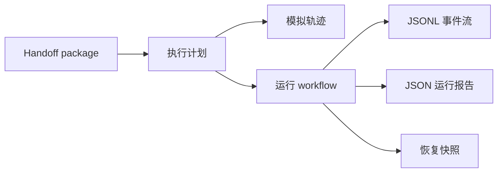

# AHFL Native Runtime Artifacts

本文用于读取 handoff package、执行计划、运行事件和恢复快照。运行命令与示例见[执行指南](../tutorials/execution.zh.md)，handoff 配置见 [Native handoff 指南](../tutorials/native-handoff.zh.md)。

## 选择需要读取的文件



`ExecutionPlan` 描述依赖和计划，`DryRunTrace` 是模拟结果。读取真实运行状态时，使用执行事件或由事件生成的报告。

## 关联事件与运行结果

运行事件中的 `RunId`、`WorkflowId`、`WorkflowNodeId`、`AgentId`、`CapabilityId`、`ProviderId`、`AgentStateId`、`InvocationId`、`RuntimeValueId`、`DiagnosticId`、`ExecutionEventId`、`CheckpointId` 是不同种类的数值身份。

关联事件、能力调用、诊断和恢复记录时使用相应 ID。名称用于展示；不要把名称字符串当作 ID，也不要混用不同种类的 ID。

## Event Payload

运行事件的类别和名称如下：

| Family | Payload |
| --- | --- |
| Run | `RunStarted`, `RunResumed`, `RunCancellationRequested`, `RunInterrupted`, `RunCompleted` |
| Workflow | `WorkflowStarted`, `WorkflowCompleted`, `WorkflowFailed` |
| Node | `NodeScheduled`, `NodeStarted`, `NodeRestored`, `NodeCompleted`, `NodeFailed`, `NodeSkipped` |
| Agent | `AgentStateEntered` |
| Capability | `CapabilityStarted`, `CapabilityUsageRecorded`, `CapabilityCompleted`, `CapabilityFailed`, `CapabilityRetryScheduled` |
| Provider | `ProviderDegraded` |
| Recovery | `CheckpointSaved` |

每个 event 记录 `ExecutionEventId` 和 monotonic offset。event ID 是单次运行的观察顺序；DAG 因果关系来自 dependency IDs。

`CapabilityUsageRecorded` 位于对应 invocation 的 start 与 terminal 之间，每个 invocation
最多一条。它保存 prompt/completion/total token、estimated cost 和 stable policy notices；
不保存 prompt、response 或 secret。失败 event 在 JSON/JSONL 中包含 code、message、range、position 与 related notes；可按 `DiagnosticId` 关联同一诊断。

## 校验事件完整性

接入事件流时，应检查以下约束；不满足约束的完整事件流会被 `validate_execution_events` 拒绝：

1. event ID 未按事件顺序从 0 开始连续编号。
2. monotonic offset 倒退。
3. 同一 identity 重复 start。
4. started identity 缺少 terminal event。
5. 同一 identity 重复 terminal。
6. 没有 start 的 terminal event。
7. usage 出现在 invocation start 前或 terminal 后。
8. 同一 invocation 重复 usage。

校验失败返回结构化 issue。尚未结束的实时流可能缺少 terminal event；完整性检查应在运行结束或读取完整记录后进行。

## 选择结果视图

| 需要的信息 | 输入与接口 | 输出 |
| --- | --- | --- |
| 最终业务结果 | `ExecutionReport`，CLI `--output-format human` 或 `json` | workflow/节点最终状态、执行顺序、输出和诊断。 |
| 逐条事件 | CLI `--output-format jsonl` | 按事件 ID 排序的机器事件流。 |
| 重放、审计、调度或 checkpoint | runtime projection API，读取 `WorkflowResult` | 节点进展、依赖、事件计数、下一可运行节点和恢复候选。 |
| 分布式追踪 | `build_execution_otel_trace(...)`，读取事件与运行起始时间 | OpenTelemetry 追踪数据，使用 OTLP（OpenTelemetry Protocol）兼容格式。 |

projection API 是从运行事实生成特定视图的库接口，定义在 `include/ahfl/runtime/`。接入系统时请读取结构化视图，避免解析 human output。

## 读取恢复快照

加载器只接受当前完整格式 `ahfl.workflow-recovery`：

```text
ahfl.workflow-recovery
```

snapshot 保存 workflow ID、checkpoint ID、已完成节点的 agent/value，以及
挂起节点坐标、节点 input（信息性，不作为恢复信任源）、pending capability 的
SymbolId/ordinal，以及覆盖挂起点之前**整个 workflow** 的 capability memo
（按 per-node ordinal 索引，带 cap_id/arg_hash 完整性交叉校验；结果可带
按当前强类型 binding 解码的精确 result wire JSON）。
保存使用 atomic replace。load 对 missing、read failure、schema/value corruption、
非法 identity 和 memo 坐标/ordinal 不一致 fail closed。

Wasm 的恢复模型是**冷启动整模块重放**：在 fresh wasm instance 上从头重跑整个
module，frontier 之前的 capability 调用逐字回喂 memo（绝不 live 重调），重放到
pending 调用时由 host 提供结果后继续。恢复后的 event stream 包含：

1. `RunResumed`
2. memo 覆盖的每个已完成节点的 `NodeRestored`
3. 后续未完成节点的正常 scheduled/start/terminal events
4. 唯一 `RunCompleted`

快照仅使用 `format: "ahfl.workflow-recovery"` 的当前结构。读取时严格校验字段、类型与身份；未知字段或缺少必填字段拒绝，旧快照须重新生成；不要通过编辑快照跳过结果或身份校验。恢复操作步骤见[执行指南](../tutorials/execution.zh.md)。

## 导出与读取命令

导出执行计划、模拟轨迹或读取真实运行结果：

```text
ahflc emit execution-plan ...
ahflc emit dry-run-trace ...
ahflc run [--profile <name>] [--output-format human|json|jsonl|quiet] ...
```

replay、audit、scheduler 和 checkpoint 通过 runtime 库接口读取；CLI 使用上述执行计划、模拟轨迹和运行结果输出。

追踪数据按 run、workflow、node、capability 组织父子 span，并把 retry、fallback、checkpoint、resume 与 interruption 记录为 span event；生成追踪数据不改变运行状态。
