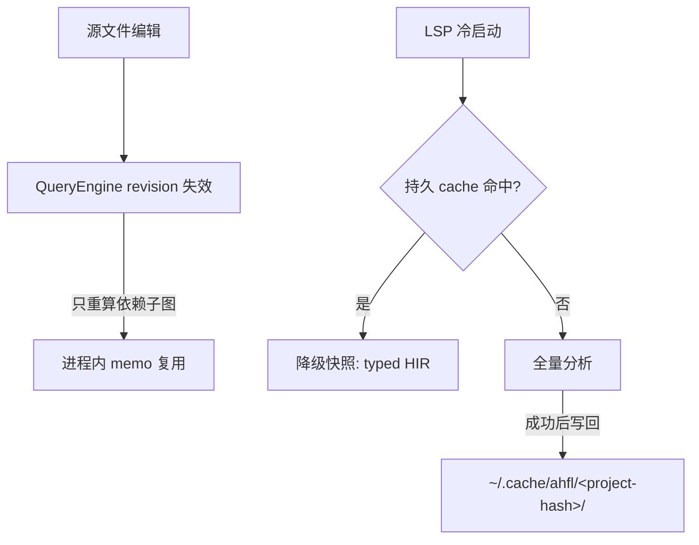

# AHFL 增量编译指南

本文说明 AHFL 当前的增量编译模型：进程内的 QueryEngine 增量重算（默认开启）与
RFC 0016 持久化 cache 契约（typed-HIR 冷启动缓存）。命令面以
[CLI 命令参考](./cli-commands.zh.md) 为准；LSP 侧行为见
[LSP / VS Code 扩展](./lsp-vscode-extension.zh.md)。

## 两层增量模型

AHFL 的“增量编译”由两个相互独立的层组成，不要混淆：

| 层 | 作用域 | 持久化 | 默认状态 | 代码位置 |
|---|---|---|---|---|
| QueryEngine 增量重算 | 单个进程内 | 无（内存） | 始终开启 | `src/compiler/query/` |
| 持久化 typed-HIR cache | 跨进程 / 跨重启 | 磁盘 | opt-in，服务端默认关闭 | `src/tooling/cache/`（库 `ahfl_tooling_cache`） |



QueryEngine 解决“同一进程内连续编辑只重算受影响阶段”；持久 cache 解决“进程重启后
不必全量重编译”。两者可以叠加：LSP 进程内先查 QueryEngine memo，冷启动时才查持久
cache。

## 进程内增量重算（QueryEngine）

`ahflc check` 与 LSP `AnalysisService` 的分析读取（diagnostics、hover、completion、
rename 等）全部经 workspace 级 `query::FrontendQueries` 引擎求值（RFC 0027 P4/P5）。
编译管线 parse → resolve → typecheck 被建模为查询图上的 memoized query：

1. 每个打开文档占一个 `FileId` slot，每个被分析的（URI × 项目语义输入）占一个
   `ProjectId` slot。
2. 每个 query 结果带 revision 标记。写入相同文本是 no-op——不 bump revision，不触发
   失效。
3. 编辑输入只 bump 受影响 slot 的 revision，依赖查询子图失效；未受影响的 slot 保持
   Verified 并直接复用已有 memo。
4. 读取 fail-closed：调用方只能拿到当前 revision 下仍有效的结果，引擎永不返回已被
   取代的文本版本的 AST。

对用户的可观察效果：在 LSP 中连续编辑时，未触及 import 链的文件诊断几乎瞬时刷新；
`ahflc check` 每次调用是新进程，因此进程内增量只惠及 LSP / 长驻会话，不惠及两次
独立的 CLI 调用。

观测查询路由：设置环境变量 `AHFL_QUERY_ENGINE_TRACE=1` 可让 CLI 输出 query 路由
trace，用于确认某次分析走了引擎还是回退路径。

## 持久化 cache 契约（RFC 0016）

持久化层缓存的是 **Typed HIR**（typecheck 产物），粒度是 **source unit（文件级）**，
不是 declaration 级。它是本地 cache：不做分布式 / 远程缓存，不做跨项目共享——cache
目录按 project root 隔离。

### 缓存什么

每个 cache entry 是一个源文件的 typed-HIR 序列化结果，附带命中判定所需的 identity
与元数据。以下内容**不**在当前 envelope 的可序列化范围内：`TypeEnvironment`、
`ResolveResult`、workspace index、hover index。因此冷启动命中只能提供“降级快照”
（见下文 LSP 一节）。

### 目录布局

cache 根目录遵循 XDG base directory spec，由消费方（当前为 LSP）解析：

```text
$XDG_CACHE_HOME/ahfl/            # 设置了 XDG_CACHE_HOME 时
~/.cache/ahfl/                   # 否则，HOME 可用时
./.ahfl-cache/                   # 兜底（HOME 也不可用时，相对当前目录）
  <project-root-hash>/           # 项目根路径的 SHA-256 hex
    index.json                   # source_path → entry 文件映射 + 时间戳
    <source-path-hash>.json      # 每个源文件一个 entry
```

- `<project-root-hash>`：项目根路径（weakly-canonical、lexically-normal）的
  SHA-256 hex 摘要。不同项目天然隔离。
- `<source-path-hash>`：project-relative 源路径的 FNV-1a 64-bit hex（16 个小写
  十六进制字符）。
- `index.json` 的 schema 版本为 `AHFL_TYPED_HIR_CACHE_INDEX_V1`，每条记录含
  `file`、`cached_at`、`last_accessed`（均为 epoch 秒）。早于生命周期切片写入的
  index 没有 `last_accessed`，加载时回退为 `cached_at`，使旧 cache 在 TTL 策略下
  自然老化。

### Cache key（统一 identity）

两个 cache entry 描述同一 artifact，当且仅当以下四个字段全部相等：

| 字段 | 含义 |
|---|---|
| `project_root_hash` | 项目根路径的 SHA-256 hex |
| `source_path` | project-relative 路径（如 `src/main.ahfl`），不含绝对路径 |
| `content_hash` | 源文件内容的 FNV-1a 64-bit hash |
| `toolchain_fingerprint` | `ahfl-cache/<cache-schema>/cxx<__cplusplus>/<编译器><主版本>` |

`toolchain_fingerprint` 以 cache schema 版本为主导成分：任何格式变更都会 bump
schema 字符串，从而使旧 cache 整体失效；C++ 标准与编译器主版本紧随其后，ABI 相关的
编译器升级也会使 cache 失效。stdlib 变化通过 schema / 编译器升级间接覆盖。

### Envelope 格式与命中判定

entry 文件是一个 JSON envelope（schema 版本 `AHFL_TYPED_HIR_CACHE_V1`）：

```json
{
  "schema_version": "AHFL_TYPED_HIR_CACHE_V1",
  "cache_key": {
    "project_root_hash": "<sha256 hex>",
    "source_path": "src/main.ahfl",
    "content_hash": 1234567890,
    "toolchain_fingerprint": "ahfl-cache/AHFL_TYPED_HIR_CACHE_V1/cxx202302/clang19"
  },
  "source_graph_revision": "<import 图结构 hash>",
  "resolver_snapshot_version": "<resolver 状态 hash>",
  "signature_fingerprint": 0,
  "serialized_typed_hir": "<内层 envelope JSON 字符串>",
  "cached_at": 1756000000
}
```

`serialized_typed_hir` 内层是 typed-HIR 自身的 cache envelope：

```json
{
  "format": "AHFL_TYPED_HIR_CACHE_V1",
  "metadata": {
    "schema_version": "AHFL_TYPED_HIR_CACHE_V1",
    "source_graph_revision": "<package graph identity>",
    "source_content_hash": "<content_hash 的十进制字符串>",
    "resolver_snapshot_version": ""
  },
  "typed_program": { "format": "AHFL_TYPED_HIR_V1", "symbols": ["..."], "references": ["..."] }
}
```

加载时按以下顺序校验，任一失败即 cache miss 并优雅回退到全量分析：

1. 外层 `schema_version` 匹配；
2. 外层 `cache_key` 四字段全部相等；
3. 内层 `format` 与 `metadata`（schema、source graph revision、source content hash、
   resolver snapshot）匹配；
4. `typed_program` 反序列化成功。

文件损坏、JSON 非法、字段缺失、schema 不匹配——全部按 miss 处理，永不向调用方返回
错误 artifact。

注意：外层 envelope 中的 `source_graph_revision`、`resolver_snapshot_version`、
`signature_fingerprint` 字段会被持久化，但外层 `PersistentCache::lookup` 只校验
schema 版本与四字段 `cache_key`；图结构与 resolver 状态的实际校验由内层 typed-HIR
loader 的 metadata 比较承担。`signature_fingerprint` 当前不参与任何命中或下游跳过
决策（LSP 写路径固定写 0）；历史上的 signature-fingerprint 下游跳过优化随
`ahfl-incremental` 原型一并退役，下游失效改由 QueryEngine 的 revision 边与 LSP 的
transitive importer closure 精确表达。

### 写入与并发模型

- **原子写入**：所有 entry 与 `index.json` 都先写临时文件再 `rename` 替换
  （`support::atomic_replace_text`），崩溃不会留下半写文件。
- **单写者模型**：cache 层不加文件锁。设计上同一项目 cache 目录同时只有一个写者
  （daemon 或 CLI / LSP 进程）。多进程并发写同一目录不在契约范围内。
- **读即刷新**：每次命中都会刷新该 entry 的 `last_accessed` 并重存 `index.json`
  （index 很小，写入是原子的）。

### 生命周期（TTL 与 LRU）

| 策略 | 默认值 | 触发时机 |
|---|---|---|
| TTL | 7 天（`kDefaultTtl`） | `lookup()` 与 `store()` 开头惰性清除 `last_accessed` 超龄的 entry |
| 容量上限 | 1 GiB（`kDefaultMaxCacheBytes`） | 每次 `store()` 后急切执行 LRU 驱逐 |

LRU 驱逐按 `last_accessed` 从旧到新选择 victim，`source_path` 字典序打破并列，保证
驱逐顺序与哈希表迭代顺序无关（确定性）。TTL 与容量上限当前是编译期常量，不提供
运行时配置。

## LSP cold-start 持久缓存

持久 cache 的第一个（也是当前唯一的）生产消费方是 LSP `AnalysisService` 的
typed-HIR 冷启动缓存：

1. **opt-in**：通过 `AnalysisService::set_persistent_cache_enabled(bool)` 开启，
   默认关闭。当前发布的 `ahfl-lsp` server 不开启它——集成与契约测试在受控的临时
   `XDG_CACHE_HOME` 下验证该能力。embedding 方可显式开启。
2. **冷启动命中**：某 URI 没有进程内 snapshot 时，先查持久 cache。命中则反序列化
   typed program，并重跑 parse（廉价）以锚定 `SourceRange`，跳过昂贵的
   resolve / typecheck，返回**降级快照**。
3. **降级快照语义**：快照只含 typed HIR。`TypeEnvironment`、`ResolveResult`、
   workspace index、hover index 不可序列化，因此 hover、completion、references 等
   依赖环境的特性在冷启动命中后仍需一次全量重建才能服务；typed-HIR 派生的诊断与
   结构信息立即可用。
4. **写回**：全量分析成功后，typed program 序列化写入持久 cache，供下次冷启动复用。
5. **失效**：`didChange` / `didSave` 使变更路径及其 transitive importer（由内存中的
   项目 import 图计算）的持久 entry 一并删除——否则下游 importer 的陈旧 typed HIR
   会在下次冷启动被错误重载。`invalidate_all` 清空所有受管项目 cache。detached 源文件
   （无项目 manifest）没有 project root 可键控，不参与持久缓存。

## CLI 与环境变量

当前 `ahflc` **没有**任何 cache 相关 flag：没有 `--cache-dir`、`--no-cache`、
`--clear-cache`。历史上的 `ahfl-incremental --daemon` / `--clear-cache` 已随该入口
一并退役（RFC 0027 P5 / KR6.12），不要再使用。

与增量 / cache 相关的环境变量：

| 变量 | 作用 |
|---|---|
| `XDG_CACHE_HOME` | 覆盖持久 cache 根目录（标准 XDG 语义；未设置时用 `~/.cache/ahfl`） |
| `AHFL_QUERY_ENGINE_TRACE=1` | 输出 QueryEngine 路由 trace，用于确认分析是否走了引擎 memo |

手动清除 cache（等价于历史上的 `--clear-cache`）：

```bash
# 清除所有项目的 AHFL cache
rm -rf "${XDG_CACHE_HOME:-$HOME/.cache}/ahfl"

# 只清除某个项目：先算项目根的 hash，再删对应子目录
python3 -c "import hashlib,os; print(hashlib.sha256(os.path.realpath('.').encode()).hexdigest())"
rm -rf "${XDG_CACHE_HOME:-$HOME/.cache}/ahfl/<project-root-hash>"
```

## 故障排查

1. **怀疑 cache 陈旧导致错误诊断**：直接删除项目 cache 子目录（命令见上）。cache 是
   纯加速层——删除后下一次分析回退全量编译，行为必然正确，只是更慢。
2. **LSP 重启后没有变快**：确认 embedding 方调用了 `set_persistent_cache_enabled(true)`；
   发布的 `ahfl-lsp` 默认关闭持久 cache。其次确认项目有 `ahfl.toml` manifest——
   detached 文件不缓存。最后检查 `XDG_CACHE_HOME` 是否指向了预期位置。
3. **cache 目录异常增长**：TTL（7 天）与 LRU（1 GiB）是自动的；若仍需回收，手动
   `rm -rf` 整个 `ahfl` cache 根即可，没有任何状态依赖它。
4. **磁盘上看到损坏的 entry 文件**：无需处理。损坏文件在 lookup 时按 miss 处理并
   被后续 store 覆盖；`index.json` 损坏则该项目 cache 视为空索引。
5. **编译器升级后 cache 全部失效**：这是预期行为。`toolchain_fingerprint` 与 schema
   版本变化会使旧 entry 自然 miss，旧文件随后由 TTL / LRU 回收。
6. **确认 QueryEngine 是否在复用 memo**：设 `AHFL_QUERY_ENGINE_TRACE=1` 跑
   `ahflc check`，观察路由 trace。

## 稳定性承诺与格式边界

RFC 0016 的持久化 cache 格式是 **stable artifact**：

- entry envelope（`AHFL_TYPED_HIR_CACHE_V1`）与 index（`AHFL_TYPED_HIR_CACHE_INDEX_V1`）
  的 schema 版本字符串是契约的一部分。
- 任何不兼容的格式变更必须 bump schema 版本；旧 cache 因此自动失效，无需用户干预。
- cache 内容是确定性、无 secret 的派生 artifact：键控只依赖项目根路径、源路径、源内容
  hash 与 toolchain fingerprint，不包含凭证或环境相关状态。

当前明确的边界（诚实声明）：

1. 只有 Typed HIR 被持久化；`TypeEnvironment`、`ResolveResult`、workspace / hover
   index 不可序列化，冷启动命中是降级快照。
2. 持久 cache 是 opt-in 能力，发布的 `ahfl-lsp` server 默认不开启。
3. cache 层是单写者模型，不加锁；多进程并发写同一项目目录不在契约内。
4. TTL（7 天）与容量上限（1 GiB）是编译期常量，无运行时配置项。
5. cache 粒度是文件级，不是 declaration 级；不做 query-based（salsa 风格）细粒度
   增量，也不做 AST 级复用。
6. `signature_fingerprint` 字段保留在 envelope 中，但当前不驱动任何下游跳过决策。

## 历史：`ahfl-incremental` 入口退役

RFC 0016 最初描述的 standalone `ahfl-incremental` 二进制（含 daemon 模式、手工
dependency graph、changed-compile 驱动与 signature-fingerprint 下游跳过）已随
RFC 0027 P5 / KR6.12 删除。增量重算改由主编译路径的 QueryEngine 原生提供；本 RFC
的持久化 cache contract 重锚为 QueryEngine 持久化层，代码从 `src/tooling/incremental/`
迁移至 `src/tooling/cache/`（库 `ahfl_tooling_cache`，命名空间 `ahfl::cache`，无编译
器依赖，任何未来的 query 持久化消费方都可单独链接）。历史命令行用法的存档见
[CLI 命令参考](./cli-commands.zh.md) 的 Incremental 一节。
