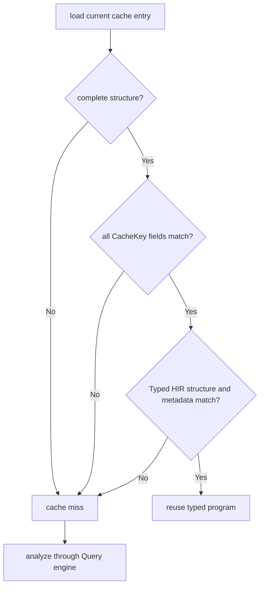

# RFC 0016: Incremental Cache Contract

## Summary

当前前端执行统一使用 [RFC 0027](0027-query-frontend-and-ir-ssot.zh.md) 的 Query 引擎，
持久 Typed HIR 缓存由 `src/tooling/cache/cache_core.{hpp,cpp}`（`ahfl::cache`）拥有。
旧独立 `IncrementalCompiler`、daemon 和 `ahfl-incremental` 已删除，不提供并行入口。
本 RFC 当前约束缓存身份、完整磁盘结构和生命周期；下面的 Decision History 保留
当时阶段的事实，不代表旧 CLI 或旧缓存格式仍受支持。

## Motivation

Query 引擎拥有前端依赖、失效与进程内结果，LSP `AnalysisService` 拥有用户文档
snapshot。持久缓存只保存能严格反序列化的 Typed HIR，不能恢复不存在的
`TypeEnvironment`、resolver 或导航 facts。缓存加速不能绕过当前语义分析，也不能
把不同编译器、配置、sysroot 或依赖图的结果认成同一产物。

## Goals

1. 用实际 producer、源内容、配置、依赖与项目身份决定命中。
2. 只读取当前完整 Typed HIR 缓存结构，损坏或不匹配直接 miss。
3. 原子更新 entry 与 index，保留 TTL、LRU 和按 source path 的确定性淘汰。
4. Query 依赖失效与 LSP snapshot 分工清楚，不复制前端执行流水线。

## Non-Goals

1. 不迁移旧缓存，不协商 schema 编号，不恢复已删除的独立编译器或 daemon。
2. 不做分布式缓存、跨项目共享或跨进程写入锁协议；当前 `PersistentCache` 是单写者模型。
3. 不把 Typed HIR cache hit 视作完整 LSP 语义 snapshot；缺少所需 facts 的功能必须完整重建。

## Design

### Cache Identity

`CacheKey` 使用当前完整六字段结构：

```cpp
struct CacheKey {
    std::string project_root_hash;
    std::string source_path;
    std::string content_digest;
    std::string producer_digest;
    std::string configuration_digest;
    std::string dependency_digest;
};
```

- `project_root_hash` 是规范项目路径的 SHA-256；`source_path` 是项目相对源路径。
- `content_digest` 是精确源字节的 SHA-256。
- `producer_digest` 是实际编译器可执行文件字节的 SHA-256；不可获得时禁用持久命中。
- `configuration_digest` 覆盖 analysis mode、scope、stdlib 和 package graph 配置。
- `dependency_digest` 覆盖实际依赖与 source graph 身份。

这些摘要与源路径共同决定命中。软件发布号和递增 cache 编号不代替 build 身份。
LSP 将目录隔离到 `<cache-root>/<producer-digest>/<project-root-hash>/`，
cache root 遵循 XDG 规则。每个 source entry 一个 JSON 文件，`index.json`
记录 source path、文件名、`cached_at` 和 `last_accessed`。

### 持久化结构

外层 entry 固定包含七字段：

| 字段 | 当前类型和含义 |
| --- | --- |
| `format` | `"ahfl.typed-hir-cache"` |
| `cache_key` | 上述完整六字段对象 |
| `source_graph_digest` | 依赖图身份字符串 |
| `resolver_snapshot_digest` | resolver/依赖身份字符串 |
| `signature_fingerprint` | 当前签名指纹整数 |
| `serialized_typed_hir` | 完整 Typed HIR envelope 的 JSON 字符串 |
| `cached_at` | epoch seconds 整数 |

内层 Typed HIR envelope 使用唯一 `format: "ahfl.typed-hir-cache"`，
metadata 包含 `source_graph_digest`、`source_content_digest` 和
`resolver_snapshot_digest`，payload 是当前 `typed_program` 完整结构。
外层缓存记录和内层 IR envelope 分别由缓存模块与 Typed HIR 序列化模块校验，
它们不是两种可选择的历史格式。

Index 使用 `format: "ahfl.typed-hir-cache-index"` 和当前完整 entry 字段。
缺字段、多余字段、错误类型、错误 format 或任一摘要不匹配都不能命中；
不通过缺省值补齐历史结构，也不升级旧文件。



### Query / LSP 边界

CLI 和 LSP 通过 Query 引擎提供源输入并求值 parse/resolve/typecheck。
源变更、import closure 和 manifest/config 变化由该依赖模型决定失效。
`AnalysisService` 的持久缓存是可选加速层：冷启动命中时恢复 Typed HIR 并通过引擎
parse 当前源以锚定 ranges；`TypeEnvironment`、resolver 和导航索引没有因此复原。
依赖这些 facts 的请求必须获得完整分析 snapshot。cache miss 或反序列化失败
回到同一 Query 路径，不回到已删除的直接执行管线。

### Cache 生命周期

- 写入通过同目录临时文件和 atomic replace 完成；失败不能作为 hit。
- `lookup()` / `store()` 懒清理 7 天未访问 entry。
- 每次命中刷新 `last_accessed` 并原子保存 index。
- `store()` 超过默认 1 GiB 上限后按最旧访问时间淘汰；同时间按 source path 排序。
- cache 是可丢弃的构建数据，清除后重新分析；不保存 workflow 或模型会话状态。

## User Impact

源代码语义与结果不依赖缓存是否存在。producer 或配置改变会产生 cache miss，
旧 entry 无需迁移。Query 引擎是唯一前端执行入口；已删除的 `ahfl-incremental`
命令不能继续使用。

## Compatibility and Migration

只读取当前完整结构，不兼容旧 envelope/index。变更生产者、消费者和 tests 必须
同一改动完成；已有不匹配缓存直接 miss 并重建。

## Implementation Plan

当前责任分配：Query 引擎负责前端依赖求值与失效，`ahfl::cache` 负责磁盘存储和
生命周期，Typed HIR 模块负责完整序列化与 metadata 校验，`AnalysisService`
负责 snapshot 生命周期与可用功能判断。不另建阶段缓存或 daemon。

## Test Plan

1. `PersistentCache` 单元测试覆盖完整 identity、缺字段/错误字段拒绝、atomic write、TTL 与 LRU。
2. Typed HIR 序列化测试覆盖当前 envelope 往返、metadata 不匹配和结构损坏 miss。
3. LSP handler 测试覆盖冷启动 Typed HIR 命中、依赖与配置失效、缺语义 facts 后完整重建。
4. Query 门禁覆盖默认唯一执行路径、重复运行确定性与非空转 corpus。
5. 用不同实际 producer/configuration/dependency 摘要证明不能跨身份命中。

## Rollout and Stabilization

缓存结构同步替换，生产者、读端、调用方与测试采用当前契约；不分阶段保留旧实现。
文档与 native gates 是验收证据，不把 cache hit 当成完整语义分析证明。

## Alternatives

1. 递增格式编号：拒绝；无法证明真实 build 或配置相同，且增加历史读端维护。
2. 保留独立 `IncrementalCompiler`：拒绝；复制 Query 依赖与执行语义。
3. 仅按源字节命中：拒绝；忽略 producer、配置、stdlib 与依赖变化。
4. 持久化完整 LSP snapshot：当前没有完整可反序列化的环境与导航 facts，不伪造已恢复状态。

## Open Questions

当前缓存没有格式协商问题。多进程协调或更完整的持久语义 facts 必须有具体需求和
独立设计证据；不为它们保留历史字段或空接口。

## Decision History

以下记录描述当时的实现阶段，旧阶段缓存、命令和历史读端已被当前 Query/cache 架构替代。


- 2026-08-23: Draft opened.
- 2026-08-23: Open Questions all resolved; status draft → review.
- 2026-08-23: Status review → implementing; Slice 1 (CacheCore + import graph discovery) started.
- 2026-08-23: Slice 1 landed (1c6f5aed): CacheKey, PersistentCache, import graph discovery, CLI wiring, 10/10 incremental tests.
- 2026-08-23: Slice 2 implemented: signature fingerprint propagation in `IncrementalCompiler::compile_changed` — old vs new fingerprint compared after recompile; transitive dependents invalidated (in-memory + persistent) only on fingerprint change or missing old entry; `fingerprint_unchanged` stat renamed to `fingerprint_skipped`; 13/13 incremental tests.
- 2026-08-23: Slice 3 implemented: daemon mode — `ahfl-incremental --daemon --project <root>` reads JSON Lines notifications from stdin (`didChange` / `didSave` / `didClose` with `file://` URIs); didChange/didSave map to `compile_changed({path})` (transitive invalidation + fingerprint propagation), didClose is a no-op, manifest changes (`ahfl.toml` / `ahfl.workspace.toml`) call the new `IncrementalCompiler::invalidate_all()` + `reset_stats()`; one compact stats JSON object emitted per invalidation, malformed lines / unknown types emit error objects and the loop continues; daemon loop extracted into `ahfl::incremental::run_daemon()` for testability; 16/16 incremental tests.
- 2026-08-23: Slice 4 implemented (4294b105): cache lifecycle — `IndexEntry` gains `last_accessed` (persisted in `index.json` as epoch seconds; 当时曾对缺访问时间字段的 index 取 `cached_at`；该缺字段读端已删除); every `PersistentCache::lookup` hit refreshes `last_accessed` and re-saves the index; `evict_expired(ttl)` runs lazily at the start of `lookup()` and `store()` with the default 7-day TTL (`kDefaultTtl`); `evict_lru(max_bytes)` runs eagerly after `store()` with the default 1 GB budget (`kDefaultMaxCacheBytes`), evicting oldest-`last_accessed` entries first (source path breaks ties for determinism); `invalidate()` refactored onto a shared `remove_entry()` helper; new `--clear-cache` CLI flag (requires `--project`, mutually exclusive with source files and `--daemon`) wipes the project cache and prints `Cache cleared for <root>`; 21/21 incremental tests.
- 2026-08-23: Slice 5 implemented: LSP persistent cache integration — `AnalysisService` gains an opt-in persistent typed-HIR cache (`set_persistent_cache_enabled(bool)`, default off) that reuses the RFC 0016 `PersistentCache` and the unified `CacheKey`, sharing the same on-disk directory as the standalone incremental compiler (`$XDG_CACHE_HOME/ahfl/<project-root-hash>/`). On a cold start (no in-memory snapshot for a URI) the service looks up the persistent cache before falling back to full analysis; a hit deserializes the typed program via `load_typed_program_cache_json` and returns a degraded snapshot (typed HIR only) without incrementing `analysis_runs_`; a miss, schema mismatch, or deserialization failure falls through to `build_snapshot` (graceful fallback). After a successful full analysis the typed program is persisted via `serialize_typed_program_cache_json` into `PersistentCacheEntry::serialized_typed_hir`. `invalidate_paths` now also removes the persistent entries for the changed paths plus their transitive importers (computed from in-memory project import graphs), and `invalidate_all` clears every managed persistent cache. The LSP 10-field `LspToolchainCacheKey` is mapped onto the 4-field unified `CacheKey` (project root from `root_manifest`, project-relative source path, `incremental::fnv1a64` content hash, `default_toolchain_fingerprint`) without altering the in-memory cache or its key (Slice 7 boundary respected). The cache is opt-in because only `TypedProgram` is round-trippable through the current envelope — `TypeEnvironment`, `ResolveResult`, `workspace_index`, and `hover_indices` are not serializable, so a cold-start hit cannot serve environment-dependent features (hover, completion, references) until a full rebuild; the LSP server therefore does not enable it yet. Three new tests in `server_handlers.cpp` (cold-start hit with `analysis_runs()==0`, didChange invalidation with next cold-start miss, corrupt entry file fallback to full analysis) bring the LSP handler suite to 1259/1259; incremental 21/21 and DAP 2/2 remain green.
- 2026-08-23: Slice 6 implemented: IrCache unification (Implementation Plan item 7). The standalone incremental compiler previously maintained a parallel in-memory cache model — its own `CacheEntry` (module_path / content_hash / serialized_ir), `CacheHitKind` (Hit/Miss/Stale), `CacheLookupResult`, and a `module_path`-keyed store — duplicating the CacheCore identity and envelope introduced in Slice 1. Those three types are deleted. `IrCache` is now a thin in-memory tier over CacheCore: it stores `PersistentCacheEntry` envelopes keyed by `CacheKey::source_path` and validates the full four-field `CacheKey` (content hash included) on `lookup`, returning the shared `PersistentCacheLookupResult`. The in-memory tier and the disk-backed `PersistentCache` now share one identity model and one envelope type, so the two caches can never disagree on what "the same artifact" is. `IncrementalCompiler` drops its translation layer (`hydrate_from_persistent` / `persist_entry`): a recompile builds a single `PersistentCacheEntry` stored into both tiers, a persistent hit hydrates the in-memory tier by storing the same envelope, and the old-fingerprint read for downstream-skip propagation uses the new `IrCache::find_by_source_path` (content-hash-agnostic) instead of the former `lookup(mod_path, 0)` Stale-path hack. Invalidation on both tiers is now keyed on the same project-relative `source_path`. The public `IncrementalCompiler` interface (`compile_changed`, `stats`, `invalidate_all`, `reset_stats`) is unchanged; the daemon and CLI required no changes (they touch only `IncrementalStats`). Two new tests: unified-key isolation on `project_root_hash` + `toolchain_fingerprint`, and persistent-hit hydration of the in-memory tier across two compiler instances sharing one `PersistentCache`. Incremental suite 23/23; LSP 3/3 and DAP 2/2 remain green. Gap: full unification is achieved for the standalone path, but the in-memory tier retains a distinct storage instance from the persistent index rather than being a literal view over it — a source unit that is present on disk but never looked up in this process is not resident in memory (by design: the in-memory tier is a per-process hot set, and reads lazily hydrate it). This is the intended two-tier caching model, not residual duplication. The LSP `AnalysisService` still uses its own 10-field `LspToolchainCacheKey` for the in-memory snapshot cache and maps it to the unified `CacheKey` only at the persistent boundary (unchanged from Slice 5); collapsing the LSP in-memory key onto the unified `CacheKey` is out of scope for this slice and remains open.

## Re-anchoring (2026-09-25, RFC 0027 P5 / KR6.12)

The standalone world this RFC originally described is retired by RFC 0027 P5
(KR6.12): the `ahfl-incremental` binary, its daemon, hand-rolled dependency
graph, in-memory IrCache and changed-compile driver are deleted — incremental
recomputation is now native to the main compiler path's QueryEngine (editing an
input invalidates exactly the dependent query subgraph), so there is no
separate subsystem simulating that model.

What survives is this RFC's **persistent cache contract**, re-anchored exactly
as RFC 0027 OQ4 decided: only deterministic, key-able derived artifacts are
persisted (index-style key + input fingerprint, secret-free), and cross-process
validation is by input fingerprint comparison. The code moved from
`src/tooling/incremental/cache_core.*` to `src/tooling/cache/cache_core.*`, the
library is now `ahfl_tooling_cache` (namespace `ahfl::cache`), with no compiler
dependency so any future query-persistence consumer can link it alone. Its
first and current consumer is still the LSP `AnalysisService` opt-in typed-HIR
cold-start cache; the cache-core contract tests moved to
`ahfl.cache.cache_core_all`. The unresolved "which derived query results beyond
typed HIR get persisted" question stays open by design — the first version
persists at the parse/hir level only, matching the original OQ4 guidance.
- 2026-10-11: **RFC 0016 Status implemented → stabilized**(coordinator 评估;无人类 owner 门)。`stabilized` 标准(RFC line 242)全部满足:① **docs/reference/ 补充增量编译指南**——新增 `docs/tutorials/incremental-compilation.zh.md`,覆盖两层增量模型(QueryEngine 进程内重算 + RFC 0016 持久化 cache)、CacheKey 4 字段、XDG 目录布局、envelope JSON 格式、TTL/LRU 策略、LSP cold-start 持久缓存、CLI 与环境变量、故障排查、稳定性承诺与格式边界;② **cache format 标记为 stable-artifact**——stability 从 `experimental` 升级为 `stable-artifact`。**RFC 0016 进入 stabilized。**

- 2026-10-12: 同步单一当前缓存契约：实际 producer/source/configuration/dependency 使用 SHA-256 摘要，entry 与 index 仅读完整结构；历史默认字段、格式协商及独立增量流水线不再存在。
