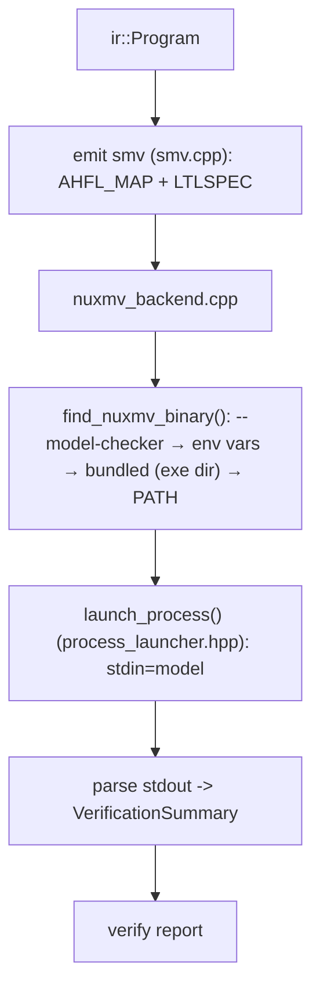
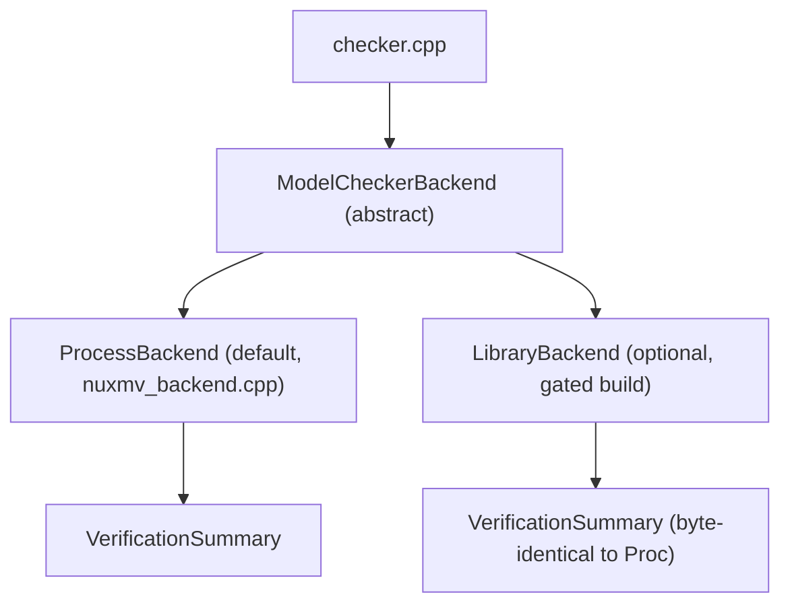

# RFC 0018: NuSMV Library-Mode Embedding

## Summary

评估并决策是否把 AHFL 的形式化验证从"外部 nuXmv/NuSMV 进程 seam"演进到"in-process
library-mode embedding"。当前 `src/verification/formal/nuxmv_backend.cpp` 通过
`find_nuxmv_binary()`（发现链：`--model-checker` → 环境变量 → **可执行文件同目录的 bundled
solver** → PATH）+ `launch_process()`（`src/verification/formal/process_launcher.hpp`，替代
popen 的进程启动 seam）调用检查器，并把 SMV 模型经 stdin 传入、解析 stdout。

**2026-10-08 起的关键变化**：NuSMV 2.6.0（LGPL-2.1）已被 vendor 进
`third_party/nusmv/`、随 AHFL CMake 从源码构建、`cmake --install` 时装到 `bin/` 与
`ahflc` 并列，运行时发现链优先查可执行文件同目录（commit 8df39dfe，RFC 0028）。默认安装
**必定**自带一个可用的 SMV 模型检查器，"缺 NuSMV"的失败模式在默认安装中不复存在。Z3
4.8.12（MIT）同样已被 vendor 进 `third_party/z3/` 并随 AHFL 构建/安装（RFC 0028）。
进程 seam 因此被
**保留为默认**，但它的对端从"外部可选进程"变成了"自带的 bundled 二进制"。

本 RFC 定义 library-mode 的**接入契约、边界与可行性判定**——包括许可证/构建耦合分析、抽象
接口保持（`ModelCheckerBackend`，`src/verification/formal/model_checker_backend.hpp`）、以及
为何本 RFC 的结论是"保持进程 seam 为默认（现对 bundled 二进制）、library-mode 作为受限可选
后端而非替换"。该结论在 NuSMV bundling 落地后**依然成立并被重申**（见 Decision History
2026-10-08）。

## Motivation

外部进程 seam 已在 backlog（`docs/plans/issue-backlog-global-gaps.zh.md` §四）被记为
"NuSMV/nuXmv library-mode embedding：当前是外部进程 seam，library-mode 仍是研究项"。
进程模型有真实成本：

1. **启动开销**：每次 `verify` fork/exec 一个 nuXmv/NuSMV 进程，对大量小 workflow 的批量
   验证（LSP 实时反馈、CI 矩阵）累积可观。
2. **数据往返**：SMV 模型经 stdin 序列化、结果经 stdout 反序列化解析
   （`nuxmv_backend.cpp` 的 parse 逻辑），是文本层的脆弱边界——nuXmv 输出格式变化会打断
   parser（RFC/既有 fixture matrix 已在防这个）。
3. **诊断粒度**：进程只能给最终文本输出；library-mode 理论上能拿到结构化的中间状态
   （trace、bound、solver 统计）而不必解析文本。

**2026-10-08 的变化（RFC 0028，commit 8df39dfe）**：NuSMV 2.6.0 已被 vendor 并随 AHFL
构建/安装，运行时发现链优先查可执行文件同目录。这**移除了进程 seam 的"外部可选依赖"
约束**——默认安装不再依赖用户自行安装/配置 NuSMV，"缺 solver"失败模式在默认安装中消失。
但 bundling **没有**消除上面三条进程模型本身的成本（启动开销、文本往返、诊断粒度）：
bundled 的 NuSMV 仍是一个被 fork/exec 的独立进程，只是它现在随 AHFL 一起分发。因此
library-mode 的动机从"摆脱外部依赖"收窄为"消除进程边界本身的性能/诊断损耗"。

Z3（SMT-BMC 路径）同样已被 vendor（`third_party/z3/`，MIT 许可），随 AHFL 构建并安装到
`bin/` 与 `ahflc` 并列；SMT-BMC 目标的运行时发现链同样优先查可执行文件同目录，默认安装
必定自带可用 SMT solver。

但 library-mode 也有真实阻碍，本 RFC 的核心是**把这些阻碍量化成可决策的事实**，而不是
默认"embedding 一定更好"。不做这个决策，"要不要 embed nuXmv"会一直是模糊的研究项，
既不推进也不明确放弃。

## Goals

1. **明确抽象边界**：确认 `ModelCheckerBackend` 接口
   （`model_checker_backend.hpp` 的 `ModelCheckerCapabilities` / `ModelCheckerAvailability`
   / `VerificationSummary`）足以让 process-mode 与 library-mode 作为两个后端实现共存，
   调用方（`checker.cpp`）不感知底层是进程还是库。
2. **许可证与构建耦合分析**：判定把 nuXmv/NuSMV 作为库链接进 AHFL 是否与
   Apache-2.0（本项目 LICENSE）及"无外部运行时依赖（除 vendored ANTLR4）"原则
   （CLAUDE.md）相容——这是 go/no-go 的硬约束。**部分已有结论**：NuSMV 的 LGPL-2.1
   与本项目在"构建期组合的独立作品"形态下相容（见 `third_party/nusmv/VENDORING.md`
   §License），NuSMV 已据此被 vendor 为**独立二进制**（进程 seam）；但"作为库
   链接/ dlopen 进同一进程"是更强的耦合，仍需单独判定。
3. **接入契约**：若 library-mode 可行，定义它的可选构建开关、availability 三态
   （`Available` / `MissingBinary`→`MissingLibrary` / `VerificationUnsupported`）、以及与
   process-mode 完全一致的 `VerificationSummary` 输出，使二者对报告层无差别。
4. **确定性与 artifact 边界**：library-mode 的结果必须与 process-mode 字节级一致
   （同一 SMV 模型 → 同一 verdict / counterexample），不引入 wall-clock / host-path /
   pid 进入 artifact。
5. **给出结论性建议**：本 RFC 应产出一个明确的 go/no-go（含中间态"仅作受限可选后端"），
   而不是继续把它挂在研究列表。

## Non-Goals

1. **不移除 process seam**。无论 library-mode 是否落地，进程 seam 保持为默认路径
   （最兼容、无链接/许可证耦合）；自 RFC 0028 起其默认对端是自带的 bundled NuSMV 二进制，
   而非外部可选进程。
2. **不 vendor nuXmv 源码，也不把 NuSMV  vendor 为库**。nuXmv 非开源可自由分发，本 RFC
   不涉及把其源码纳入 `third_party/`。NuSMV 2.6.0 已被 vendor 为**独立二进制**（RFC 0028，
   `third_party/nusmv/`，经进程 seam 调用）；本 RFC 不改变这一形态，不把 NuSMV 作为
   静态/动态库链接进 `ahflc`。
3. **不改变 SMV 模型的发射格式**。`emit smv` 的 `AHFL_MAP` / `LTLSPEC` 输出
   （`src/compiler/backends/smv/smv.cpp`）不变——library-mode 消费的是同一份 SMV 文本。
4. **不做 NuSMV 之外检查器（SPIN/TLA+）的 embedding**。它们当前是 emit-only
   （`model_checker_backend.hpp` 的 `ModelCheckerKind`），不在本 RFC 范围。
5. **不改变可用性/skip 语义的用户可见契约**。检查器不可用时的确定 skip 行为
   （`checker.cpp` 工具能力矩阵）保持不变。

## Design

### 当前进程 seam

发现链（`find_nuxmv_binary()`，RFC 0028 起）依次为：`--model-checker` flag →
`AHFL_SMV_CHECKER` / `AHFL_NUXMV_PATH` / `AHFL_NUSMV_PATH` 环境变量 → **可执行文件同目录的
bundled solver**（`bundled_solver.{hpp,cpp}`，Linux 经 `/proc/self/exe`、macOS 经
`_NSGetExecutablePath`，按 `nuXmv`/`nuxmv`/`NuSMV`/`nusmv` 顺序查找）→ PATH。默认安装命中
bundled 这一档。

### 抽象后端接口（已存在，是共存的关键）

`model_checker_backend.hpp` 已把检查器抽象为 capability + availability + summary 三组
结构。这意味着 process-mode 与 library-mode 天然可以是同一接口的两个实现，`checker.cpp`
只依赖抽象：

关键设计约束：`LibraryBackend` 的 `VerificationSummary` 必须与 `ProcessBackend` 对同一
SMV 模型**逐字段一致**。这是 library-mode 能作为可选后端而非分叉行为的前提，也是
Test Plan 的核心断言。

### 许可证与构建耦合（go/no-go 的硬约束）

本项目是 Apache-2.0，且 CLAUDE.md 明确"无外部运行时依赖（除 vendored ANTLR4）"。
nuXmv 的分发许可（非 OSI 开源，学术/评估许可）与"链接进发布二进制"存在根本张力：

- **静态链接**：几乎确定与 nuXmv 许可及本项目"无外部运行时依赖"原则冲突——no-go。
- **动态加载可选库（dlopen）**：AHFL 二进制不链接 nuXmv，用户自行提供共享库路径，
   AHFL 在运行时 `dlopen`——这把许可责任留在用户侧、AHFL 分发物不含 nuXmv 代码，
   可能相容。这是唯一可能的 library-mode 形态。
- **NuSMV（LGPL-2.1）** 而非 nuXmv：NuSMV 是 LGPL-2.1，动态链接相容性更好，但功能弱于
   nuXmv（无 IC3/部分 BMC 增强）。若 library-mode 落地，NuSMV-via-dlopen 是更干净的候选。

**NuSMV LGPL 问题已落地（2026-10-08，RFC 0028，commit 8df39dfe）**：NuSMV 2.6.0 已被
vendor 为**独立二进制**（`third_party/nusmv/`，LGPL-2.1 与 Apache-2.0 在"构建期组合的独立
作品"形态下相容，见 `third_party/nusmv/VENDORING.md` §License），经进程 seam 调用。这是
许可位置最干净的形态——AHFL 分发物不把 NuSMV 代码链接进同一进程，二进制是独立作品。
"作为库（静态/dlopen）链接进同一进程"是更强的耦合，其相容性未被本次 bundling 覆盖，仍是
library-mode 落地前必须单独判定的项。

**本 RFC 的结论（2026-10-08 重申）**：library-mode 只可能以"可选、dlopen、默认关闭、用户
自备库"的形态存在；静态链接 no-go。默认路径永远是 process seam——且自 NuSMV bundling 起，
process seam 的对端是自带的 bundled 二进制而非外部可选进程。这把决策从"embed 还是不 embed"
收敛为"是否值得为边际性能收益维护一条 dlopen 可选后端"。

### 若落地：接入契约

- 可选构建开关 `AHFL_ENABLE_SMV_LIBRARY_MODE`（默认 OFF），OFF 时 `LibraryBackend`
   不编译，零耦合。
- availability 扩展 `MissingLibrary` 态（库路径未提供/`dlopen` 失败）→ 与 `MissingBinary`
   同款确定 skip。
- `AHFL_SMV_LIBRARY` 环境变量/CLI flag 指定共享库路径；未指定则退回 process-mode。
- 输出经同一 `VerificationSummary`，报告层无感知。

## User Impact

- **默认无变化**：process seam 仍是默认，用户不装库则行为完全不变（且自 NuSMV bundling
   起，默认安装连 solver 都无需自行安装）。
- 若 library-mode 落地且用户显式启用：批量 `verify` 更快、诊断更结构化，但需自备 nuXmv/
   NuSMV 共享库并自担许可责任。
- **no-go 已兑现（2026-10-08）**：backlog 的"library-mode 研究项"被明确关闭为"经分析决定
   现阶段不做"，不再是悬而未决的模糊项——文档明确说明为何用进程 seam（现对 bundled
   二进制）。

## Compatibility and Migration

**非 breaking。** process seam 保持默认；library-mode（若落地）是默认关闭的可选后端，
不改变任何现有用户的行为、SMV 发射格式、或报告契约。

- 无 artifact 格式变化：SMV 模型文本不变，`VerificationSummary` 结构不变。
- 若结论为 no-go：无代码变更，只在 `docs/reference/` 与本 RFC 记录决策依据。
- 若结论为可选后端：新增一个默认 OFF 的构建开关；不影响不启用它的构建。

## Implementation Plan

本 RFC 的第一产出是**决策**，其次才是可选实现。切片：

1. **许可证/构建可行性调研**（无代码）：确认 nuXmv/NuSMV 许可与 Apache-2.0 + dlopen
   形态的相容性；产出 go/no-go/limited 结论并更新本 RFC Decision History。
2. **接口对齐验证**（若 go/limited）：确认 `ModelCheckerBackend` 抽象无需为 library-mode
   改形状；补齐 availability 的 `MissingLibrary` 态。
3. **LibraryBackend 骨架**（gated on `AHFL_ENABLE_SMV_LIBRARY_MODE`，默认 OFF）：dlopen
   seam + 与 process-mode 一致的 `VerificationSummary` 组装。
4. **一致性测试**：见 Test Plan。
5. **文档**：`docs/reference/` 记录 process vs library 的选择与许可注意事项。

若第 1 步结论为 no-go，则只执行"文档记录决策"，其余切片作废。

## Test Plan

- **单元**（`tests/unit/verification/formal/`）：`ModelCheckerBackend` 接口对 process 与
   library 两个实现的多态调用；availability 三/四态判定。
- **一致性（黄金）**：同一 SMV 模型分别经 process-mode 与 library-mode 验证，断言
   `VerificationSummary` 逐字段一致（verdict / bound / counterexample）。这是 library-mode
   可信的核心 gate。
- **工具缺失（反向）**：库路径未提供 / `dlopen` 失败 → 确定 `MissingLibrary` skip，
   退出码与 `MissingBinary` 一致，绝不伪造 verdict。
- **回归**：`ctest --preset test-dev -L formal-integration`；默认（OFF）构建的现有
   nuXmv process 测试无回归。
- **确定性**：library-mode 结果无 wall-clock / host-path 泄漏进 artifact。

## Rollout and Stabilization

1. `draft` → `review`：完成许可证可行性调研（Open Questions 清零），formal + tooling
   owner sign-off，给出 go/no-go/limited 明确结论。
2. 若 no-go：直接进 `accepted`（决策=不实现），文档记录后 `implemented`（决策落文档即完成）。
3. 若 limited：`accepted` 后按 Implementation Plan 实现可选后端。
4. `stabilized`：`docs/reference/` 与 spec 反映最终决策。

**实际路径（2026-10-08）**：本 RFC 经 `accepted`，决策为 **no-go（现阶段不实现
library-mode）**——process seam 保留为默认，且其对端随 RFC 0028 变为自带的 bundled NuSMV
二进制。library-mode 不被永久否决，而是降级为"研究方向"：仅当 Open Questions 2/3 被正面
回答（存在稳定 C API 且边际性能收益值得维护成本）时才重新立项。状态推进到 `implemented`
的触发条件是"决策落文档"，本 RFC 即以此为完成态。

## Alternatives

1. **静态链接 nuXmv 进发布二进制**：性能最优、无 dlopen 复杂度，但几乎确定违反 nuXmv
   许可与本项目"无外部运行时依赖"原则。**失败原因**：许可 + 原则双重 no-go。
2. **保持纯 process seam，不做任何 embedding**：零许可风险、零维护增量。代价是放弃
   library-mode 的性能/诊断收益。**这是本 RFC 的最终决策（2026-10-08 重申）**——且
   NuSMV bundling（RFC 0028）消除了该方案原本唯一的实质短板（"外部可选依赖"），使
   process seam 成为既无许可耦合、又默认自带 solver 的形态。dlopen 可选后端仅在调研证明
   其收益值得维护成本时才重新立项。
3. **自研/vendor 一个开源模型检查器替换 nuXmv**：彻底摆脱许可问题，但重写一个成熟度
   接近 nuXmv 的检查器是巨大工程,远超 embedding 的收益。**失败原因**：投入产出比
   不成立;RFC 0017 的 SMT-BMC 已在为数据谓词提供自研验证路径,时序部分继续依赖成熟
   检查器（NuSMV 现已 bundled 为独立二进制）更务实。

## Open Questions

1. nuXmv 当前分发许可的确切条款（能否 dlopen 而不违反）？——仍是 go/no-go 的决定性调研项。
   **NuSMV 侧已部分回答**：LGPL-2.1 与 Apache-2.0 在"构建期组合的独立作品"（vendor 为独立
   二进制）形态下相容，已据此落地（RFC 0028）；但"作为库 dlopen 进同一进程"的相容性仍未
   判定。
2. dlopen 形态下,nuXmv/NuSMV 是否暴露稳定的 C API 供 in-process 调用,还是只有 CLI/
   交互式接口(若只有后者,library-mode 无从谈起)？
3. 边际性能收益的量化：批量 verify 中进程启动开销占比多少?若 <10%,可选后端的维护
   成本可能不划算。
4. 若结论 limited,`MissingLibrary` 与 `MissingBinary` 是否合并为单一 "checker
   unavailable" 态以简化报告？——注意 NuSMV bundling 后，`MissingBinary` 对 SMV 路径在
   默认安装中已不可达（仅在用户显式绕过 bundled solver 且 PATH 无 solver 时出现）；合并
   讨论需以 Z3 bundling 后的可用性形态为前提。

## Decision History

- 2026-08-24: Draft opened.
- 2026-10-08: **NuSMV bundling 落地，本 RFC 结论重申并推进至 `accepted`。**
  NuSMV 2.6.0（LGPL-2.1）经 RFC 0028（commit 8df39dfe）被 vendor 进
  `third_party/nusmv/`、随 AHFL CMake 从源码构建、`cmake --install` 时装到 `bin/` 与
  `ahflc` 并列；运行时发现链（`find_nuxmv_binary()`）优先查可执行文件同目录
  （`bundled_solver.{hpp,cpp}`），默认安装必定自带可用 SMV 检查器，"缺 NuSMV"失败模式
  在默认安装中不复存在。Z3 4.8.12（MIT）同样已被 vendor 进 `third_party/z3/` 并随 AHFL
  构建/安装，SMT-BMC 路径的"缺 solver"失败模式在默认安装中同样消失。

  本 RFC 的原结论——**保持 process seam 为默认、library-mode（dlopen）作为研究方向而非
  近期实现**——在 bundling 后依然成立并被重申，且 bundling 强化了该结论：process seam
  的对端从"外部可选进程"变为"自带的 bundled 二进制"，原方案唯一的实质短板（外部依赖/
  许可耦合）已被消除，而进程边界本身的成本（启动开销、文本往返、诊断粒度）仍在，但不足
  以驱动一条 dlopen 可选后端的维护成本。决策为 **no-go（现阶段不实现 library-mode）**；
  library-mode 降级为研究方向，仅当 Open Questions 2/3 被正面回答（存在稳定 C API 且边际
  性能收益值得维护成本）时重新立项。NuSMV LGPL-2.1 与 Apache-2.0 在"构建期组合的独立
  作品"形态下相容（见 `third_party/nusmv/VENDORING.md` §License）；"作为库 dlopen 进同一
  进程"的相容性未被本次 bundling 覆盖，留待 library-mode 重新立项时判定。

- 2026-10-11: **RFC 0018 推进至 `implemented`（无人类 owner 门）。** 本 RFC 的 rollout 路径（§Rollout and Stabilization 第 2 条）明确规定："若 no-go：直接进 `accepted`（决策=不实现），文档记录后 `implemented`（决策落文档即完成）。" 2026-10-08 条目已记录 no-go 决策（library-mode 降级为研究方向，process seam 保持默认，bundled NuSMV 消除外部依赖短板）。决策落文档的完成条件已满足，本 RFC 推进至 `implemented`。`stabilized`（docs/reference 与 spec 反映最终决策）作为独立文档跟进项，不阻塞本状态推进。

- 2026-10-11: **RFC 0018 推进至 `stabilized`（无人类 owner 门）。** `stabilized` 验收标准（§Rollout and Stabilization 第 4 条）为："`docs/reference/` 与 spec 反映最终决策。" 两项均已满足：① **spec**——`docs/spec/assurance.zh.md` Formal Verification Gate 章节新增 process seam 唯一模式声明，引用 RFC 0018 no-go 决策与 bundled solver 事实；② **docs/reference**——`docs/reference/user-guide-assurance.zh.md` backend 表格新增 library-mode no-go 标注（"process seam；library-mode 经 RFC 0018 决策为 no-go"），checker 查找顺序已记录 bundled solver 优先级。
