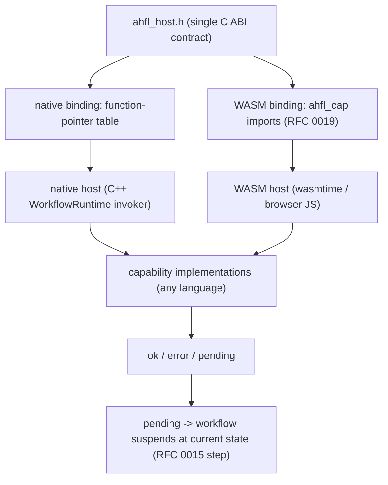

# RFC 0021: Capability Embedding ABI

## Summary

定义 AHFL 的**语言无关宿主接口(host embedding ABI)**:一个精确当前 C ABI,让任意语言
实现的宿主(C++/Rust/Go/Java/Node/浏览器 JS)把能力提供给一个嵌入的 AHFL workflow。
本 RFC 把 [RFC 0019](0019-wasm-runtime-model.zh.md) 的 `ahfl_cap`(WASM import 形态)
抽象为一个不绑定 WASM 的通用契约(`ahfl_host.h`),并落实 [RFC 0020](0020-strategic-positioning-embeddable-workflow-dsl.zh.md)
Open Questions Q1(语言无关 C ABI)与 Q3(异步:语言同步语义 + ABI 支持 pending 挂起)
的合并决策。这是 AHFL 从"多后端编译器"走向"嵌入式语言(Lua/eBPF-for-agents)"的第一块
地基。本 RFC 定义**契约**,不做完整宿主 SDK 实现(见 Non-Goals)。

## Motivation

[RFC 0020](0020-strategic-positioning-embeddable-workflow-dsl.zh.md)(accepted)把 AHFL
定位为可嵌入的 agent workflow 编排 DSL,能力由宿主经 **capability 嵌入边界**提供,并把
这条边界列为项目核心资产。初稿形成时，这条边界只存在于**一个宿主形态**里：以下是促成统一契约的历史问题。

1. **WASM 特化**:[RFC 0019](0019-wasm-runtime-model.zh.md) 的 `ahfl_cap` import
   (`(import "ahfl_cap" "cap_<id>" (func (param i32 i32) (result i32)))`,现由
   `src/compiler/backends/wasm/core_wasm_codegen.cpp` 的二进制发射器内联生成)是 WASM
   专属的。原生宿主(`src/runtime/engine/workflow_runtime.cpp` 的
   `ContextualCapabilityInvoker`)走的是另一套 C++ 内部接口。当时**两套 capability 接口没有
   统一契约**——这正是"多宿主"定位缺的那块地基。
2. **异步无位置**:LLM/HTTP 本质异步。现状原生 invoker 同步返回 `CapabilityCallResult`
   (`src/runtime/engine/capability_bridge.hpp`),WASM 侧 [RFC 0019](0019-wasm-runtime-model.zh.md)
   只说"host 侧吸收"。没有一个**跨宿主统一的挂起(pending)语义**,浏览器/serverless
   (执行有时限、不能 block)无从落地。

不定义这条统一 ABI,"AHFL 可嵌入任意宿主"永远停留在愿景——每接一个新宿主都要重新发明
capability 接口,且异步各搞各的。

## Goals

1. **定义 `ahfl_host.h` 作为唯一契约**:一个精确当前 C ABI 头,描述宿主↔AHFL 的
   capability 调用边界。WASM 的 `ahfl_cap` import 采用对应的三态契约；C 头为其他宿主提供声明约定，
   不保留已删除的原生绑定实现。
2. **`(ptr, len)` 帧 + 完整结构校验**:capability 参数/返回值是长度前缀的 canonical wire JSON 字节。
   宿主与编译产物使用同一当前契约；不协商 ABI 编号或混用历史帧格式。
3. **SymbolId 命名**:capability 按 `SymbolId`(索引式身份)标识,不用源名——重命名
   不破 ABI(延续 [RFC 0019](0019-wasm-runtime-model.zh.md) 与 AGENTS.md 索引式身份原则)。
4. **fail-closed 三态结果**:capability 调用返回 `ok` / `error` / `pending`。`error`
   →AHFL 侧终止并传播(不静默吞);`pending`→workflow 挂起在当前状态,等宿主恢复。
5. **pending/挂起语义(Q3)**:语言层 capability 调用保持同步语义(调用→得结果→继续),
   异步由宿主吸收;ABI 的 `pending` 态让宿主(浏览器/serverless)把"等 LLM"表达为
   "workflow 停在某状态、由后续事件恢复",复用 [RFC 0015](0015-dap-runtime-integration.zh.md)
   的状态机 step 语义。
6. **两个宿主形态从同一契约派生**:原生宿主(函数指针表)与 WASM 宿主(import)是同一
   `ahfl_host.h` 的两个绑定,证明契约的语言无关性。

## Non-Goals

1. **不实现完整宿主 SDK**。本 RFC 定义 C ABI 契约;各语言(Rust/Go/Node)的绑定库是
   后续工作。
2. **契约不新增运行时依赖**。C header 仅声明约定；生产 Wasm 引擎及其构建责任见
   [RFC 0019](0019-wasm-runtime-model.zh.md)，本 RFC 不另引入第二种执行引擎。
3. **不改变语言语义**。capability 调用点的语言语义仍是同步的(见 Goal 5);不引入语言级
   `async`/`await`——那是 [RFC 0020](0020-strategic-positioning-embeddable-workflow-dsl.zh.md)
   拒绝的 B 型通用计算。
4. **不迁移到 Component Model / WIT**。本 RFC 定义 core C ABI；组件模型属于独立设计，
   不预留格式切换字段或兼容入口。
5. **不拥有完整 codegen**。当前 Wasm codegen 由编译后端拥有；本 RFC 只统一 capability 边界契约。
6. **不引入第二种序列化格式**。当前边界只使用 canonical wire JSON；
   typed binding 决定值的解释，帧格式不由代际编号选择。

## Design

### 边界总览

### 当前 C ABI 形态

`include/ahfl/runtime/ahfl_host.h` 是当前契约声明；仓库没有独立的 C 入口实现。

- **能力身份**:capability 由 `uint32_t cap_id`(`SymbolId`)标识。
- **调用签名**:`ahfl_cap_status ahfl_invoke(ahfl_host *host, ahfl_invoke_args *args)`。
  `args` 完整包含 `struct_size`、`cap_id`、`args_ptr`、`args_len`、`result_ptr`、`result_len`。
  `struct_size` 必须等于 `sizeof(ahfl_invoke_args)`；缺字段和追加布局都拒绝。
- **状态码**:`AHFL_CAP_OK` / `AHFL_CAP_ERROR` / `AHFL_CAP_PENDING`。
- **结构校验**:固定当前 imports/exports、函数签名和帧布局；没有 ABI 版本函数或版本导出。
- **内存所有权**:延续 [RFC 0019](0019-wasm-runtime-model.zh.md) OQ2——宿主经导出的
  `alloc`/`dealloc` 管理帧内存;WASM 绑定直接复用已发射的 `alloc`/`dealloc`,原生绑定用
  等价的分配约定。

WASM 绑定:`ahfl_invoke` 映射为 `ahfl_cap` import(cap_id → import 名 `cap_<id>`),
即 [RFC 0019](0019-wasm-runtime-model.zh.md) 现状,增补 `pending` 返回码。
C header 供嵌入宿主实现约定使用；原先无生产调用者的 `NativeHostBinding` 适配器已删除。
当前 workflow 执行由 Wasm runtime 的 capability imports 接入，不保留另一条旧原生执行管线。

### pending/挂起语义(Q3 落实)

capability 返回 `AHFL_CAP_PENDING` 时:

1. workflow **停在当前状态**,不推进迁移(复用 [RFC 0015](0015-dap-runtime-integration.zh.md)
   的状态机 step——挂起就是"停在某状态等外部事件")。
2. 宿主稍后以 capability 结果**恢复**该 workflow(恢复接口由实现切片定义)。
3. 语言层看到的仍是"调用→得结果→继续"的**同步语义**——挂起/恢复对 AHFL 源码不可见,
   完全由宿主与 runtime 边界处理。

宿主形态映射:
- **原生 / server WASM**:宿主内部 block 等待,直接返回 `OK`,不用 `PENDING`(现状即如此)。
- **浏览器**:JSPI(WASM 原生挂起等 Promise)或 Asyncify;capability 返回 `PENDING`,
  JS host 在 Promise resolve 后恢复。
- **serverless**:capability 返回 `PENDING`,函数返回;后续事件(webhook/回调)携带
  workflow 句柄恢复——避免在有时限的函数里 block 等数十秒的 LLM。

### 与效应/能力模型的一致

capability 的 effect 分级(`read` / `external_side_effect` / `durable_write` /
`financial_write`,`include/ahfl/compiler/ir/decl.hpp` 的 `CapabilityEffectKind`)不进
ABI 调用签名,但**在编译期决定宿主需要哪些权限**——延续 [RFC 0019](0019-wasm-runtime-model.zh.md)
的 `project_wasi_config` 投影。[RFC 0020](0020-strategic-positioning-embeddable-workflow-dsl.zh.md)
Q2 的"编译期白名单上界 + 运行时绑定子集"在本 ABI 上体现为:宿主提供的 `ahfl_invoke`
只会被 AHFL 用编译期声明过的 `cap_id` 调用,宿主可拒绝(返回 `ERROR`)未绑定的能力。

## User Impact

- 宿主作者(集成 AHFL 的框架)获得一个**单一、稳定、语言无关的 C 契约**去提供能力,
  不必理解 AHFL 内部或为每个宿主重发明接口。
- WASM 执行采用统一 capability 契约，C header 为宿主提供精确结构声明。
- 异步能力有了**统一的 pending 落地路径**,浏览器/serverless 宿主成为可能。
- 对 AHFL 源码作者**无可见变化**:capability 调用仍是同步语义;这是宿主侧的 ABI。

## Compatibility and Migration

宿主、编译器和 runtime 同步使用当前完整结构。结构变化时同步更新生产者、消费者、
文档及测试，并重新编译生成产物；不读旧结构，不协商代际编号，不自动迁移。
三态状态和单一所有者内存约定保持为当前语义。C header 是声明契约；
历史原生适配器已删除，实际执行入口与宿主桥接见 [RFC 0019](0019-wasm-runtime-model.zh.md)。

## Implementation Plan

当前责任划分：C header 声明精确结构、状态和内存所有权；Wasm backend 发射当前
capability import；runtime 按 typed binding 封送参数和结果，并提供 pending / resume。
没有原生绑定适配器或第二条生产执行管线。第三方语言宿主 SDK 是独立实现范围。

## Test Plan

- `tests/unit/runtime/engine/ahfl_host_abi.cpp` 验证 C header 定宽状态、精确结构和当前字段。
- 当前 Wasm backend / host 测试验证 import 签名、typed binding、参数与结果帧往返。
- 未绑定能力、未知状态或错误结果帧必须 fail closed，不调用替代执行路径。
- pending → suspend → resume 通过真实 workflow 路径验证，结果与同步执行一致，已完成副作用不重跑。
- 回归执行当前项目 ctest；历史原生适配器测试不作为现存生产绑定的证明。

## Rollout and Stabilization

契约变化时同步更新 header、codegen、host、文档和测试，旧产物重新生成。
当前 C header 是声明契约，不能将其视作已有第三方 C 入口实现；完整宿主 SDK
必须有实际调用证据，不能通过保留已删除的原生适配器获得稳定性声明。

## Alternatives

1. **每个宿主各自定义 capability 接口(现状)**:WASM 用 import、原生用 C++ 内部类。
   **失败原因**:两套接口漂移、异步各搞各的、每接新宿主重发明——与 [RFC 0020](0020-strategic-positioning-embeddable-workflow-dsl.zh.md)
   "capability 边界是核心资产、多宿主"的定位直接冲突。
2. **进程外 IPC(gRPC/JSON-RPC over socket)作为宿主边界**:更松耦合、天然跨语言。
   **失败原因**:引入序列化 + 网络往返开销,且丢掉 in-process 嵌入的性能与 WASM 沙箱
   红利——走 IPC 就不是"嵌入"(参 [RFC 0020](0020-strategic-positioning-embeddable-workflow-dsl.zh.md)
   Q1 结论)。IPC 可作为**可选**远程 capability 传输(现有 HTTP/gRPC transport 已覆盖),
   但不是嵌入边界本身。
3. **直接上 Component Model / WIT**:带类型的接口更优雅。**失败原因**:浏览器支持未
   成熟、工具链新、绑定复杂([RFC 0019](0019-wasm-runtime-model.zh.md)/[RFC 0020](0020-strategic-positioning-embeddable-workflow-dsl.zh.md)
   已列为未来 major 版本目标)。core C ABI 满足当前边界，采用精确结构校验，不保留兼容格式。

## Open Questions

两个设计问题已在进入 review 前给出**倾向性结论 + 理由**。当前函数签名由 `ahfl_host.h` 精确声明；Wasm 投影由 backend/host 校验。

1. **帧序列化与结构规则** → **决策:只接受当前 canonical wire JSON 和精确布局。**
   参数与结果按 capability 的 typed binding 解码；`struct_size`、Wasm imports/exports、
   frame layout 均必须完整匹配当前契约。没有连接级版本协商或帧级格式选择。
   同一变更更新所有生产者和消费者，旧产物必须重新生成。
2. **pending 恢复接口** → **决策:由 [RFC 0022](0022-durable-capability-resume.zh.md)
   的确定性重放 + memoization 提供。** 初稿仅凭 `(WorkflowId, CheckpointId)`
   回注当前节点的假设已被调用点级设计替代：持久记录包含 pending ordinal、
   capability 身份、参数校验和已完成调用的结果；恢复按调用顺序校验并复用 memo，
   不重新执行已完成副作用。持久快照只接受 `ahfl.workflow-recovery` 当前完整结构。

## Decision History

以下是当时实现与评审的记录；已删除的原生适配器和格式协商不构成当前接口。

- 2026-08-25: Draft opened. 落实 [RFC 0020](0020-strategic-positioning-embeddable-workflow-dsl.zh.md)
  Q1(语言无关 C ABI + `(ptr,len)` 帧 + SymbolId 命名)与 Q3(语言同步语义 +
  异步下沉宿主 + ABI 三态含 pending 挂起)的合并决策,把 [RFC 0019](0019-wasm-runtime-model.zh.md)
  的 `ahfl_cap` 抽象为语言无关的 `ahfl_host.h`,原生与 WASM 从同一契约派生。
- 2026-08-25: 两个 Open Questions 给出倾向性结论并进入 review:(1)当时提出连接级帧格式协商，后由 2026-10-12 的精确当前结构决策替代；(2)pending 恢复复用 runtime 已有的
  `WorkflowRecoverySnapshot` / `CheckpointId` 机制,句柄为 `(WorkflowId, CheckpointId)`,
  结果按 `RecoveredNodeState::output` 同型回注入,不新发明续延机制。Owners / shepherd
  分配,tracking_issue / discussion 设为 none。Status draft → review。
- 2026-08-25: Owner sign-off; status review → implementing. 按 Implementation Plan
  切片,从 `ahfl_host.h` C ABI 契约(slice 1)开始。各语言宿主 SDK 与完整 WASM codegen
  仍超出本 RFC 范围。
- 2026-08-25: Slice 1 landed — `include/ahfl/runtime/ahfl_host.h` C ABI 契约。落地前经
  一次多 lens 设计评审(ABI 稳定性 / 内存所有权 / 异步-pending / 双绑定一致性),据其
  must-fix 列表定型:不透明 `ahfl_host*` 句柄作首参(否则 1.0 后不可加)、size-prefixed
  `ahfl_invoke_args` 参数对象（当时的追加扩展承诺已被精确布局替代）、`uint32_t` 定宽状态 + OK=0 +
  fail-closed(未知状态视作 ERROR)、当时区分 ABI 与 wire format（两种选择轴已删除）、
  callee-alloc/caller-free 帧所有权(alloc/dealloc 带 `host` 防跨分配器 free)、三态
  post-condition 逐条写进契约、小端长度前缀帧。原生表与 WASM import 皆从此单一头派生。
  验证为有效 C11(`-Wall -Wextra -Wpedantic` clean)。Covered by
  `tests/unit/runtime/engine/ahfl_host_abi.cpp`(`ahfl.runtime.host_abi_all`:定宽/OK=0/
  struct_size 首字段的 static_assert + 状态/帧/args 形态)。原生绑定、WASM pending、
  resume 接口为后续 slice。
- 2026-08-25: Slice 3 landed — WASM 绑定对齐。`ahfl_cap` import 签名(当时由
  WAT 发射器的 import 生成 helper 发射,现由
  `src/compiler/backends/wasm/core_wasm_codegen.cpp` 二进制发射)从
  `(param i32 i32) (result i32)`(RFC 0019,丢了 status 与 result_len)改为
  `(param i32 i32) (result i32 i32 i32)` = args (ptr,len) → (status, result_ptr,
  result_len),即 `ahfl_host.h` 的 WASM 投影(status 为 ahfl_cap_status,含 PENDING)。
  确定性不变(纯签名文本)。Covered by `ahfl.backends.wasm_all` 与端到端 `emit wasm`。
  规划 fan-out(8-agent 分析 workflow)确认此 slice 最隔离、可先行;并确认 slice 4
  (pending resume)需独立设计评审(见后续 Decision History)。
- 2026-08-25: Slice 4(pending resume)拆分为独立的
  [RFC 0022](0022-durable-capability-resume.zh.md)(Durable Capability Resume)。经一次
  4-lens 设计评审确定其为语义级改动(确定性重放 + memoization),且依赖两处确定性前置
  (nondet 内建重分类、`unordered_map` 字段序列化),不宜作为本 RFC 的接线型 slice 直接
  编码。本 RFC 余下 slice(原生绑定 slice 2、参考宿主 + 差分测试 slice 5)不受影响。
- 2026-08-25: Slice 2 landed — 原生绑定。`WorkflowRuntime` 的 capability 派发改为从
  `ahfl_host.h` 的函数指针表派生(`NativeHostBinding` +
  `make_native_capability_invoker`,`src/runtime/engine/native_host_binding.{hpp,cpp}`),
  取代无契约的 `ContextualCapabilityInvoker` 直连;`WorkflowRuntimeConfig` 新增
  `native_host_binding`,优先于直连 invoker。适配器按 `AHFL_WIRE_VALUE_JSON` 帧
  marshal 参数、调 `ahfl_invoke`、解码 status + callee-alloc 结果帧(经 `ahfl_dealloc`
  单次释放)。status 遵循 ABI fail-closed:OK→Success、ERROR/未知状态→Error、
  PENDING→Error + 指向 [RFC 0022](0022-durable-capability-resume.zh.md) 的诊断(resume
  未实现)。既有 invoker 型宿主可观察行为不变。Covered by
  `tests/unit/runtime/engine/native_host_binding.cpp`(`ahfl.runtime.native_host_binding_all`,
  dev + asan:OK 无损回环 + 帧单次释放 + cap_id 透传;ERROR/未知/无效绑定 fail-closed;
  PENDING fail-closed 引用 RFC 0022)。asan 确认跨 ABI alloc/dealloc 无泄漏、无 UAF。
- 2026-08-25: Slice 5 landed(可达成部分)— 参考宿主 + 绑定等价性。最小 C 式参考宿主
  实现 `ahfl_host.h`(`ahfl_invoke`/`alloc`/`dealloc`,不透明 host),经原生绑定跑通一个
  真 capability workflow;并证明该原生绑定运行与"直连 invoker 返回同值"在 L1(workflow
  status + 用确定性 `value_json` 得到的逐字节相同输出)与 L2(capability 调用序列
  `{"is_ready"}`)上可观察等价;golden 负例:未绑定能力(宿主返 ERROR)→ workflow 不成功
  完成(fail-closed)。**范围**:AHFL 只 emit WAT、不含 WASM VM(RFC 0019/0021),故差分
  为原生绑定 vs 直连 invoker,而非 vs 执行中的 WASM 模块;执行型 WASM 差分(需 WASM
  运行时)与 PENDING/resume(RFC 0022)另行跟踪,测试文件已注明该边界。Covered by
  `tests/unit/runtime/engine/native_wasm_differential.cpp`
  (`ahfl.runtime.native_wasm_differential`,dev + asan,11/11)。
- 2026-08-25: Status implementing → implemented. Implementation Plan item 4
  (pending/恢复接口)由 [RFC 0022](0022-durable-capability-resume.zh.md) 的
  suspend/resume runtime API 交付(`WorkflowStatus::Suspended` +
  `WorkflowResult::suspended` + `WorkflowRuntimeConfig::{recovery_snapshot,
  resume_pending_result}`);Test Plan 的 "pending 语义" 用例由端到端 capstone
  `tests/integration/durable_resume_capstone.cpp`
  (`ahfl.reference_workflow.durable_resume_capstone`)覆盖:一个 capability 返回
  `AHFL_CAP_PENDING` → workflow 挂起 → 跨进程冷启动从磁盘快照恢复 → 结果与同步路径
  逐字节一致。`implemented` 门槛(`ahfl_host.h`、原生 + WASM 两个绑定、pending、参考
  宿主、契约级测试)已全部落库。`stabilized` 尚需 `docs/reference/` ABI 契约文档 + 至少
  一个第三方语言绑定(Rust/Node),后者 Q4 范围外。
- 2026-08-25: `stabilized` 前置之一落地 —— `docs/reference/host-abi.zh.md` 宿主嵌入 ABI
  契约文档（当时的格式协商、三态 fail-closed 状态码、不透明 host 句柄、单一所有者
  分配器、`ahfl_invoke_args` size-prefixed 契约、durable-resume 挂起/恢复、原生 vs 直连
  等价性范围说明)。`stabilized` 剩余门槛为一个第三方语言绑定(Rust/Node),明确为 Q4
  范围外的后续工作;故本 RFC 保持 `implemented`。
- 2026-10-11: **stability 升级 experimental → stable-artifact**(coordinator 评估;无人类
  owner 门)。`ahfl_host.h` C ABI 契约自 2026-08-25 落地以来未发生破坏性变更,帧规则
  与三态状态码已在 `docs/reference/host-abi.zh.md` 稳定表述,原生 + WASM 两个绑定
  与契约级测试全部落库。ABI 契约本身满足 stable-artifact 标准;RFC status 保持 `implemented`,
  因 `stabilized` 仍需至少一个第三方语言绑定(Rust/Node)。

- 2026-10-12: 按仓库单一当前契约决策删除格式协商和追加布局兼容承诺；C header 仅声明精确当前结构，Wasm 执行使用当前 capability imports。无生产调用者的原生绑定适配器删除，旧产物需重新生成。
