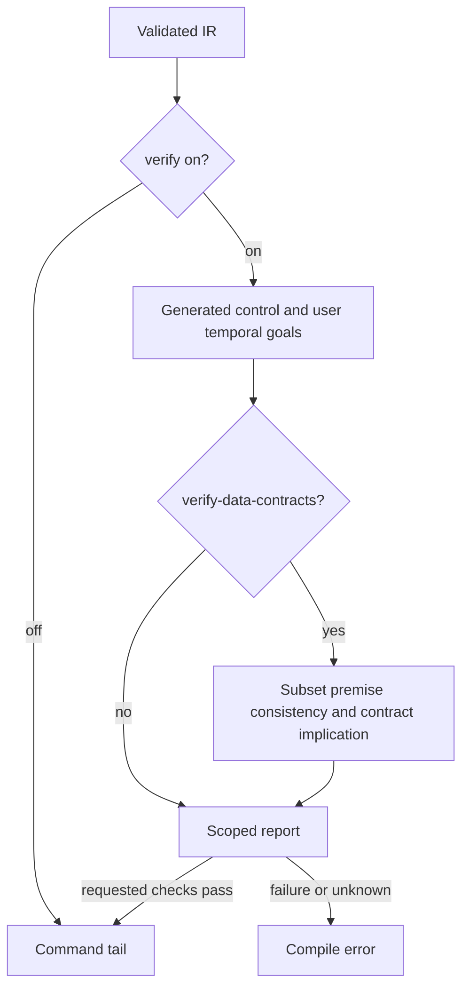

# RFC 0028: Formal Verification in the Default Compilation Pipeline

## Summary

`check`、`build`、`run` 默认 `--verify=on`，验证通用 Agent 状态与 workflow 执行控制模型。用户声明的纯控制 temporal clause 即验证请求。业务数据合同由用户使用 `--verify-data-contracts` 按需选择，普通数据条款不会自动启动 SMT。报告分别呈现生成义务、用户时序目标、环境前提、数据目标及运行时检查范围。

## Motivation

默认提供稳定、通用的状态/控制检查，避免用户必须额外调用验证命令。用户可以逐步声明更细粒度业务规则，并明确请求证明，而不会把宿主 predicate 声明误当成已证明实现。

## Goals

1. 复用已有 SMV 与 SMT 引擎，保持 `--verify=off|on`；不增加 control/full 模式或新 DSL 属性。
2. 所请求检查 fail closed；报告不再笼统声称所有形式化验证通过。
3. 所有 Agent（含 standalone）合成初始、合法转移和 final 吸收义务。
4. 数据默认 not_requested，requires 是环境前提；显式选择后的 unsupported/unknown/反例均失败。
5. runtime 合同检查当前 not_implemented，不伪造已执行。

## Non-Goals

不引入新验证引擎、无限数据模型或 provider 真实性证明。不新增 runtime predicate executor。本次 SMT 只证明合同蕴含，不证明 flow 实现满足后置条件；详细约束见 [RFC 0017](./0017-bmc-contract-semantics.zh.md)。

## Design

### Pipeline and commands

前端 parse/resolve/typecheck/validate → IR lowering/structural gate → verification stage → command tail。默认如下：

| Command | Default verify |
|---|---|
| check / bare source / build / run | on |
| inspection / artifact / other commands | off |

显式 `--verify` 覆盖默认。`--verify-data-contracts` 要求 on，否则为 usage error。`verify-formal` 已删除；控制验证入口为 `check --verify=on`，请求数据验证再添加 `--verify-data-contracts`。

### Control scope

Agent 初始状态、合法转移、final 吸收性以及 workflow lifecycle/final/dependency、模型中的 call/effect/recovery 控制义务默认检查。基础控制义务不会自动声称终止、公平调度或 provider 返回。

用户 temporal invariant/forbid 与 workflow safety/liveness 继续进入 SMV。模型中未编码的 embedded data observation 导致目标 conditional/unsupported，不能计为无条件用户证明。no-fault 或其他模型前提必须在报告中可见。默认 BDD 结论与 `--bmc-depth` 有界结论分别报告。

### Data scope

普通数据 requires 列为环境前提；数据 ensures/invariant/forbid 默认 not_requested。未请求不发相关子集 warning、不启动 Z3。`--verify-data-contracts` 请求现有 package 数据目标；必要前提或目标超出子集须拒绝并定位源码。

先验证前提一致，再逐目标查询 requires ∧ ¬goal。invariant 不作为其自身或其他未证明目标的假设。报告 scope=contract_implication；SAT 是公式反例赋值而非执行轨迹。output 与 flow statement 没有赋值关系，因此不能宣称实现证明。

### Fail-closed and reports

控制检查缺 checker、超时、反例、checker error、specification 结果不匹配必须失败。显式数据检查缺 solver、超时、unknown、unsupported、矛盾前提、反例必须失败。只有确实无义务/目标时可跳过 checker，不能把含 standalone Agent 的 package 当成 zero-spec。

报告分别呈现生成控制义务、用户时序目标及 conditional/unsupported、环境前提、数据目标状态、runtime contract checks=not_implemented。成功文案限定“控制模型验证”，不能保留全局 formal verification passed。状态空间估计仅是规模提示。

### Bundled solvers and artifacts

NuSMV 2.6.0 与 Z3 4.8.12 通过第三方 wrapper 随构建/安装提供。SMV 发现顺序：显式 --model-checker → AHFL_SMV_CHECKER → backend-specific 环境变量 → ahflc 同目录 → PATH；Z3：AHFL_Z3_PATH → bundled → PATH。

`--formal-backend nuxmv|nusmv` 支持当前验证；spin/tlaplus 只支持相关 artifact，不承诺外部验证。`--formal-model-out` 保存实际 SMV checker 输入，`--checker-timeout-seconds` 限制检查进程。`emit smv` / `emit smt` 是 artifact，生成 artifact 不是证明完成。

### Remaining implementation constraint

完整业务实现证明需要 sound executable-IR transition relation。目前数据路径未建该关系，Core IR 也未保留可执行合同；host predicate 与 flow assert/requires 没有自动 runtime 执行。应以该真实限制描述当前能力，取得执行关系与一致性证据后通过新决策扩展，不增加永久兼容路径。

## User Impact

- check/build/run 默认检查通用控制模型及用户纯控制目标。
- 依赖旧默认 SMT 检查的脚本必须添加 --verify-data-contracts。
- 原退款示例默认列三条环境前提与一条未请求数据目标，控制目标单独验证；显式请求数据验证会因未定义 host predicate 失败。
- 退款规则 package 展示支持的数据合同蕴含与公式反例，不承诺退款执行实现等价。
- --verify=off 保留关闭阶段的行为，与 --verify-data-contracts 同用为参数错误。

## Compatibility and Migration

`--verify` 的 on/off 语法保留。原默认数据检查需显式添加 `--verify-data-contracts`；全局成功文案由分范围报告取代，不改变 runtime 数据格式。

## Implementation Plan

1. CLI 请求选择和报告；2. SMV standalone 义务与分类；3. SMT 前提一致性和独立目标；4. docs/examples 与原生回归测试。

## Test Plan

使用 project-native 单元、golden、CLI integration 与真实 bundled checker/solver 验证：默认控制/standalone 义务；默认不启动 SMT；可证/反例/unsupported/unknown 数据目标；矛盾前提与循环 invariant；条件/有界报告；verify off 与选项错误；源位置。退款审核和退款规则 manifest 命令须真实运行。文档门禁和相关更广测试通过后才宣称完成。

## Rollout and Stabilization

沿用现有默认管线，一次性替换请求/报告行为和相关调用方。验收证据包含真实 bundled solver、退款 manifest 命令与相关门禁；不保留旧默认 SMT 路径。

## Alternatives

拒绝默认证明所有业务合同：混淆前提与目标，也让无实现 predicate 的存在变成自动证明请求。拒绝新 DSL 标记和 control/full 模式：既有合同与一个明确请求选项已足够，且 full 容易暗示尚不存在的完整实现证明。拒绝删除业务条款或隐藏所有诊断：应保留身份和范围，只有未请求的数据不作为 warning。

## Open Questions

完整执行实现证明仍缺少 sound transition relation；取得该关系和实现一致性证据后，通过新决策修订范围。当前结论不得提前使用该保证。

## Decision History

- 2026-10-12: Standalone-FSM acceptance supplement: generate initial-state,
  legal-transition, and final-absorption obligations for every Agent, including
  those not referenced by a workflow. These properties must observe the actual
  lowered flow control relation so a final-state handler that leaves final, or a
  mismatched flow transition, is exposed rather than hidden by normalization.
  Generic verification does not request termination or provider-return proofs.
  Packages with no verification targets report no_targets/not_run and must not
  claim passed; data contracts with no selected goals similarly report no_targets.
  This supplements the independent scope decision, without adding a parallel
  engine or changing the required end-state for execution/data proofs.

- 2026-10-12: The dedicated verification-scope decision agent selected default
  control-model verification plus explicit `--verify-data-contracts`. Existing
  `--verify=off|on` remains; `on` checks generic Agent/workflow control obligations
  and user-declared control temporal targets. Data preconditions and goals are
  reported separately and do not request SMT verification by their presence.
  `--verify-data-contracts` selects package data contracts and fails on unsupported
  selected clauses/dependencies, unavailable solver, unknown, or counterexample.
  Using it with `--verify=off` is a usage error. Reports distinguish generated
  obligations, user temporal goals, environment premises, requested data goals,
  and runtime checks. Abstracted temporal goals are conditional/unsupported,
  never counted as fully proved user properties. Runtime contract checks are
  currently not implemented and must not be reported as executed.
  Alternatives rejected: implicit verification of all contracts (confuses trust
  premises with goals), new DSL attributes (unnecessary parser/HIR/persistence
  changes), and `control/full` verification modes (break existing options and
  imply an unsupported complete proof). The current SMT engine proves only
  `requires => goal`, without flow execution semantics; its scope is explicitly
  `contract_implication`. Inconsistent premises must fail, and unproved
  invariants cannot be assumed to prove each other. The end-state implementation
  proof requires a sound executable-IR transition relation; adding that relation
  is the trigger for revising this documented limitation. No compatibility path
  or alternate engine is introduced. Acceptance: default refund control checks,
  explicit supported/unsupported/refuted data targets, honest conditional and
  bounded reporting, no fabricated runtime checks, and preserved `--verify=off`.
  **CLI migration:** scripts that relied on default SMT checks must add
  `--verify-data-contracts`. This decision records the agent rationale, not
  human sign-off.

- 2026-10-07: Draft opened. Decision: tiered `--verify=<off|light|full>` with `light`
  default for `check`/`run`; formal stage inserted after IR structural verification;
  `light` degrades on missing external solver / timeout / oversized state space, `full`
  is fail-closed; `verify-formal` deleted in the same big-bang change. External-solver
  dependency named as the Principle 6 constraint blocking fail-closed-by-default;
  internal-BMC / RFC 0018 embedding is the removal trigger.
- 2026-10-07: Implemented. Formal stage landed in `run_analysis` after IR structural
  verification; `verify-formal` command deleted; all call sites migrated to
  `check --verify=full`; light-mode tests added (missing binary, no properties,
  verify=off, bogus value, model-checker with verify=off, BMC refutation). Full
  test suite green (580/580; one known-flaky LLM smoke under parallel load).
- 2026-10-07: Revised. Light/Full distinction eliminated per user directive
  ("默认就完备检查"). `VerificationMode` simplified to `{Off, On}`; default is `On`
  (fail-closed) for `check`/`run`. All graceful-degradation logic removed: missing
  solver, timeout, oversized state space, and unknown results all fail the build.
  Zero-spec fast path retained (silent when no LTLSPECs/SMT goals). BMC engine
  no longer default; BDD (exhaustive) is the default. `--verify=<off|on>`
  replaces `--verify=<off|light|full>`. Temp model file uses a unique-per-invocation
  name (PID + timestamp) to avoid races under parallel test load; the temp path is
  normalized to `<temp-model>` in captured checker output for differential test
  stability. Test suite green (585/585 in parallel).
- 2026-10-08: NuSMV 2.6.0 bundled per user directive ("安装我们这个的时候，要默认
  安装，至少安装一个 Solver 才行"). The external-solver constraint for the SMV
  path is REMOVED: NuSMV is vendored in `third_party/nusmv/`, built from source,
  and installed to `bin/` alongside `ahflc`. Runtime discovery checks the
  executable's own directory first (`bundled_solver.{hpp,cpp}`). The
  `missing_binary` test is replaced by `bundled_solver` (asserts the solver IS
  found with no env vars and a solver-free PATH). All NuSMV install rules except
  the binary are stripped (no headers, no static libs, no docs). Constraint
  section updated to reflect the partial removal.
- 2026-10-08: Z3 4.8.12 bundled per user directive ("把后续工作全部做完"). The
  external-solver constraint for the SMT-BMC path is REMOVED: Z3 is vendored in
  `third_party/z3/`, built from source, and installed to `bin/` alongside
  `ahflc`. Runtime discovery checks the executable's own directory first (same
  `bundled_solver.{hpp,cpp}` helper). The `bundled_smt_solver` test asserts the
  bundled Z3 is found and discharges SMT-BMC goals with no env vars and a
  solver-free PATH. All Z3 install rules except the binary are stripped (no
  headers, no static libs, no docs, no bindings). The external-solver
  constraint is now FULLY REMOVED for both engines. Constraint section updated
  to reflect the full removal.

- 2026-10-11: **RFC 0028 推进至 `stabilized`（无人类 owner 门）。** `stabilized` 验收标准（§Rollout and Stabilization 第 4 条）为："`docs/reference/` CLI reference reflects `--verify`; both solvers (NuSMV, Z3) are bundled so the missing-solver failure path is unreachable in a default install." 两项均已满足：① **CLI reference**——`docs/reference/cli-commands.zh.md` line 134 完整记录 `--verify=<off|on>` 标志（默认 `on`、fail-closed、零规格时静默跳过、NuSMV 和 Z3 内置）；② **solvers bundled**——NuSMV 2.6.0 vendor 于 `third_party/nusmv/`（commit 8df39dfe）、Z3 4.8.12 vendor 于 `third_party/z3/`（commit 952d814b），两者随 AHFL CMake 从源码构建并 `cmake --install` 装到 `bin/`，runtime solver discovery 优先查可执行文件同目录，默认安装必定自带可用 solver，missing-solver 失败路径在默认安装中不可达。
