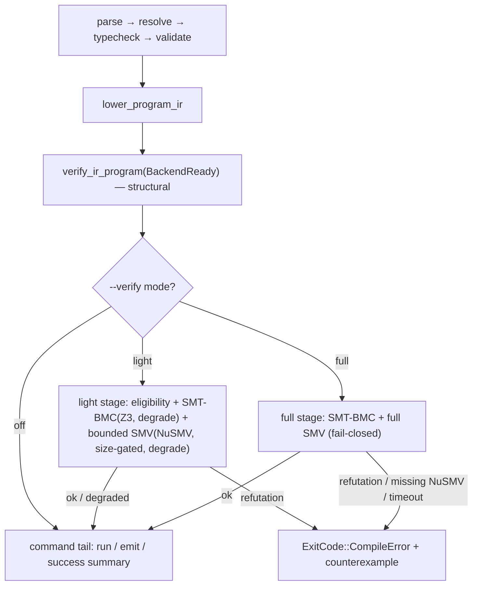

# RFC 0028: Formal Verification in the Default Compilation Pipeline

## Summary

Formal verification moves from an opt-in command (`ahflc verify-formal`) into the
default compilation pipeline as a first-class stage. A new `--verify=<off|light|full>`
option controls the stage; `light` is the default for `ahflc check` and `ahflc run`,
`off` for inspection/artifact commands. `light` runs structural verification, subset
eligibility, SMT-BMC contract-data discharge (when Z3 is present), and a size-gated,
timeout-bounded NuSMV BMC pass (when NuSMV is present); it degrades to a `note:` and
success when an external engine is absent or times out. `full` is the current
fail-closed `verify-formal` semantics. The `verify-formal` command is deleted in the
same big-bang change (Principle 1): `ahflc check --verify=full` is its strict
superset. The external-solver dependency is a named, removable constraint (Principle 6);
the end-state is a self-contained engine that makes `light` fail-closed.

## Motivation

Today formal verification is reachable only through `ahflc verify-formal`, a separate
routed command. The default pipeline (`ahflc check` / bare `ahflc <file>`) runs
`lower_verified_ir_or_report`, whose `verify_ir_program(BackendReady)` enforces
structural IR invariants only — it is explicitly NOT model checking. A program with a
refuted `ensures` clause or a violated workflow `safety` property compiles cleanly by
default; the violation surfaces only when the user remembers to run a second,
opt-in command.

The project lead has directed that formal verification must be part of the default
compilation flow: users should not need to be aware of it, but it must exist, and it
must be configurable. Without this decision, "verified by default" is impossible: the
two formal engines (SMT-BMC via Z3, SMV model checking via NuSMV/nuXmv) sit behind a
command most users never invoke, and the default pipeline gives no feedback on the
properties the language lets users write.

## Goals

1. `ahflc check` (and bare `ahflc <file>`) runs a formal-verification stage by default,
   after IR lowering and structural verification, before the command tail.
2. A single `--verify=<off|light|full>` option controls the stage, parsed into an
   index-based enum at the CLI boundary (Principle 2). Default: `light` for `check` /
   `run`, `off` for every other command.
3. `light` is fast enough for edit-compile-debug: no external launch when the program
   has no verifiable properties; bounded effort (BMC depth, per-query timeout, overall
   stage timeout) otherwise; graceful degradation (`note:` + success) when an external
   solver is missing or a bound is hit.
4. `full` reproduces the current `verify-formal` semantics exactly: full SMV (BDD by
   default, BMC under `--bmc-depth`) + SMT-BMC, fail-closed on missing NuSMV, timeout,
   or refutation. This is the production / CI gate.
5. A genuine refutation (SMT-BMC `Unsafe`, or an SMV `is false` specification) FAILS
   the compilation in every mode that ran the engine, with a counterexample.
6. The `verify-formal` command, its routing, its option guards, and its dedicated
   tests are deleted in the same change; `ahflc check --verify=full` is the migration
   target (Principle 1: no coexistence).
7. The existing formal flags (`--bmc-depth`, `--model-checker`,
   `--checker-timeout-seconds`, `--formal-backend`, `--formal-model-out`, `--explain`,
   `--bmc-boundary-invariants`) are relaxed from "verify-formal only" to "formal stage
   active" (`--verify != off`).

## Non-Goals

1. **No new verification engine.** This RFC wires the two existing engines
   (SMT-BMC, SMV model checker) into the pipeline; it does not build the internal
   IR→`BmcStateMachine` lowering that would make `run_bmc` the always-available
   backbone. That is the constraint-removal end-state (see Design §Constraint).
2. **No vendoring or embedding of NuSMV/Z3.** The "no external runtime dependencies
   besides vendored ANTLR4" principle stands; RFC 0018's dlopen library-mode is the
   separate track for removing the external-process constraint.
3. **No change to SMV model emission format.** `print_program_smv` output
   (`AHFL_MAP` / `LTLSPEC`) is unchanged; `emit smv` is unaffected.
4. **No change to the SMT-BMC engine semantics** (RFC 0017): loop-free data-predicate
   fragment, single query per goal, `Unsupported` on no goals, `SolverUnavailable`
   on missing Z3.
5. **No new temporal fragment.** What `light` can prove is bounded by what the existing
   SMV backend encodes; this RFC changes WHEN verification runs, not WHAT it can prove.
6. **No LSP integration** in this RFC. The stage is a CLI-pipeline concern; LSP
   real-time verification is a follow-up that consumes the same stage.

## Design

### Pipeline position

The formal stage is inserted in `CliDriver::run_analysis`
(`src/tooling/cli/cli_driver.cpp:4019-4026`), immediately after
`lower_verified_ir_or_report` (lower + `verify_ir_program(BackendReady)`) and before
the command-specific tail (`RunWorkflow` dispatch at `:4028`, emit/backend dispatch at
`:4124`/`:4174`). This is the verification boundary: the IR is well-formed, now check
its properties before executing or emitting it.



The stage is a STAGE, not a command: on success it falls through to the normal command
tail (so `check --verify=full` prints the formal report AND the `ok: checked ...`
summary; `run --verify=light` verifies then executes). On failure it returns
`ExitCode::CompileError`, exactly as a typecheck failure would.

### The `--verify` option

A new field on `CommandLineOptions`
(`src/tooling/cli/command_catalog.hpp`):

```cpp
enum class VerificationMode { Off, Light, Full };
std::optional<VerificationMode> verify_mode; // nullopt = per-command default
```

The CLI string (`off|light|full`) is parsed into the enum at the option-table boundary
(`src/tooling/cli/option_table.cpp`); strings are user input, the enum is canonical
identity (Principle 2). An unknown value is a usage error. The per-command default is
resolved in `run_analysis`:

| Effective command | Default `--verify` |
|---|---|
| `Check` or bare (nullopt) | `light` |
| `RunWorkflow` | `light` |
| everything else (`emit *`, `dump *`, `fmt`, `package *`, `validate *`, ...) | `off` |

An explicit `--verify=<mode>` overrides the per-command default on any command (so
`ahflc emit-wasm --verify=full` is possible). The stage is active iff the resolved
mode `!= Off`.

### Stage behavior by mode

The stage replaces `verify_formal_program`
(`src/tooling/cli/cli_analysis_helpers.cpp:273`) with a single
`run_pipeline_formal_verification(const ir::Program&, const CommandLineOptions&,
VerificationMode, std::ostream& out, std::ostream& err) -> bool` (true = pass).
`verify_formal_program` is deleted.

**Always (light and full):**

1. Subset eligibility (`analyze_contract_subset_eligibility`) — pure, fast. Ineligible
   clauses emit `warning[formal.NOT_IN_VERIFIED_SUBSET]` exactly as today.

**SMT-BMC path (light and full):**

2. `run_smt_bmc(program, options)`. The engine already returns `Unsupported` when there
   are no encodable contract data-predicate goals — the fast path, no Z3 launch, silent.
   When goals exist:
   - Z3 present: each goal is one SMT query. `Unsafe` (refutation) → stage FAILS with
     the counterexample assignment. `Safe`/`BoundedSafe` → pass.
   - Z3 missing (`SolverUnavailable`): in `light`, emit a single `note: SMT-BMC skipped
     (Z3 not found)` and continue; in `full`, same (SMT-BMC has always been
     skip-not-fail on a missing solver — see `smt_bmc_result_is_failure`).
   - `Unknown`/`Timeout`: `light` degrades (`note:`); `full` reports but does not fail
     (only `Unsafe` fails, matching current semantics).

**SMV path:**

3. Generate the SMV model text (`print_program_smv`) — cheap text emission. Count
   LTLSPECs (`count_expected_specifications`).
4. **No-spec fast path (both modes):** if `expected_specification_count == 0`, skip the
   NuSMV launch entirely and return pass (silent). A program with no contracts and no
   workflows does NO external work. (Today `verify_program_with_smv_checker` launches
   NuSMV even with zero specs; this fast path is added for both modes.)
5. **Light mode — bounded, size-gated, degrading:**
   - State-space estimate (`estimate_state_space`). If `!likely_tractable`, emit
     `note: state space too large for default bounded verification; use --verify=full`
     and skip the NuSMV launch (degrade, not fail).
   - Otherwise launch NuSMV with the BMC engine (`use_bmc_engine=true`,
     `bmc_depth=20` unless `--bmc-depth` overrides) and a 30s timeout (unless
     `--checker-timeout-seconds` overrides).
   - NuSMV missing (`CheckerUnavailable`): `note: SMV verification skipped (NuSMV/nuXmv
     not found)` + pass (degrade).
   - Timeout: `note: SMV bounded verification timed out after Ns; use --verify=full` +
     pass (degrade).
   - Refutation (`failing_specifications` non-empty): stage FAILS with counterexample.
   - Bounded pass: pass, reported honestly as bounded (not an unconditional proof).
6. **Full mode — fail-closed (current `verify-formal` semantics):**
   - BDD engine by default; BMC engine when `--bmc-depth` is given.
   - NuSMV missing → FAIL (`checker_status: missing_binary`).
   - Timeout → FAIL. `CheckerError` / `VerificationUnsupported` → FAIL.
   - Refutation → FAIL with counterexample. Proven/bounded → pass.
   - `expected > 0 && observed == 0`, or `observed < expected`, or inconclusive
     invariants → FAIL (the existing fail-closed integration checks, unchanged).

### Report shape

- `light`: concise. One summary line on success
  (`ok: formal verification passed (light: <n> data goal(s), <m> temporal
  specification(s) bounded)`), `note:` lines for any degradation, warnings for
  ineligible clauses, and a counterexample block on failure. The full
  `print_formal_verification_report` / `print_smt_bmc_report` are NOT dumped in light
  mode unless `--explain` is set.
- `full`: the existing detailed reports (`print_formal_verification_report`,
  `print_smt_bmc_report`), unchanged.

### Flag guard relaxation

The seven usage guards in `CliDriver::validate_options`
(`src/tooling/cli/cli_driver.cpp:2395-2510`) that currently reject
`--model-checker` / `--checker-timeout-seconds` / `--formal-backend` /
`--formal-model-out` / `--bmc-depth` / `--bmc-boundary-invariants` / `--explain`
outside `verify-formal` are re-pointed from `effective_command_ != VerifyFormal` to
"formal stage inactive" (resolved `--verify == off`). `--bmc-depth` /
`--bmc-boundary-invariants` keep their existing `emit smv` allowance.

### Deleting `verify-formal` (big-bang)

`ahflc check --verify=full` is a strict superset of `verify-formal`: it runs the same
frontend → IR → SMV + SMT-BMC path with the same fail-closed semantics, plus the
structural gate and the `ok: checked ...` summary. Per Principle 1 (no coexistence),
the `verify-formal` command is deleted in the SAME change:

- `CommandKind::VerifyFormal` removed from `command_catalog.hpp` (and the `_Count`
  sentinel shifts).
- The `routed_command(VerifyFormal, ...)` registration and the `ActionGroup::Verify`
  routing in `command_registry.cpp` / `option_table.cpp` removed.
- The two dispatch sites in `run_analysis` (`:4103`, `:4145`) removed.
- `command_help.cpp`'s `verify` help block removed.
- `verify_formal_program` and its header declaration removed.
- Dedicated `ahflc.verify_formal.*` tests removed or migrated to
  `ahflc.check.verify_full.*` equivalents (fake-checker pass/fail/timeout/error,
  missing-binary, unsupported-backend, not-in-verified-subset, smt-bmc-refutation).
- `docs/spec/assurance.zh.md` updated: the production gate is
  `ahflc check --verify=full` (and `validate-assurance`).
- `config/product-scope-freeze.json`'s `command_kinds` list drops `VerifyFormal` (the
  gate lifts while RFC 0012 is `stabilized`, but the catalog is kept truthful).

### Constraint (Principle 6)

The correct architecture — Dafny-style always-on verification that fails closed — is
blocked by a named external constraint: **NuSMV/nuXmv and Z3 are external, optional
processes that AHFL does not vendor (license + "no external runtime dependencies besides
vendored ANTLR4").** This is why `light` degrades instead of failing closed.

The end-state (constraint removed) is a self-contained formal engine that makes `light`
unconditionally fail-closed: either (a) the internal `run_bmc`
(`src/verification/formal/bmc.hpp`) is wired to the IR via a structured
IR→`BmcStateMachine` lowering (today it is REPL-only, `src/tooling/repl/repl.cpp:409`),
giving an always-available bounded reachability engine; or (b) RFC 0018's dlopen
library-mode lands a bundled solver. The trigger condition is either engine becoming
available in-tree; the migration is ONE big-bang change that flips `light`'s
missing-solver and timeout paths from degrade to fail-closed and deletes the `note:`
degradation. Until then, `light`'s degradation is a deletable workaround, never
load-bearing: `full` is already fail-closed, and `light` never reports "verified" for a
property it did not check (it reports `bounded` / `skipped`).

## User Impact

- **Default `ahflc check` / `ahflc run`**: now runs a bounded formal stage. Programs
  with no contracts/workflows see no output change and negligible overhead (<100ms).
  Programs with verifiable properties get a one-line `ok: formal verification passed
  (light: ...)` summary; refutations now fail the build by default with a
  counterexample (previously: compiled clean).
- **Missing NuSMV/Z3**: `check`/`run` still succeed, with a `note:` explaining the
  skipped engine. The compiler is usable without optional tooling installed.
- **`ahflc verify-formal`**: REMOVED. Migration: `ahflc verify-formal <file>` →
  `ahflc check --verify=full <file>`. CI / release pipelines that called
  `verify-formal` must update the invocation (breaking, documented in
  Compatibility and Migration).
- **New flag**: `--verify=<off|light|full>`. `--verify=off` restores the exact
  pre-RFC behavior (structural only).
- **Formal flags relaxed**: `--bmc-depth`, `--model-checker`,
  `--checker-timeout-seconds`, `--formal-backend`, `--formal-model-out`, `--explain`,
  `--bmc-boundary-invariants` now work with `check`/`run` (previously usage errors
  outside `verify-formal`).
- **Inspection commands** (`emit-ir`, `dump-*`, `fmt`, ...): unchanged (default `off`).

## Compatibility and Migration

**BREAKING.** Two user-visible breaks:

1. **`verify-formal` command removed.** Migration: `ahflc verify-formal <file>` →
   `ahflc check --verify=full <file>`. The `ahflc verify formal` action routing is
   removed with it. Impact: `docs/spec/assurance.zh.md` (production gate), CI scripts,
   and any user muscle memory. The fake-checker test fixtures under
   `tests/golden/formal/fake_smv_checker_*.sh` are reused by the migrated
   `check --verify=full` tests.
2. **Default `check`/`run` now verifies.** A program with a refuted property that
   previously compiled clean now fails. Migration: fix the property, or pass
   `--verify=off` (or `--verify=light` with the degrading note if the refutation is in
   a fragment the bounded engine cannot discharge — though a genuine `Unsafe`/`is false`
   verdict fails in `light` too).

No artifact-format change: SMV model text, SMT-LIB output, `VerificationSummary`, and
`SmtBmcResult` are unchanged. No new env vars. The `AHFL_SMV_CHECKER` /
`AHFL_NUXMV_PATH` / `AHFL_NUSMV_PATH` / `AHFL_Z3_PATH` resolution is unchanged.

## Implementation Plan

1. **Option surface** — `command_catalog.hpp`: add `VerificationMode` enum +
   `verify_mode` field. `option_table.cpp`: register `--verify` with a parser
   (`off|light|full` → enum, else usage error). `command_help.cpp`: document it.
2. **Stage function** — `cli_analysis_helpers.{hpp,cpp}`: add
   `run_pipeline_formal_verification(...)` implementing the mode matrix above; delete
   `verify_formal_program`. Reuse `verify_program_with_smv_checker`, `run_smt_bmc`,
   `analyze_contract_subset_eligibility`, `estimate_state_space`,
   `count_expected_specifications`, and the existing report printers. Add the
   zero-spec fast path and the light-mode degrade/note paths.
3. **Pipeline wiring** — `cli_driver.cpp` `run_analysis`: resolve the per-command
   default mode, insert the stage after `lower_verified_ir_or_report`, return
   `CompileError` on failure. Remove the two `VerifyFormal` dispatch sites.
4. **Guard relaxation** — `cli_driver.cpp` `validate_options`: re-point the seven
   formal-flag guards from `!= VerifyFormal` to "stage inactive".
5. **Command deletion** — `command_catalog.hpp` (remove `VerifyFormal`),
   `command_registry.cpp` (registration + `ActionGroup::Verify` routing),
   `option_table.cpp` (`ActionGroup::Verify` branch), `command_help.cpp`. Update
   `config/product-scope-freeze.json`.
6. **Docs** — `docs/spec/assurance.zh.md`: production gate is
   `ahflc check --verify=full`. `docs/design/formal-backend.zh.md`: note the pipeline
   integration. `docs/reference/` CLI reference: document `--verify`.
7. **Tests** — migrate `ahflc.verify_formal.*` to `ahflc.check.verify_full.*`; add
   light-mode tests (see Test Plan).

## Test Plan

- **Unit** (`tests/unit/verification/formal/` or `tests/unit/tooling/cli/`):
  `--verify` string→enum parsing (valid + invalid); per-command default resolution
  (check/run→light, others→off); zero-spec fast path returns pass without launching;
  light-mode degrade on `CheckerUnavailable` / `SolverUnavailable` / timeout returns
  pass with a `note:`; full-mode fail-closed on the same.
- **Golden / integration** (`tests/cmake/SingleFileCliTests.cmake`, fake checkers under
  `tests/golden/formal/`):
  - `ahflc.check.verify_full.fake_pass` / `fake_bmc_pass` / `fake_fail` /
    `fake_timeout` / `fake_error` (migrated from `verify_formal.*`, reusing
    `fake_smv_checker_*.sh`).
  - `ahflc.check.verify_full.missing_binary` → `checker_status: missing_binary`,
    exit non-zero (fail-closed).
  - `ahflc.check.light.missing_binary` → exit 0 with `note: SMV verification skipped`.
  - `ahflc.check.light.no_properties` → exit 0, no formal output, no NuSMV launch
    (assert via a fake checker that records invocations).
  - `ahflc.check.light.refutation` (fake checker emitting `is false`) → exit non-zero
    with counterexample.
  - `ahflc.check.verify_off` → byte-identical to pre-RFC `check` output.
  - `ahflc.check.formal_real_smv_control` / `formal_bounded_data_semantics` (existing)
    still pass under the new default.
  - SMT-BMC refutation: `ahflc.check.light.smt_bmc_refutation` fails with a
    counterexample when `AHFL_Z3_SOLVER` is set (gated on `AHFL_Z3_SOLVER`, mirroring
    the existing `formal-smt-bmc` label).
- **Negative**: `--verify=bogus` → usage error; `--model-checker` with `--verify=off`
  → usage error (flag requires active stage).
- **Regression**: `ctest --preset test-dev -j$(nproc)` full suite; the
  `formal-model-checker` / `formal-smt-bmc` / `formal-integration` labels stay green.
- **Performance budget gate**: a no-properties `check` adds <100ms vs `--verify=off`;
  a small workflow under light (real NuSMV, depth 20) completes in <2s.

## Rollout and Stabilization

1. `draft` → `review`: this RFC; compiler/tooling/formal owner sign-off.
2. `accepted` → `implementing`: land the Implementation Plan as one big-bang change
   (command deleted in the same PR as the stage is added).
3. `implemented`: code + migrated/new tests + `docs/spec/assurance.zh.md` landed;
   `ctest` green.
4. `stabilized`: `docs/reference/` CLI reference reflects `--verify`; the
   constraint-removal end-state (internal BMC engine or RFC 0018 embedding) is tracked
   as the trigger that flips `light` to fail-closed.

## Alternatives

1. **Full NuSMV model checking by default (no tiers).** Rejected: full BDD model
   checking takes minutes-to-hours on real workflows and FAILS when NuSMV is absent,
   making `ahflc check` unusable without an optional external tool. Unacceptable for an
   edit-compile-debug default.
2. **Structural verification only (status quo), keep `verify-formal` opt-in.** Rejected:
   violates the directive — `verify_ir_program(BackendReady)` is structural, not model
   checking; refuted properties compile clean by default.
3. **SMT-BMC (Z3) only by default, no SMV in the default.** Rejected: covers only
   contract data predicates, not the temporal/control properties (workflow
   safety/liveness, state-machine reachability) that are the SMV backend's reason to
   exist; and vacuous on machines without Z3. The tiered `light` keeps both engines,
   bounded and degrading.
4. **Always fail-closed (like `verify-formal`), even in the default.** Rejected: makes
   the compiler fail on every machine without NuSMV/Z3 installed. The project's
   "fail-closed" philosophy governs correctness gates a user explicitly opts into
   (`--verify=full`, `validate-assurance`), not the default compile. Dafny — the closest
   reference — is fail-closed by default only because it BUNDLES Z3; AHFL does not
   vendor its solvers (named constraint, Design §Constraint).
5. **Keep `verify-formal` AND add `--verify` (coexistence).** Rejected by Principle 1:
   `check --verify=full` is a strict superset, so two entry points would drift. The
   command is deleted, not deprecated.
6. **Internal BMC (`run_bmc`) as the default backbone, wired to the IR.** The right
   end-state (always-available, no external dependency), but requires a structured
   IR→`BmcStateMachine` lowering that does not exist today (the engine is REPL-only).
   Tracked as the constraint-removal trigger, not this RFC's scope.

## Open Questions

1. Should `emit-wasm` (and other execution-artifact commands) default to `light`
   instead of `off`? This RFC defaults them to `off` (inspection/artifact commands);
   the call is whether producing a deployable artifact should verify first. Leaning:
   yes, in a follow-up once `light`'s budget is proven in practice.
2. Light-mode SMT-BMC launches Z3 per goal (N process launches for N clauses). Should
   the default batch goals into a single solver session? Leaning: yes, as a
   follow-up optimization, not a blocker.
3. The exact light-mode constants (BMC depth 20, SMV timeout 30s, state-space
   tractability gate): confirm against the real-NuSMV test corpus once landed; they are
   tunable without a semantic change.

## Decision History

- 2026-10-07: Draft opened. Decision: tiered `--verify=<off|light|full>` with `light`
  default for `check`/`run`; formal stage inserted after IR structural verification;
  `light` degrades on missing external solver / timeout / oversized state space, `full`
  is fail-closed; `verify-formal` deleted in the same big-bang change. External-solver
  dependency named as the Principle 6 constraint blocking fail-closed-by-default;
  internal-BMC / RFC 0018 embedding is the removal trigger.
