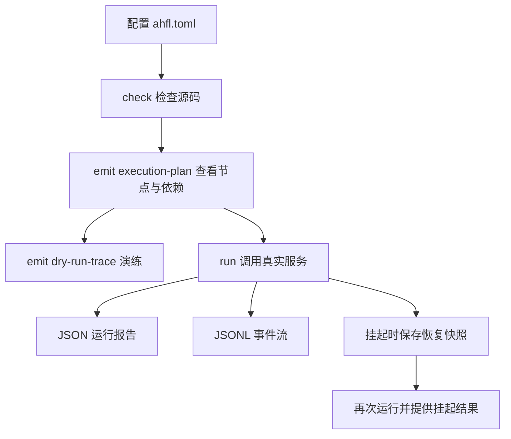

# AHFL 执行与包指南

本指南说明如何配置 workflow 输入和模型服务、演练节点依赖、运行并保存结果，以及恢复挂起任务。

先按 [工程配置](./packages.zh.md) 准备 `ahfl.toml`，按 [CLI 工作流](./cli.zh.md) 检查源码。外部写入和资金操作的声明与验证见 [行为约束与验证](./assurance.zh.md)。

## 先检查，再运行



执行计划描述节点和依赖；dry run 使用预设结果，不调用真实服务；`run` 的报告和事件描述实际执行。

## 推荐执行路径

对于新的 package，先走这条路径，再接入真实 provider：

1. `check`：确认 package、类型、Agent/flow/workflow 通过静态检查。
2. `dump package-graph`、`emit package-review`、`emit execution-plan`：确认 target、
   exports、DAG、node input reads 与 return read。
3. `emit dry-run-trace`：用 mock capability 演练而不调用外部系统。
4. 在 `ahfl.toml` 中定义 `[run]` 和可选 profile；为 provider 配置 secret handle。
5. `run --output-format jsonl`：验证真实 lifecycle、usage、retry/fallback 与 diagnostics。
6. 对高风险外部调用，运行 `validate` 检查声明，并按 [行为约束与验证](./assurance.zh.md) 测试故障、预算和恢复路径。

## Package manifest 与 handoff target

AHFL 的公开工程配置入口是 `ahfl.toml`。Package 身份、module root、target、导出和依赖属于同一份 manifest；多 package 工程由 `ahfl.workspace.toml` 选择 member package。

最小 handoff target：

```toml
[package]
name = "refund-audit"
version = "0.1.0"
edition = "2026"
kind = "application"

[module]
prefix = "refund_audit"
root = "src"

[exports]
modules = ["main"]

[targets.workflow]
kind = "handoff"
entry = "refund_audit::main::RefundAuditWorkflow"
exports = [{ kind = "workflow", name = "refund_audit::main::RefundAuditWorkflow" }]

[dependencies]
std = { source = "sysroot" }
```

`[run]` 是运行配置，不是 handoff target 的替代品。它指定默认 target、输入、
展示格式和 verbosity，使配置完整的 package 可以直接运行 `ahflc run`：

```toml
[run]
target = "workflow"
input = "inputs/high-severity.json"
output_format = "human"
verbosity = "normal"

[run.profiles.low-risk]
input = "inputs/low-risk.json"
output_format = "jsonl"
verbosity = "trace"
```

LLM 配置通常不写进 package，而是由用户一次性放在用户级全局文件
`~/.ahfl/llm_config.json` 里。解析顺序为 `--llm-config` > profile
`llm_config` > `[run].llm_config` > `~/.ahfl/llm_config.json`；因此全局配置
一次写好，所有 package 裸跑 `ahflc run` 即可。仅当某个 package 需要独立
provider 时才在 `[run]` 或 profile 里显式填 `llm_config`（包内相对路径）。

`--profile low-risk` 只覆盖它明确声明的字段；未声明字段回退到 `[run]`。优先级为：
**显式 CLI 参数 > profile 字段 > `[run]` 默认字段**。manifest 和 profile 中的相对文件路径按 `ahfl.toml` 所在目录解析；显式传入 `--input-file`、`--llm-config` 等 CLI 文件路径时，按命令执行的当前目录解析。

检查 package：

```bash
./build/dev/src/tooling/cli/ahflc check \
  --manifest tests/integration/package_graph_manifest/ahfl.toml \
  --target workflow \
  --sysroot .
```

查看 PackageGraph：

```bash
./build/dev/src/tooling/cli/ahflc dump package-graph \
  --manifest tests/integration/package_graph_manifest/ahfl.toml \
  --sysroot .
```

发射 native handoff package：

```bash
./build/dev/src/tooling/cli/ahflc emit native-json \
  --manifest tests/integration/package_graph_manifest/ahfl.toml \
  --target workflow \
  --sysroot .
```

配置交接目标时的常见错误：

| 错误 | 含义 |
|------|------|
| unknown target entry | `targets.<name>.entry` 没有解析到 workflow 或 agent |
| wrong target kind | `targets.<name>.kind` 与 artifact 所需入口类型不一致 |
| unknown capability | target capability binding 引用了不存在的 capability |
| duplicate binding | 同一 capability 绑定重复或冲突 |
| invalid manifest | manifest 字段、类型、路径或 dependency 规则不满足 schema |

## 查看执行计划

在仓库根目录运行，查看事件分诊示例的节点与依赖：

```bash
./build/dev/src/tooling/cli/ahflc emit execution-plan \
  --manifest examples/execution-demo/ahfl.toml --target workflow --sysroot .
```

你应该在 execution plan 中检查：

1. 目标 workflow 是否正确。
2. entry node 是否符合预期。
3. `after` 依赖是否形成正确 DAG。
4. 每个 node 的目标 agent、初始状态、终态和输入读取是否正确。
5. capability binding 是否落到正确 node。

## 使用 mock 演练

Dry run 用 mock capability 结果演练 workflow，不调用真实外部系统。

Mock 文件示例：

```json
{
  "format": "ahfl.capability-mocks",
  "mocks": [
    {
      "capability_name": "lib::agents::Echo",
      "result_fixture": "fixture.echo.ok",
      "invocation_label": "echo-runtime"
    }
  ]
}
```

以下命令使用仓库自带的 workflow 和 mock 文件：

```bash
./build/dev/src/tooling/cli/ahflc emit dry-run-trace \
  --manifest tests/integration/workflow_value_flow/app/ahfl.toml \
  --target workflow --sysroot . \
  --capability-mocks tests/golden/dry_run/project_workflow_value_flow.mocks.json \
  --input-fixture fixture.request.basic --run-id run-001
```

Dry-run trace 应重点看：

| 字段 | 说明 |
|------|------|
| `status` | workflow 是否 completed、failed 或 partial |
| `execution_order` | DAG 节点执行顺序 |
| `node_traces` | 每个 node 的目标 Agent、依赖、输入读取和 mock 结果 |
| `capability_bindings` | capability 是否绑定到预期 runtime key |
| `return_summary` | workflow 返回值来自哪里 |

## 选择运行输出

`run --output-format` 支持 `human`、`json`、`jsonl` 和 `quiet`。报告中的 replay（节点状态回顾）和 audit（事件一致性摘要）帮助你检查执行过程；读取实际结果时使用 JSON 或 JSONL。

### 为人和程序选择正确输出

| 场景 | 格式 | 消费方式 |
|---|---|---|
| 交互式排查 | `human` | 读取 workflow、step、result 和简化 usage 摘要 |
| 一次运行的 CI 汇总 | `json` | 读取 `ahfl.run-report` 中的 run、node、usage、replay、audit |
| 审计、失败定位、下游事件处理 | `jsonl --verbosity trace` | 逐行消费 `ahfl.run-event` |
| Unix pipeline 只需要最终值 | `quiet` | 成功时只读取 final value JSON；失败依赖 exit code/stderr |

JSONL 每行包含 `schema: "ahfl.run-event"`、`event_id`、`type`、
`monotonic_offset_ns` 和 `payload`。常见 type：

```text
run_started
workflow_started
node_scheduled
node_started
capability_started
capability_usage_recorded
capability_completed | capability_failed
capability_retry_scheduled
provider_degraded
checkpoint_saved
node_completed | node_failed | node_skipped | node_restored
workflow_completed | workflow_failed
run_completed
```

关联事件时使用 event ID（事件编号）和 invocation ID（外部调用编号），并按事件顺序读取。检查开始事件对应的完成或失败事件，以及调用期间记录的模型用量。失败事件包含 code、message、range、position 和 related notes，可用于定位源码和错误原因。

## 查看可视化执行图

将执行计划保存为 JSON，再生成 HTML：

```bash
AHFLC="$PWD/build/dev/src/tooling/cli/ahflc"
"$AHFLC" emit execution-plan \
  --manifest examples/execution-demo/ahfl.toml --target workflow --sysroot . > plan.json
"$AHFLC" visualize plan.json -o canvas.html
```

在浏览器中打开 `canvas.html` 查看节点和依赖。配置好下面的模型服务后，还可以保存实际运行事件并叠加回放：

```bash
"$AHFLC" run --manifest examples/execution-demo/ahfl.toml --target workflow --sysroot . \
  --output-format jsonl --verbosity trace > run.events.jsonl
"$AHFLC" visualize plan.json run.events.jsonl -o canvas.html
```

回放显示节点状态、耗时、调用次数和时间线；点击节点查看已记录的 Agent 状态路径。也可导出 Mermaid：

```bash
"$AHFLC" visualize plan.json --format mermaid -o workflow.mmd
```

## 真实 LLM 执行

`ahflc run` 使用 OpenAI-compatible LLM Provider 执行 workflow。它需要：

1. 已通过 `check` 的 package。
2. manifest `[run]` / `[run.profiles.<name>]`，或显式 `--workflow`。
3. profile input、`--input-file` 或 `--input`。
4. `~/.ahfl/llm_config.json`，或通过 profile / `--llm-config <path>` 指定配置。
5. 可选的 `--capability-mocks <path>`，用于把 deterministic capability mock 暴露为 LLM function tools。
6. 可选的 `--tool-catalog <path>`，用于把 deterministic runtime tool catalog 暴露为 LLM function tools。
7. 可选的 `--capability-bindings <path>`，用于把 workflow capability 调用直接绑定到 HTTP 或 gRPC JSON transcoding runtime transport。
8. `--output-format human|json|jsonl|quiet` 与 `--verbosity normal|verbose|trace`。

`--input` 必须是 AHFL runtime JSON，并且必须匹配目标 workflow 的 input schema。Struct 输入需要 `_type`，enum 字段需要 `_enum` 和 `_variant`。`run` 会在调用 LLM provider 前拒绝缺字段、额外字段、字段类型错误、struct/enum 名称不匹配和未知 enum variant。

### 连接模型服务

最小配置只需连接信息，下面这些调优字段不必填写：

```json
{
  "endpoint": "https://api.example.com/v1",
  "model": "example-model",
  "api_key_secret": "env:AHFL_LLM_API_KEY"
}
```

| 可选字段 | 缺省行为 | 含义 |
| --- | --- | --- |
| `max_tokens` | 自动，通常为 `1024` | 单次输出预算，受模型物理上限约束 |
| `max_prompt_tokens` | 按容量预留输出及压缩空间；未知容量为 `3072` | 完整 prompt 预算，包括工具历史与定义 |
| `max_total_tokens` | 按模型容量；未知容量为 `4096` | 单次 prompt 与响应合计预算 |
| `json_mode` | `true` | 请求 JSON 输出，返回值仍由本地类型校验 |
| `temperature` | 不发送 | 采用模型服务端默认采样策略；需要时显式覆盖 |

模型容量由官方精确目录或 OpenRouter 元数据识别；未知容量的数值仅为保守应用预算。
工具历史会自动压缩，并与[模型会话恢复](#模型会话自动恢复与压缩)配合。temperature
缺省不发送，避免向不支持该参数的模型强制传值；显式值须为 `[0, 2]` 的有限数值，
并由使用者确认模型支持。采样参数不能保证输出确定性。

以下是高级配置字段的覆盖示例，普通用户无需复制整段：

```json
{
  "endpoint": "https://api.example.com/v1",
  "model": "example-model",
  "api_key_secret": "env:AHFL_LLM_API_KEY",
  "auth_scheme": "bearer",
  "auth_header": "Authorization",
  "temperature": 0.1,
  "max_tokens": 1024,
  "max_prompt_tokens": 3072,
  "max_total_tokens": 4096,
  "prompt_token_cost_per_million": 0.25,
  "completion_token_cost_per_million": 1.25,
  "max_total_cost_usd": 0.01,
  "max_workflow_total_tokens": 12000,
  "max_node_total_tokens": 8000,
  "max_workflow_total_cost_usd": 0.05,
  "max_node_total_cost_usd": 0.02,
  "token_budget_policy": "fail",
  "capability_token_budgets": [
    {
      "capability": "support::ClassifyTicket",
      "max_tokens": 512,
      "max_prompt_tokens": 2048,
      "max_total_tokens": 3072,
      "max_total_cost_usd": 0.005,
      "policy": "warn"
    }
  ],
  "json_mode": true,
  "stream": false,
  "timeout_seconds": 30,
  "max_retries": 2,
  "response_cache_enabled": false,
  "response_cache_max_entries": 128,
  "response_cache_ttl_seconds": 300,
  "refresh_secrets_before_use": false,
  "secret_providers": [
    {
      "kind": "env",
      "prefix": "env",
      "default_for_unqualified": true
    },
    {
      "kind": "vault",
      "prefix": "vault",
      "address": "https://vault.example.com",
      "token_env": "AHFL_VAULT_TOKEN",
      "mount_path": "kv",
      "timeout_seconds": 5
    },
    {
      "kind": "cloud",
      "prefix": "cloud",
      "address": "https://secrets.example.com",
      "token_env": "AHFL_CLOUD_SECRET_TOKEN",
      "project": "agent-prod",
      "version": "latest",
      "timeout_seconds": 5
    }
  ],
  "tool_choice": "auto",
  "max_tool_rounds": 5,
  "fallback_providers": [
    {
      "name": "backup",
      "endpoint": "https://backup.example.com/v1",
      "model": "backup-model",
      "api_key_secret": "AHFL_BACKUP_LLM_API_KEY",
      "auth_scheme": "api_key_header",
      "auth_header": "x-api-key",
      "priority": 10
    }
  ]
}
```

### 配置认证与凭证

`endpoint`、`model` 必填。认证信息推荐使用 `api_key_secret`；裸 handle（例如
`AHFL_LLM_API_KEY`）由默认 secret provider 解析。显式 handle 可以
写成 `env:AHFL_LLM_API_KEY`、`vault:llm/api-key` 或 `cloud:llm/api-key`。
`secret_providers` 定义 `env`、`vault`、`cloud` 链；secret 缺失、provider prefix
未配置、认证失败、404、超时或空值都会在调用 LLM endpoint 前 fail closed。
`refresh_secrets_before_use: true` 会在解析 `api_key_secret`、`oauth2_token_secret`
和 mTLS secret handle 前刷新凭证。`api_key` 字段接受直接提供的凭证；需要保存或共享配置时，使用 `api_key_secret` 引用凭证。字符串中的 `${ENV_VAR}` 会展开。

`auth_scheme` 支持 `bearer`、`api_key_header`、`oauth2_bearer`、
`oauth2_client_credentials` 与 `mtls`。前四种最终写入 HTTP header；OAuth2 名称表示
从 `oauth2_token_secret` 解析可用 access token，当前 runtime 不替你执行 OAuth grant。
`mtls` 需要 client certificate 与 key 的 path 或 secret handle。fallback provider 可
覆盖 auth/credential；未声明的字段从主 provider 继承。

### 限制 token 用量与费用

通常无需填写 token 预算。`max_tokens`、`max_prompt_tokens`、`max_total_tokens` 省略时自动分配：官方 OpenAI endpoint 的受支持精确模型和 OpenRouter 元数据提供物理容量；未知服务使用保守的 4096 总量、1024 输出、3072 prompt 应用预算。备用模型单独解析容量。服务没有提供容量、又需要处理更大输入时，可由服务管理员设置 `model_context_window_tokens` 和 `model_max_output_tokens`。

如需费用或业务上限，再显式设置 `max_tokens`（单次输出）、`max_prompt_tokens`（单次 prompt）和 `max_total_tokens`（单次总量）；总量必须覆盖 prompt 与输出。`capability_token_budgets` 可按 capability 覆盖预算、费用和策略，未覆盖字段继承全局配置。完整业务输入保持原样，工具历史接近可用容量时自动压缩；每个主模型、备用模型及压缩请求都校验完整请求与响应预留。无法压缩到预算内则明确失败。token 计数仍为启发式估计，模型服务可能因实际计数不同而拒绝请求。

`max_workflow_total_tokens` / `max_workflow_total_cost_usd` 限制同一任务的累计用量；`max_node_total_tokens` / `max_node_total_cost_usd` 限制同一节点的累计用量，`0` 表示关闭。持久会话恢复后继续计入已记录用量及中断请求的保守预留，压缩摘要也会消耗模型额度。

使用运行事件中的用量记录查看 token 与估算费用，使用完成事件的 `cache_hit` 判断是否复用了响应。`token_budget_policy: "fail"` 会让超限调用和 workflow 失败；`"warn"` 会记录警告并允许调用继续。`prompt_token_cost_per_million` 和 `completion_token_cost_per_million` 是可选成本估算费率，必须为非负数。

### 配置备用模型服务

`fallback_providers` 可配置 OpenAI-compatible 备用 provider。主 provider 在 HTTP 失败并耗尽自身重试后，runtime 会按 fallback `priority` 从高到低继续尝试。服务切换会记录为降级事件；所有备用服务也失败时，capability 和 workflow 失败。fallback provider 同样支持 `api_key_secret`，缺失或为空会在 `run` 启动阶段失败。

需要关联调用开始、用量、结果和服务切换时，使用 `--output-format jsonl --verbosity trace` 保存 stdout，按 payload 中的 invocation ID 关联事件。失败事件包含诊断编号、错误码、消息和源码位置。

### 使用流式响应

`stream: true` 会请求 OpenAI-compatible streaming response，并把 SSE `data:` chunks 合成为最终 response content 后再进入 AHFL return type 解析。stream 必须以 `data: [DONE]` 完成；HTTP 成功但 SSE 未完成会作为 interruption-class capability failure，不会把部分 content 当成成功结果继续解析。JSONL 记录调用结果，不逐段输出模型返回的文本。

### 复用模型响应

设置 `response_cache_enabled: true` 启用响应缓存，使用 `response_cache_max_entries` 控制容量、`response_cache_ttl_seconds` 控制有效期。缓存只用于不调用工具的请求，且只有响应通过 AHFL 返回类型校验后才会保存；命中时不再向模型服务发起请求。

设置 `response_cache_path` 后，未过期的缓存可供后续进程使用；未设置时只在当前进程内复用。缓存文件包含模型响应内容，应按运行产物管理访问权限并排除在源码仓库之外。完成事件中的 `cache_hit` 表示是否命中缓存。

### 联调工具与外部服务

`--capability-mocks` 使用与 mock dry run 相同的 `ahfl.capability-mocks` 文件。`run` 会把每个 mock selector 暴露为 OpenAI-compatible function tool：tool 名称以 `ahfl_` 开头，selector 中非字母、数字、`_`、`-` 的字符会替换为 `_`，超长名称会附加稳定 hash 后截断。LLM 发起 tool call 后，运行时返回 mock 的 `result_fixture`；这适合 deterministic 本地联调。无效参数或未知工具会使调用失败。

`--tool-catalog` 使用 `ahfl.llm_tool_catalog` 文件，把 deterministic runtime tool catalog 暴露为 OpenAI-compatible function tools。每个 tool 需要 `name`、可选 `description`、可选 `parameters` 或 `params_schema_json` JSON object，并且必须在 `result` AHFL value JSON 与 `failure` object 中二选一。`failure.kind` 支持 `error` 和 `timeout`；`error` 需要 `message`，`timeout` 需要正整数 `timeout_ms` 并可选 `message`。LLM 发起 tool call 后，runtime 解析 arguments JSON、调用 catalog tool，并把 `result` 作为 tool message 返回 provider；catalog schema negative、catalog-specific invalid args/unknown tool、tool timeout 和 tool failure 都会 fail closed。

`--capability-bindings` 使用 `ahfl.runtime_capability_bindings` 文件，将指定 capability 绑定到外部服务。已配置的 capability 优先使用 binding；其他 capability 使用模型服务。HTTP binding 需要 `url`，可选 `method`、`headers`、`timeout_ms`、`retry`、`circuit_breaker` 和 `auth`；gRPC JSON transcoding binding 使用 `transport: "grpc_json_transcoding"`，需要 `endpoint`、`service` 和 `method`。`auth.scheme` 支持 `none`、`bearer`、`oauth2_client_credentials` 和 `mtls`，secret key 会复用 `--llm-config` 中配置的 secret provider 链解析。binding 响应必须是 AHFL value JSON，并会按 capability 返回类型做 schema 校验；HTTP/gRPC timeout、retry exhaustion、schema mismatch 和 malformed JSON 会通过 workflow runtime 诊断 fail closed。

最小 catalog 示例：

```json
{
  "format": "ahfl.llm_tool_catalog",
  "tools": [
    {
      "name": "lookup_context",
      "description": "Return deterministic context",
      "parameters": {
        "type": "object",
        "additionalProperties": true
      },
      "result": {
        "value": "catalog-context"
      }
    }
  ]
}
```

准备好模型配置后，从仓库根目录运行。需要工具或服务绑定时，在此命令中追加指向自己配置文件的 `--tool-catalog`、`--capability-bindings` 或 `--capability-mocks`：

```bash
./build/dev/src/tooling/cli/ahflc run \
  --workflow app::main::ValueFlowWorkflow \
  --input '{"_type":"lib::types::Request","value":"hello"}' \
  --llm-config ~/.ahfl/llm_config.json \
  --output-format jsonl \
  --verbosity trace \
  --manifest tests/integration/workflow_value_flow/app/ahfl.toml \
  --target workflow --sysroot . > /tmp/ahfl-run-events.jsonl
```

### 排查运行失败

`run` 会在以下场景拒绝执行：

| 场景 | 结果 |
|------|------|
| manifest/profile 和 CLI 都无法选择 workflow | 参数错误 |
| profile、`--input-file` 和 `--input` 都未提供输入 | 参数错误 |
| 配置文件不存在 | 执行失败 |
| `endpoint` / `model` 缺失 | 执行失败 |
| `max_prompt_tokens + max_tokens > max_total_tokens` | 执行失败 |
| token cost 费率或累计 token/cost 预算为负数 | 执行失败 |
| `token_budget_policy` 不是 `fail` / `warn` | 执行失败 |
| `capability_token_budgets` 中 capability 为空、重复、预算非法或 policy 非法 | 执行失败 |
| `api_key_secret` 指向的 secret handle 缺失、provider prefix 未配置或解析为空 | 执行失败 |
| Vault secret provider 未提供 `token` 或 `token_env` | 执行失败 |
| fallback provider 的 credential 无法解析 | 执行失败 |
| 非 mTLS provider 未提供 `api_key_secret`、`oauth2_token_secret` 或 `api_key` | 执行失败 |
| `auth_scheme` 不属于支持集合 | 执行失败 |
| 非 mTLS authentication 未能解析有效 auth header | 执行失败 |
| mTLS 缺少 client certificate 或 private key | 执行失败 |
| streaming response 缺少 `data: [DONE]` | 执行失败 |
| `response_cache_enabled` 为 true 但 cache 容量或 TTL 非正数 | 执行失败 |
| 设置了 `response_cache_path` 但 `response_cache_enabled` 不是 true | 执行失败 |
| `--capability-mocks` 文件不存在或格式非法 | 执行失败 |
| capability mock selector 映射到重复 tool 名称 | 执行失败 |
| `--tool-catalog` 文件不存在、schema 不支持或 tool 定义非法 | 执行失败 |
| `--tool-catalog` 与 `--capability-mocks` 产生重复 tool 名称 | 执行失败 |
| `--capability-bindings` 文件不存在、schema 不支持、capability 未声明或 transport 配置非法 | 执行失败 |
| `--capability-bindings` 指向的 HTTP/gRPC runtime 调用失败或响应不匹配 capability 返回类型 | 执行失败 |
| `--input` 不是合法 JSON | 执行失败 |
| `--input` 与 workflow input schema 不匹配 | 执行失败 |
| workflow 运行失败或产生 runtime error | 非零退出 |

## 挂起与恢复 workflow

使用 `--recovery-store <path>` 保存和恢复任务。外部能力返回 `PENDING` 时，workflow 挂起并保存恢复快照；再次使用相同路径运行时，会读取已完成调用的结果并恢复到挂起位置。

快照仅接受 `format: "ahfl.workflow-recovery"` 的当前完整结构，包括必填的 `suspended`（对象或显式 null）。缺字段、旧结构或类型不符均拒绝，不自动迁移。快照文件不存在时开始新运行；文件不可读、损坏或格式不受支持时，命令以退出码 `1` 失败，并在调用外部服务前停止。文件存在且有效时会用于恢复，因此启动另一个独立任务应选择另一个快照路径。

先运行不需要真实模型服务的 [挂起恢复示例](../../examples/durable-resume/README.md)：

1. 使用 `--suspend-capability` 让指定能力返回 `PENDING`，同时传入 `--recovery-store`。
2. 确认输出是挂起状态，并保存好快照文件。
3. 再次指定相同的 `--recovery-store`，通过 `--resume-pending-result` 提供符合该 capability 返回类型的 JSON 结果。
4. 检查恢复后的 workflow 结果与外部调用记录。

恢复会复用快照中已完成的 capability 结果；未匹配到预期调用位置时停止恢复。这个机制不等于任意崩溃时都能保证外部副作用只发生一次：服务端仍需实现幂等键、回执和事务保障。

### 模型会话自动恢复与压缩

LLM 会话默认与外层快照配合，无需添加 `--recovery-store`。任务在 `~/.ahfl/runs` 下自动保存进度；进程中断后，再执行相同程序、workflow、输入和配置的命令即可继续。完成后的再次运行开始新任务。显式 `--recovery-store` 仍用于指定恢复位置；该位置绑定原任务，不能拿来恢复其他输入或配置。

显式路径在全新任务正常完成后清理本次生成的快照和模型会话。如果命令启动时已存在快照，恢复完成后继续保留原任务记录，沿用手工恢复的文件行为；启动独立任务应选择新路径。

工具对话接近可用 prompt 容量的 80% 时，会自动总结较旧的完整交换。规则、完整输入和最近交换保留；模型可通过只读历史工具取回旧记录的原文。不能缩小、输入本身太大或摘要非法时会停止，并保留可排查的原始记录。

已经保存完成回执的工具直接复用结果。如果进程恰好在工具已开始、回执尚未保存时中断，系统无法确认外部提交状态，会停止并报告 `unknown commit`，不会自动重跑该工具。模型请求重试可能产生额外费用，中断前的用量预留不会因恢复而清零。

模型会话的 pending 结果由保存的会话提供；对该位置使用 `--resume-pending-result` 会被拒绝。上面的手工挂起示例没有模型会话，仍可手工提供结果。恢复文件损坏、密钥丢失或绑定不符时，运行在调用模型前停止。文件包含对话原文，使用私有目录及文件权限保存，当前支持 macOS/Linux。

## 部署前检查

在目标服务和真实配置下测试输入校验、节点失败、重试、备用模型、预算超限和恢复路径，保存对应版本的 JSON 报告或 JSONL 事件。具体检查项见 [行为约束与验证](./assurance.zh.md)。

`grpc_json_transcoding` binding 通过 HTTP/JSON 接入 gRPC 网关；当前不支持原生 gRPC / Protobuf transport。
