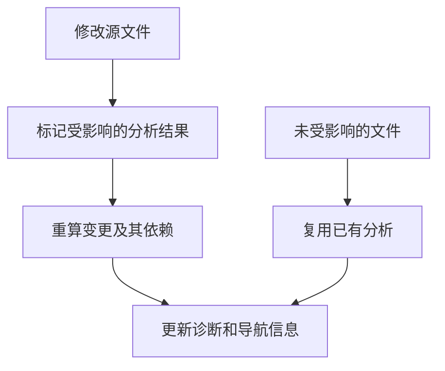

# 使用增量分析与排查缓存问题

在编辑器中连续修改 AHFL 源码时，语言服务器会复用仍然有效的分析结果，并重新分析受影响的依赖。本指南说明这种复用何时生效，以及如何查看分析过程或清理持久缓存。

## 哪些操作能复用分析

| 场景 | 行为 |
| --- | --- |
| 同一个语言服务器进程中连续编辑 | 重新分析变更文件及依赖它的部分，复用其他结果 |
| 连续两次独立执行 `ahflc check` | 每次都是新进程，不共享进程内分析结果 |
| 重启默认发布的 `ahfl-lsp` | 重新分析；默认未开启磁盘持久缓存 |
| 嵌入语言服务并显式开启持久缓存 | 可在重启后复用部分类型分析结果 |

日常编辑无需启动额外的增量编译工具。编辑器安装与工程设置见 [VS Code 配置](../reference/lsp-vscode-extension.zh.md)。



## 观察分析过程

在仓库根目录运行：

```bash
AHFL_QUERY_ENGINE_TRACE=1 ./build/dev/src/tooling/cli/ahflc check \
  --manifest examples/execution-demo/ahfl.toml --target workflow --sysroot .
```

`AHFL_QUERY_ENGINE_TRACE` 输出查询引擎（QueryEngine）的分析路由信息，可用于定位重复分析。单次 `check` 的输出不能说明另一次独立进程会复用结果；要观察连续编辑的效果，应在同一个语言服务器会话中比较修改前后的诊断响应。

## 嵌入语言服务时启用持久缓存

如果你在自己的应用中使用 AHFL 的 `AnalysisService`，可调用 `set_persistent_cache_enabled(true)` 开启持久缓存。当前发布的 `ahfl-lsp` 没有对应开关，设置缓存目录不会自动启用这项能力。

持久缓存保存已完成类型检查的中间表示（Typed HIR），以源文件为单位。复用后可以立即读取类型分析相关信息；悬停、补全和引用导航仍需重建完整的分析环境。没有 package manifest 的独立源文件不参与持久缓存。

缓存按项目隔离，并核对源码内容、工具链和分析元数据。编辑或保存文件时，受影响的缓存会失效；文件损坏、格式不匹配或工具链变化时，会重新进行完整分析。

## 缓存位置与回收

| 设置或策略 | 行为 |
| --- | --- |
| `XDG_CACHE_HOME` | 缓存根目录为 `$XDG_CACHE_HOME/ahfl`；未设置时使用 `~/.cache/ahfl` |
| 项目目录 | 每个项目使用规范化根路径的 SHA-256 哈希作为子目录名 |
| 空闲过期 | 超过 7 天未访问的条目在后续缓存操作时回收 |
| 容量限制 | 上限 1 GiB；写入时优先回收最近最少使用的条目 |

过期时间和容量上限没有运行时配置项。不要让多个进程同时写入同一个项目缓存目录；需要并行运行嵌入服务时，为各进程设置独立的 `XDG_CACHE_HOME`。

## 手动清理缓存

先关闭使用该缓存目录的语言服务，避免它在清理期间重新写入。缓存是可重新生成的分析结果，删除后不会删除源码。

清除全部项目缓存：

```bash
rm -rf "${XDG_CACHE_HOME:-$HOME/.cache}/ahfl"
```

只清除一个项目时，在项目根目录计算子目录名：

```bash
python3 -c "import hashlib,os; print(hashlib.sha256(os.path.realpath('.').encode()).hexdigest())"
```

再将输出替换到下面的路径中：

```bash
rm -rf "${XDG_CACHE_HOME:-$HOME/.cache}/ahfl/<project-root-hash>"
```

`ahflc` 没有 `--cache-dir`、`--no-cache` 或 `--clear-cache` 参数。

## 排查常见问题

| 问题 | 检查与处理 |
| --- | --- |
| 重启语言服务器后分析仍然耗时 | 默认发布的服务器未开启持久缓存；这是预期行为 |
| 嵌入服务没有写缓存 | 确认已显式开启缓存，源码属于 manifest 工程，且缓存目录可写 |
| 怀疑缓存导致陈旧诊断 | 关闭服务，删除对应项目缓存，再重新打开工程；若仍存在，按 [调试指南](./debugging.zh.md) 定位源码或配置问题 |
| 磁盘上有损坏条目 | 下次读取会重新分析；也可手动清理 |
| 工具链升级后没有缓存命中 | 缓存不再匹配当前工具链，会重新分析 |
| 缓存占用空间需要立即释放 | 关闭服务后清理对应项目或全部缓存 |

需要实现缓存读取工具时，格式契约见 [持久缓存设计](../rfcs/0016-incremental-cache-contract.zh.md)。日常使用无需编辑缓存文件。
