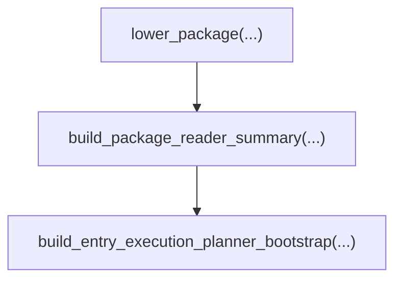

# 导出与接入 Native Handoff 包

Native handoff 包是 AHFL 编译器生成的交接产物，包含 Agent、workflow、外部能力绑定和合同信息，供接入程序读取或构建执行计划。本指南说明如何在 `ahfl.toml` 中配置交接目标、导出 JSON、检查产物，以及通过 C++ 接口读取包内容。

## 配置交接目标

在 package 的 `ahfl.toml` 中声明 `kind = "handoff"` 的 target（编译目标）。以下配置取自仓库中的 `tests/integration/workflow_value_flow/app/ahfl.toml`：

```toml
[targets.workflow]
kind = "handoff"
entry = "app::main::ValueFlowWorkflow"
exports = [
  { kind = "workflow", name = "app::main::ValueFlowWorkflow" },
  { kind = "agent", name = "lib::agents::AliasAgent" },
]

[[targets.workflow.capability_bindings]]
capability = "lib::agents::Echo"
binding_key = "runtime.echo"
```

`entry` 指定交接入口，`exports` 列出对外提供的目标。名称必须对应源码中声明的 Agent 或 workflow。完整 package 配置和 sysroot（标准库根目录）的选择方式见 [工程使用指南](./packages.zh.md)。

`capability_bindings` 将源码中的外部能力关联到接入程序识别的绑定键（`binding_key`）。例如，接入程序可用 `runtime.echo` 查找对应的能力实现。

## 导出交接包

先按 [入门教程](./getting-started.zh.md) 构建 `ahflc`。在仓库根目录运行：

```bash
./build/dev/src/tooling/cli/ahflc emit native-json \
  --manifest tests/integration/workflow_value_flow/app/ahfl.toml \
  --target workflow \
  --sysroot . > handoff.native.json
```

`--target workflow` 选择上面的 `[targets.workflow]`。生成的 `handoff.native.json` 使用 `ahfl.native-package` 格式，供接入程序读取。使用自己的工程时，将 `--manifest`、`--target` 和 `--sysroot` 替换为对应路径与名称。

## 检查交接内容

使用同一份 manifest 和 target 生成包审查摘要：

```bash
./build/dev/src/tooling/cli/ahflc emit package-review \
  --manifest tests/integration/workflow_value_flow/app/ahfl.toml \
  --target workflow \
  --sysroot .
```

`package-review` 展示所选交接目标的包信息。检查入口、导出目标和外部能力绑定是否符合预期，再将产物交给接入程序。格式详情见 [Native Runtime 产物参考](../reference/native-runtime-artifacts.zh.md)。

## 通过 C++ 接口接入

接入程序（consumer）是读取交接包的应用。嵌入 AHFL 编译器的 C++ 程序可使用 `ahfl::handoff` 命名空间下的接口，声明位于 `include/ahfl/compiler/handoff/package.hpp`。

这些接口接收内存中的 `handoff::Package`。`lower_package(...)` 将已编译的中间表示（IR）和 `PackageMetadata` 转为该对象；导出的 JSON 是另一种产物表示，不能直接作为这些函数的参数。



| 接口 | 用途 |
| --- | --- |
| `build_package_reader_summary(package)` | 读取包摘要，检查入口、导出目标与外部能力绑定的一致性。 |
| `build_entry_execution_planner_bootstrap(package)` | 为包中声明的 workflow 入口生成规划所需的节点和依赖信息。 |
| `build_execution_planner_bootstrap(package, workflow_name)` | 为指定的 workflow 生成规划信息。 |

每次调用后先检查返回值的 `has_errors()`，处理 `diagnostics` 中的错误，再使用摘要或规划信息。入口规划要求 package 定义 workflow 入口；缺少入口或入口类型为 Agent 时会报错。规划接口也会检查 workflow 节点依赖和目标类型。

## 执行 workflow

导出交接包或生成规划信息不会执行 workflow，也不会自动完成调度、重试、超时、部署或外部服务连接。需要实际运行时，按 [执行与包指南](./execution.zh.md) 配置 provider 并使用 `ahflc run`；需要查看编译期执行计划时，使用：

```bash
./build/dev/src/tooling/cli/ahflc emit execution-plan \
  --manifest tests/integration/workflow_value_flow/app/ahfl.toml \
  --target workflow \
  --sysroot .
```

完整命令参数见 [CLI 命令参考](../reference/cli-commands.zh.md)。
