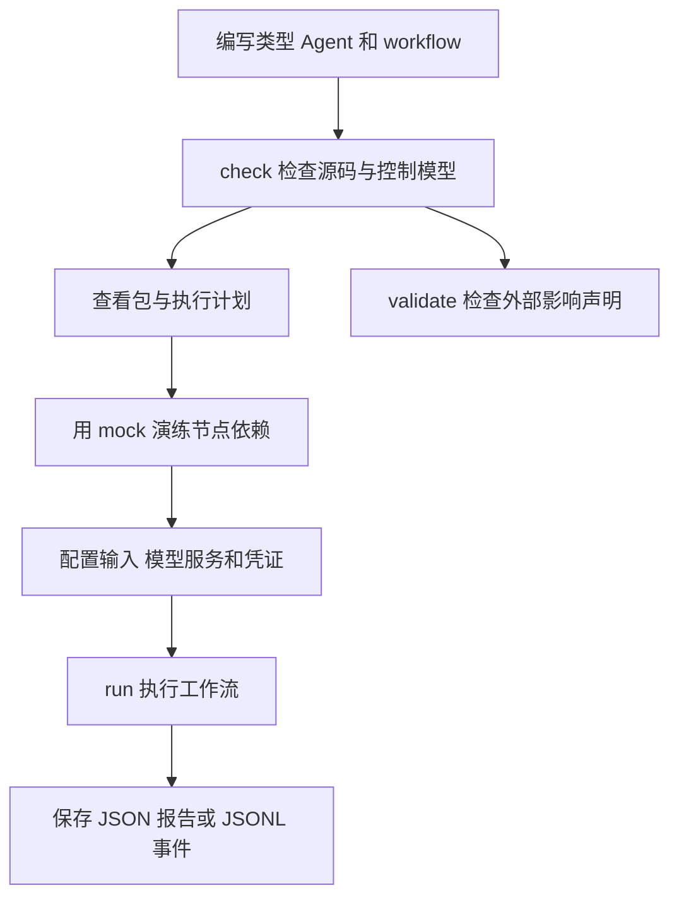
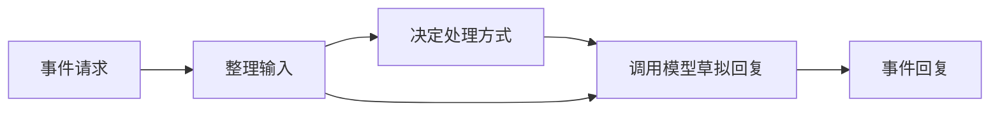

# AHFL 用户指南总览

AHFL（Agent Handoff Flow Language）是一门用于编写、检查和执行 Agent 工作流的强类型领域专用语言（DSL）。你可以在源码中定义输入输出、Agent 状态、外部调用和节点依赖，再用编译器检查模型、演练执行顺序，并保存运行报告。

## 按任务选择指南

| 你想做什么 | 阅读指南 |
| --- | --- |
| 安装工具链并跑通第一个示例 | [入门教程](./getting-started.zh.md) |
| 编写自己的类型、Agent 和 workflow | [建模指南](./authoring.zh.md) |
| 选择命令、格式化源码或排查编译失败 | [CLI 工作流](./cli.zh.md) |
| 配置多个源码文件、依赖和标准库 | [工程配置](./packages.zh.md) |
| 配置模型服务、运行 workflow 和恢复挂起任务 | [执行与包指南](./execution.zh.md) |
| 检查高风险外部调用和理解验证结果 | [行为约束与验证](./assurance.zh.md) |
| 将编译结果交给自己的接入程序 | [Native handoff](./native-handoff.zh.md) |
| 设置断点、查看状态和变量 | [调试指南](./debugging.zh.md) |
| 了解编辑器增量分析、排查缓存问题 | [增量编译指南](./incremental-compilation.zh.md) |
| 处理可缺失值、错误、字符串和集合 | [标准库示例](./standard-library.zh.md) |

## 一个工作流需要哪些文件

| 文件 | 放什么 |
| --- | --- |
| `.ahfl` | 业务数据类型、Agent 状态和处理逻辑、外部能力声明、workflow 节点及约束 |
| `ahfl.toml` | 包名称、源码目录、依赖、编译目标和默认运行参数 |
| 输入 JSON | 符合 workflow 输入类型的业务数据 |
| `~/.ahfl/llm_config.json` | 模型服务地址、模型名、凭证引用和调用预算 |

多包工程还可以使用 `ahfl.workspace.toml`。密钥通过环境变量或密钥服务提供，不写进源码或 manifest（包配置文件）。

`capability` 表示 Agent 可调用的外部能力，例如模型、订单查询或工单创建。Agent 必须在白名单中声明它；实际服务地址和认证信息放在运行配置中。

## 从编写到运行



1. 在 `.ahfl` 中定义输入输出、Agent 状态、处理逻辑和 workflow。
2. 用 `ahflc check` 修复导入、类型和状态转移错误，并阅读控制模型验证结果。
3. 用 `dump package-graph` 确认源码和依赖，用 `emit execution-plan` 核对节点顺序与输入来源。
4. 用 `emit dry-run-trace` 和 mock（预设的外部能力结果）检查演练路径。
5. 在 manifest 中配置 `[run]`，准备输入 JSON 和模型服务配置，再执行 `ahflc run`。
6. 需要自动处理结果时，选择 `--output-format json`；需要逐条追踪运行过程时，选择 `jsonl`。
7. 对持久写入或资金操作，声明幂等键、回执、审批与补偿策略，并用 `validate` 检查声明是否完整。

## 跑通事件分诊示例

[`examples/execution-demo`](../../examples/execution-demo/README.md) 将事件分诊拆成三个 Agent：



按 [入门教程](./getting-started.zh.md) 构建工具链后，在仓库根目录检查示例并查看计划：

```bash
AHFLC="$PWD/build/dev/src/tooling/cli/ahflc"
"$AHFLC" check --manifest examples/execution-demo/ahfl.toml \
  --target workflow --sysroot .
"$AHFLC" emit execution-plan --manifest examples/execution-demo/ahfl.toml \
  --target workflow --sysroot .
```

这两个命令不调用模型服务。实际运行前，按照示例 README 配置 `~/.ahfl/llm_config.json` 和凭证环境变量，然后执行：

```bash
cd examples/execution-demo
"$AHFLC" run --output-format json
```

## 判断检查结果能说明什么

- 类型和结构检查能发现输入输出不匹配、未知状态、非法转移和错误节点依赖。
- 默认形式验证检查有限控制模型。声明的时序目标需要结合报告中的环境假设阅读；`conditional` 表示结论依赖尚未证明的数据假设。
- `--verify-data-contracts` 请求数据规则的公式证明：在 `requires` 前提成立时，目标是否成立。它不证明每条 flow 语句或外部服务的实现。
- `runtime_contract_checks: not_implemented` 表示合同中的 predicate（布尔判定）不会自动变成运行时校验；业务服务仍需实际检查前提和结果。
- 运行报告描述这一次执行。部署前仍需在自己的模型服务、业务数据和故障条件下验证工作流。

详细状态字段和失败处理见 [行为约束与验证](./assurance.zh.md)。

## 查询语法与参数

- [语言规范](../spec/core-language.zh.md)：语法、类型和状态机规则。
- [行为约束规范](../spec/assurance.zh.md)：外部影响和验证规则。
- [CLI 命令参考](../reference/cli-commands.zh.md)：参数、输入组合和产物。
- [运行产物参考](../reference/native-runtime-artifacts.zh.md)：JSON/JSONL、恢复快照和字段定义。
- [错误码参考](../reference/error-codes.zh.md)：诊断含义和修复方法。
