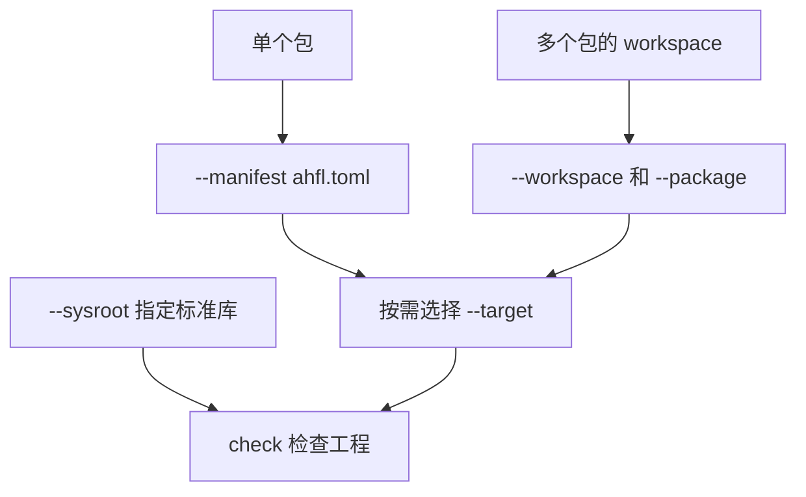

# 配置 AHFL 工程

使用 `ahfl.toml` 配置单个 package（包），使用 `ahfl.workspace.toml` 组织多个包，并通过 sysroot 指定标准库。本指南说明目录布局、配置字段、常用命令和配置错误的处理方式。

关联文档：

- [CLI 命令参考](../reference/cli-commands.zh.md)
- [Native Handoff Usage](./native-handoff.zh.md)
- [Native Runtime Artifacts](../reference/native-runtime-artifacts.zh.md)

## 配置要点

1. 一个 AHFL package 必须由 `ahfl.toml` 描述；package identity、module root、exports、targets 和 dependencies 属于同一份 manifest。
2. 多 package 工程必须由 `ahfl.workspace.toml` 枚举成员；workspace 不会隐式包含未声明的子目录。
3. `std` 是 sysroot package；选中的 sysroot 必须包含 `std/ahfl.toml`。
4. 检查解析后的包、依赖和目标配置时，使用 `ahflc dump package-graph`。
5. 在 `[targets.<name>]` 中声明 native handoff 目标的入口、导出和能力绑定。

## 术语

| 术语 | 含义 |
|---|---|
| package manifest | `ahfl.toml`，描述一个 AHFL package 的身份、源码根、导出模块、target 和依赖。 |
| workspace manifest | `ahfl.workspace.toml`，声明一组 package 成员和 workspace 级依赖策略。 |
| sysroot | 包含 `std/ahfl.toml` 的目录；通过 `--sysroot`、`AHFL_SYSROOT` 或编译期默认值选择。 |
| PackageGraph | 解析配置后得到的包图，用于查看依赖、源码目录、标准库和编译目标。 |
| target | manifest 中 `[targets.<name>]` 声明的可编译或可发射入口，例如 handoff workflow。 |

## 选择要检查的工程



命令行通过 `--manifest` 选择单个包，或通过 `--workspace --package` 选择 workspace 中的包；需要指定编译目标时，再传入 `--target`。

## 最小目录

单 package 工程：

```text
refund-audit/
  ahfl.toml
  src/main.ahfl
```

最小 `ahfl.toml`：

```toml
[package]
name = "refund-audit"
version = "0.1.0"
edition = "2026"
kind = "application"

[module]
prefix = "refund_audit"
root = "src"

[exports]
modules = ["main"]

[targets.workflow]
kind = "handoff"
entry = "refund_audit::main::RefundAuditWorkflow"
exports = [{ kind = "workflow", name = "refund_audit::main::RefundAuditWorkflow" }]

[dependencies]
std = { source = "sysroot" }
```

多 package workspace：

```text
commerce-workflows/
  ahfl.workspace.toml
  packages/refund-audit/ahfl.toml
  packages/refund-audit/src/main.ahfl
  packages/audit-core/ahfl.toml
  packages/audit-core/src/lib.ahfl
```

最小 `ahfl.workspace.toml`：

```toml
[workspace]
name = "commerce-workflows"
members = [
  "packages/refund-audit",
  "packages/audit-core",
]

[dependencies]
std = { source = "sysroot" }
```

## 常用命令

检查单 package：

```bash
ahflc check \
  --manifest tests/integration/package_graph_manifest/ahfl.toml \
  --target workflow \
  --sysroot .
```

检查 workspace 中的 package：

```bash
ahflc check \
  --workspace tests/integration/package_graph_workspace/ahfl.workspace.toml \
  --package refund-audit \
  --target workflow \
  --sysroot .
```

查看 PackageGraph：

```bash
ahflc dump package-graph \
  --manifest tests/integration/package_graph_manifest/ahfl.toml \
  --sysroot .
```

发射 native handoff JSON：

```bash
ahflc emit native-json \
  --manifest tests/integration/package_graph_manifest/ahfl.toml \
  --target workflow \
  --sysroot .
```

格式化 package 覆盖的源码：

```bash
ahflc fmt --check \
  --manifest tests/integration/package_graph_manifest/ahfl.toml \
  --sysroot .
```

## Sysroot 选择

sysroot 选择顺序：

1. `--sysroot <path>`
2. `AHFL_SYSROOT`
3. 编译期默认 sysroot

`--sysroot` 和 `AHFL_SYSROOT` 可以传工具链根，也可以直接传 active
`std/ahfl.toml`。两种输入都会归一化为同一个 sysroot manifest：

```text
<sysroot>/std/ahfl.toml
<sysroot>/std/*.ahfl
```

`std` 依赖必须写作：

```toml
[dependencies]
std = { source = "sysroot" }
```

如果找不到 sysroot，命令会报告无法定位标准库；请显式指定 `--sysroot` 或设置 `AHFL_SYSROOT`。

开发 AHFL corelib 时，当前 checkout 可以作为 source sysroot：

```bash
ahflc check --manifest std/ahfl.toml --sysroot .
ahflc check std/json.ahfl --sysroot .
ahflc dump package-graph --manifest std/ahfl.toml --sysroot .
```

这条路径不会把 `std/` 同时当成用户 package 和外部 sysroot。打开
`std/*.ahfl` 的 VS Code workspace 应配置：

```json
{
  "ahfl.toolchain.sysroot": "${workspaceFolder}"
}
```

独立源文件不会自动加载标准库。需要 `std` 时，使用 manifest 或 workspace，并选择正确的 sysroot。

## Manifest 字段

| 字段 | 必填 | 说明 |
|---|---|---|
| `[package].name` | 是 | PackageGraph 中的 package identity；同一 graph 内不能重复。 |
| `[package].version` | 是 | package 版本。 |
| `[package].edition` | 是 | 语言 edition。 |
| `[package].kind` | 是 | `application`、`library`、`standard-library` 等 package 分类。 |
| `[module].prefix` | 是 | module namespace 前缀；同一 graph 内不能冲突。 |
| `[module].root` | 是 | package 内源码根目录。 |
| `[exports].modules` | 是 | 对外导出的 module 列表。 |
| `[targets.<name>]` | 视需求 | 可检查、发射或打包的目标入口。 |
| `[dependencies]` | 视需求 | `sysroot`、`path` 或 registry 依赖；registry 配置见 [CLI 命令参考](../reference/cli-commands.zh.md)。 |

## 支持矩阵

| 命令 | `--manifest` | `--workspace --package` | `--target` | `--sysroot` |
|---|---:|---:|---:|---:|
| `check` | 是 | 是 | 是 | 是 |
| `fmt` | 是 | 是 | 否 | 是 |
| `dump package-graph` | 是 | 是 | 否 | 是 |
| `dump lockfile` | 是 | 是 | 否 | 是 |
| `emit native-json` | 是 | 是 | 是 | 是 |
| package artifact commands | 是 | 是 | 是 | 是 |
| workflow execution artifacts | 是 | 是 | 是 | 是 |

读取运行报告时，使用 `run --output-format json` 获取 `ahfl.run-report` JSON，或使用
`run --output-format jsonl` 获取 `ahfl.run-event` 事件流。参见 [执行与包指南](./execution.zh.md)。

## 常见失败

- `failed to locate sysroot std/ahfl.toml`
  - 传入 `--sysroot`，或设置 `AHFL_SYSROOT` 指向包含 `std/ahfl.toml` 的工具链根；也可直接指向 `std/ahfl.toml`。
- `failed to resolve imported module 'std::...'`
  - 单文件模式没有 PackageGraph sysroot；改用 `--manifest` / `--workspace --package` 并传 `--sysroot`。
- `E::toolchain_sysroot_mismatch`
  - 打开的 standard-library package 不是 active sysroot；开发 corelib 时将 `--sysroot` 或 VS Code `ahfl.toolchain.sysroot` 指向当前 checkout。
- `E::toolchain_profile_ambiguous`
  - 同一 PackageGraph 跨了两个不同 sysroot profile；统一 workspace folder 的 sysroot 配置，或拆分 workspace / dependency 边界。
- `E::toolchain_incompatible`
  - active sysroot 与当前 language server 不兼容；使用同一构建产出的 server / VSIX 和 std。
- `dependency package '...' is not in PackageGraph`
  - dependency 未在 workspace members 中声明，或 path dependency 指向了无效 package。
- `workspace does not contain package named '...'`
  - `--package` 必须匹配 workspace 中某个 member 的 `[package].name`。
- `target '...' does not exist`
  - `--target` 必须匹配 `[targets.<name>]`。
- `module prefix '...' conflicts with package '...'`
  - 两个 package 声明了相同或冲突的 module prefix，应在 manifest 层重命名。

## 检查配置

修改 package 配置后，至少运行：

```bash
ahflc dump package-graph --manifest path/to/ahfl.toml --sysroot path/to/toolchain
ahflc check --manifest path/to/ahfl.toml --target workflow --sysroot path/to/toolchain
```

将路径和 target 名称替换为自己的配置。先确认包图中的源码根、依赖和目标符合预期，再处理 `check` 报告的诊断。
