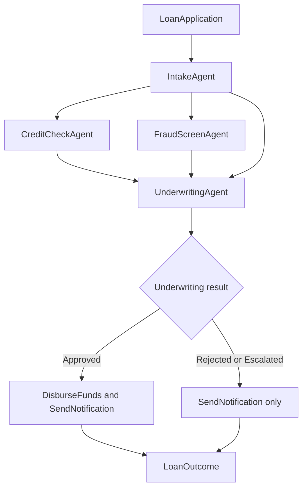

# AHFL Loan Origination

Use this example to model a loan application with parallel screening,
underwriting decisions, and conditional disbursement. You can check its types
and control rules and export its workflow model without connecting bank services.

## The workflow

An application is intake-normalized, then fanned out into two parallel
screening branches (credit bureau pull || fraud/AML screen) that join at an
underwriting agent. Underwriting routes to one of three final states —
Approved, Rejected, or Escalated (manual review). A fulfillment agent then
either requests financial disbursement and notifies the applicant, or sends
only a notification and skips disbursement.



## Module layout

| File | Contents |
|------|----------|
| `src/types.ahfl` | All shared enums and structs, with refinement types at the trust boundary (`Int(300,850)` credit score, `String(1,64)` identifiers, `Decimal(2)` money) |
| `src/intake.ahfl` | `IntakeAgent` — pure normalization, tier derivation, contract with predicate requires |
| `src/screening.ahfl` | `CreditCheckAgent` and `FraudScreenAgent` — the two parallel screening branches, each with a read-only capability and a called()-invariant contract |
| `src/underwriting.ahfl` | `UnderwritingAgent` — the join and router: three final states (Approved/Rejected/Escalated), contract with ensures implications and a forbid clause |
| `src/disbursement.ahfl` | `DisbursementAgent` — fulfillment: `DisburseFunds` (financial_write with idempotency key, required receipt, saga compensation, approval policy) or notify-only skip |
| `src/main.ahfl` | `LoanOriginationWorkflow` — the 5-node DAG with 5 safety clauses and 2 liveness clauses |

## Patterns you can reuse

- **Typed DAG orchestration** — workflow nodes with explicit `after`-dependency
  edges, exact schema matching at every agent boundary.
- **Parallel fan-out and join** — credit || fraud both start after intake;
  underwrite joins with `after [intake, credit, fraud]`.
- **Conditional routing via multiple final states** — UnderwritingAgent routes
  to Approved/Rejected/Escalated, each a declared final state with its own
  return handler.
- **Financial capability policy** — `DisburseFunds` is
  `financial_write` with idempotency path, `receipt: required`,
  `retry: safe_if_idempotent`, `compensation: ReverseDisbursement`, and an
  `approval_required` policy. The host must implement the service call, enforce
  approval, honor the idempotency key, and provide receipts and compensation.
- **Full effect ladder in one example** — read (credit/fraud pulls),
  external_side_effect (notification), durable_write (saga compensation),
  financial_write (disbursement).
- **Contracts with predicates** — requires/ensures/invariant/forbid over pure
  host-implemented Bool predicates. Their declarations describe environmental
  assumptions; checking this example does not execute those predicates or
  prove the external services meet them.
- **Temporal safety + liveness at both levels** — agent contracts use
  `called(cap)` and `in_state(state)` atoms; the workflow uses
  `running(node)` / `completed(node)` / `completed(node, FinalState)`.
- **The money invariant** — `safety: always (not completed(fulfill, Disbursed)
  or completed(underwrite, Approved))`: funds are disbursed only when
  underwriting reached its Approved final state. This is the headline property
  a bank auditor would ask for, stated in the language and machine-verifiable.
- **Refinement types at the trust boundary** — `Int(300,850)` credit score,
  `Int(12,360)` term, `String(1,64)` / `String(64,64)` identifiers.
- **State resilience policies** — retry / retry_on / timeout per state;
  agent quotas (max_tool_calls, max_execution_time).
- **Option-typed receipt** — `LoanOutcome.disbursement_receipt` is
  `option::Option<DisbursementReceipt>`, distinguishing disbursed from skipped
  without nullable fields.

## Check and export the model

```bash
cd examples/loan-origination
../../build/dev/src/tooling/cli/ahflc check
../../build/dev/src/tooling/cli/ahflc emit smv
```

A successful `check` reports the type and control-verification results.
`emit smv` prints the NuSMV model for inspecting the declared state machines
and temporal rules. See the [assurance guide](../../docs/tutorials/assurance.zh.md)
for the limits of control-model verification.

The example is a manifest-driven project (`ahfl.toml`). Three sample inputs
under `inputs/` illustrate the intended decision branches when connected to
compatible host services:

- `preferred.json` — a Preferred-tier application that routes to Approved.
- `jumbo.json` — a Jumbo-tier application that routes to Escalated (amount
  exceeds the jumbo threshold).
- `rejected.json` — a low-score application that routes to Rejected.

## Inspect nodes and capability policies

From `examples/loan-origination`, run:

```bash
../../build/dev/src/tooling/cli/ahflc emit summary
../../build/dev/src/tooling/cli/ahflc emit execution-plan
```

To execute the financial workflow, integrate the declared capabilities with
your host services using the [native handoff guide](../../docs/tutorials/native-handoff.zh.md).
The sample inputs and policy declarations do not provide a banking service or
authorize a real disbursement.
